# Street Fighter': The World Tournament

<p align="center">
  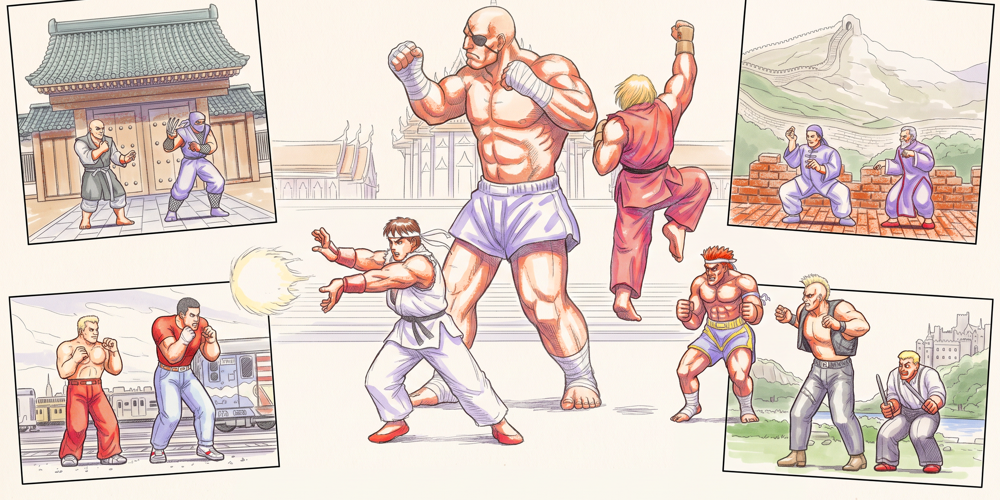
  <br />
  <sub>Fan-made key art, not affiliated with or endorsed by Capcom.</sub>
</p>

**Street Fighter': The World Tournament** is a native Windows PC port of Capcom's original 1987 arcade **Street Fighter** (US set 1, six-button controls).

[Windows download](https://github.com/johnstreetfighter/sf1-port/releases/latest) · [Gameplay trailer (MP4)](https://github.com/johnstreetfighter/sf1-port/releases/download/v1.3.3/sf1-port-trailer.mp4) · [Netplay guide](docs/netplay.md)

<p align="center">
  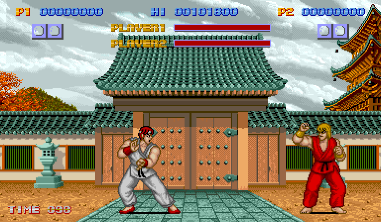
  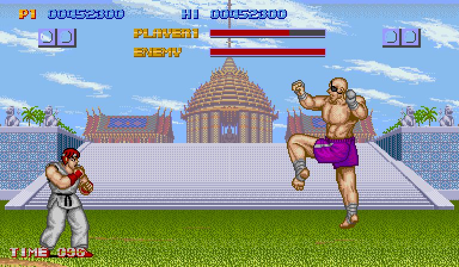
</p>

Rather than running the game inside an emulator or rebuilding it from memory, this port translates the original 1987 arcade game and sound programs directly into native Rust. Sprites, background layers, FM music, voice samples, frame timing, AI patterns, and cabinet quirks all behave just as they did on the arcade hardware.

No copyrighted ROM binaries are included in this repository. To play, you need your own local copy of the arcade `sf` ROM set.

Extract the entire Windows ZIP and follow `QUICKSTART.txt`. Keep the included `shaders` folder beside `sf-game.exe`. The release page includes a SHA-256 checksum for the package.

Double-click `sf-game.exe` to open the game window. The log is saved in `%APPDATA%\sf1-port\sf-game.log`. Run `sf-game.exe --console` to see the log live.

## Screenshots

| Title Screen | 4-Country Select |
| :---: | :---: |
| 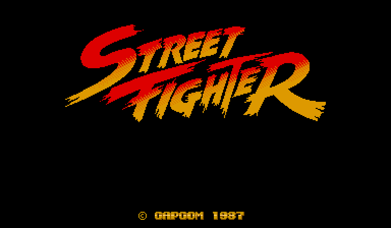 | 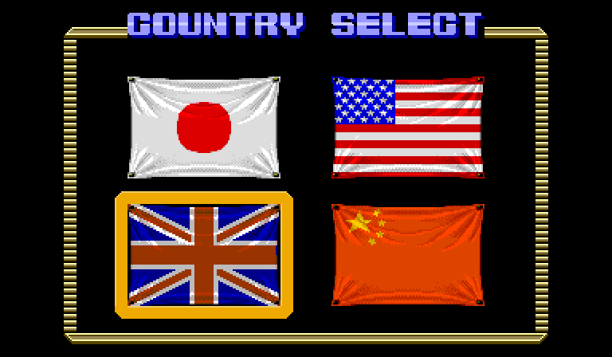 |
| **Round 1: Ryu vs. Retsu (Japan)** | **Final Boss: Ryu vs. Sagat (Thailand)** |
| 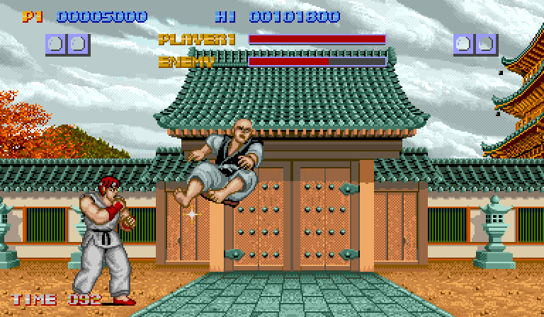 | 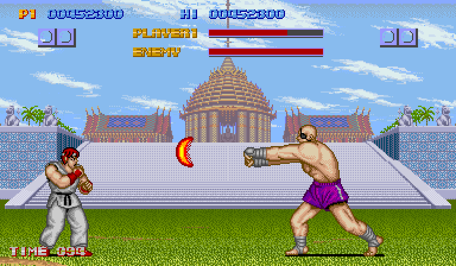 |
| **Bonus Stage: Tile Breaking** | **Hitbox, Command-Tracker & 60-Cell Frame Meter Overlay** |
| 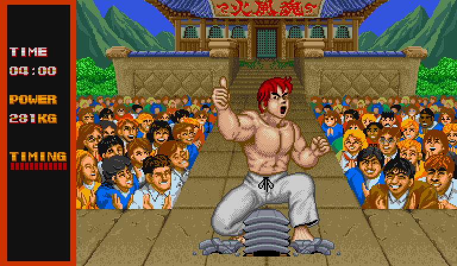 | 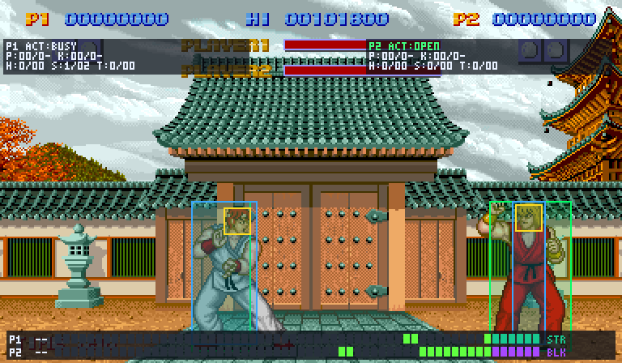 |

### The front end

| Main Menu | Settings: Gameplay Toggles |
| :---: | :---: |
| 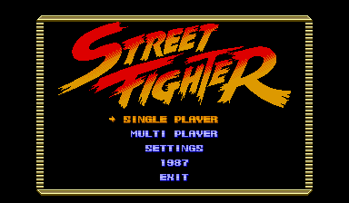 | 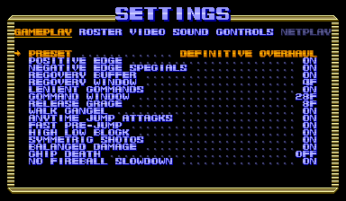 |
| **Local Player Select: Sagat vs. Geki** | **Local Fight: Sagat vs. Geki (Japan)** |
| 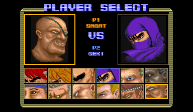 | 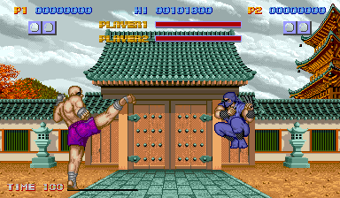 |

### The era HUD

Under Definitive Overhaul, the Style card carries each fighter's era, revision, and loadout into the fight. The HUD draws each side's gauges and call-outs from that fight's state. Online 1v1 synchronizes both Style picks.

The stills below show the later-era gauges and call-outs using preview fixtures. They come from a Training fight of Ryu against the dummy Ken with `cargo run -p sf-host --release --example era_hud_shots`.

| A Counter-Hit Combo That Was the First Attack | A Super Against a Perfect Parry |
| :---: | :---: |
| 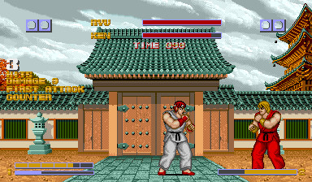 | 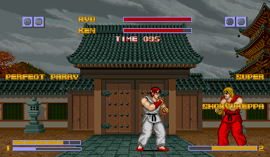 |
| **Gauge Art: Ruled, Blocks and Plate** | **Training: the Frame Meter With the Gauges Above It** |
| 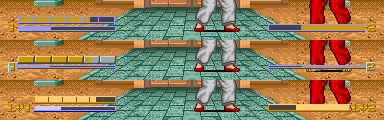 | 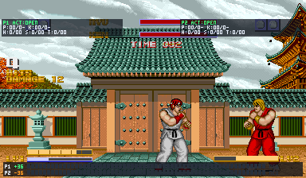 |

## Gameplay and features

The base edition, *The World Tournament*, is complete and playable from power-on to the ending credits:

- **1-player arcade tournament.** Boot up the cabinet, drop a coin, choose your starting country (Japan, USA, England, or China), and fight through all ten opponents across five countries:
  - **Japan:** Retsu and Geki
  - **USA:** Joe and Mike
  - **England:** Birdie and Eagle
  - **China:** Lee and Gen
  - **Thailand:** Adon and the final boss, Sagat
- **Bonus stages and endings.** Fly between countries on the world map, test your timing on the plank-breaking and block-breaking bonus stages, and smash through the timed concrete-stack bonus rounds. Defeating Sagat plays the ending sequence, staff roll, and high-score name entry.
- **2-player versus and arcade join-in.** Play head-to-head as Ryu (Player 1) and Ken (Player 2), or have a second player insert a coin mid-match to challenge an active 1-player run. The winner of a versus match carries on into the single-player tournament, which also lets Player 2 play the arcade campaign as Ken.
- **Quick-launch fight modes.** Jump straight into Round 1 against the CPU (Ryu vs. Retsu) or a 2-player versus round (Ryu vs. Ken) whenever you want to skip the attract sequence and country select.
- **Original 1987 six-button combat.** Standing, crouching, and jumping Light, Medium, and Heavy punches and kicks, plus all three special moves (*Hadoken*, *Shoryuken*, and *Tatsumaki Senpukyaku*). Preserves the original 1987 negative-edge trigger (attacks fire on button release), tight command windows, and heavy special-move damage.
- **Arcade sound and cabinet options.** Stereo YM2151 FM music and sound effects paired with dual MSM5205 ADPCM voice samples and impact sounds, plus original cabinet DIP switch settings (difficulty, round timer, two-country or four-country select, game speed, continues, buy-in, coinage rates, and screen flip) and the operator service menu.
- **Remappable keyboard and pad controls.** Play both fighters and the cabinet on the keyboard or on two pads, and rebind either from the Controls tab.

## Playing the game

### Requirements

- Windows and a recent stable Rust toolchain (`x86_64-pc-windows-msvc`), with Visual Studio's **Desktop development with C++** workload (the MSVC compiler). Tracker module support builds libopenmpt from C++ source; see [Tracker modules and the C++ build](#tracker-modules-and-the-c-build).
- A legally obtained `sf` arcade ROM set (MAME's `sf`, US set 1). The game checks each of its 44 files against the size and CRC-32 in the embedded manifest.

### Build and launch

Build the game from the repository root:

```bash
cargo build -p sf-game --release
```

The game is one file, `target\release\sf-game.exe`. It looks for the ROM set in three folders, in this order:

1. `roms\sf` beside the executable
2. `%APPDATA%\sf1-port\roms\sf`
3. the folder named by `rom_folder` in `%APPDATA%\sf1-port\settings.toml`

To play from anywhere, copy `sf-game.exe` into a folder and put the ROM files in `roms\sf` beside it. When no folder holds a matching set, the game opens on a screen that lists each folder it tried and what was wrong there. Add the files and choose `RETRY` to carry on, or choose `EXIT`. From the repository, `--roms` names a folder to look in first:

```bash
cargo run -p sf-game --release -- --roms tools/reference/local/roms/sf
```

The game opens on the 1987 attract. Press Start (`Space`, `Enter`, `1`, `2`, or a pad's Options) for the Main Menu:

- **Single Player:** Arcade mode against the CPU ladder, or Training against a CPU or a dummy. Under the overhaul presets Training's CPU is the *fair CPU*: it plays Ryu, Ken or Retsu through Player 2's pad like a person, from what the screen shows after a human reaction delay (27 frames on Easy down to 12 on Very Hard, set by the Gameplay difficulty), and never reads your inputs. *Faithful 1987* keeps Capcom's CPU.
- **Multi Player:** Local versus, each player choosing a fighter on the portrait select.
- **Settings:** gameplay toggles and the preset, roster options, video, sound and controls. The game saves them when you leave the screen.
- **1987:** the original cabinet's DIP switches, then `POWER ON` to play the untouched 1987 machine from power-on. Hold `Esc` for one second to come back.

The game draws through the graphics card (Vulkan, or Direct3D 12 without it) and waits for the display's refresh (VO2). When the refresh is a multiple of 60 Hz, every game frame is shown for the same number of refreshes: two at 120 Hz, one at 60 Hz. Other rates, such as 144 Hz, run the game on a 60 Hz clock. `cargo run -p sf-game --release -- smoke` opens the window, switches it to fullscreen and back, and reports presents and game frames per second and late refreshes over five seconds.

The game keeps its files in `%APPDATA%\sf1-port`: `settings.toml` (video, sound, devices, ROM folder, the cabinet's DIP switches), `match_config.toml` (preset, toggles, roster, difficulty and round time) and `bindings.toml` (keys and pad buttons). A first launch writes all three with their defaults. `sf-game.log` there records each launch: the settings in force, the ROM folder, the graphics adapter and the display's refresh rate, pads seen or lost, any file that failed to load, and any untranslated-branch notice. The game overwrites the log at every launch.

If a `sf1-port-art` folder sits beside the ROM set's `sf` folder (for example `roms\sf1-port-art`), the game loads the art pack from it: the poses the art pipeline made for fighters whose 1987 art lacks SF1+ moves. The pack is local and not in the repository. Without it, every fighter keeps the ROM's own art, and the log says so.

A `sf1-port-voice` folder beside it (`roms\sf1-port-voice`) is the voice pack: the overhaul announcer's lines, played on a third emulated MSM5205 beside the board's two so he never cuts off a 1987 sound. The pack is local and not in the repository; its format is in [`docs/reference/announcer.md`](docs/reference/announcer.md). Without it there is no announcer, and the log says so in one line. `ANNOUNCER` on the Sound tab sets his volume (0 is off). He never speaks under the Faithful 1987 preset or on the 1987 cabinet.

### Tracker modules and the C++ build

The Jukebox plays tracker modules (MOD, XM, S3M, IT, MPTM, 669, MTM and the rest of libopenmpt's list) as well as OGG, WAV and FLAC. Modules go through [libopenmpt](https://lib.openmpt.org/libopenmpt/) 0.8.10, a C++ library. Its official source release is committed, as an unmodified subset, in `crates/sf-openmpt/vendor/libopenmpt` (about 6.5 MB of source, no binaries), and `crates/sf-openmpt/build.rs` compiles it into a static library with the `cc` crate. So on Windows a fresh clone builds with the same command as before and needs no download, no DLL, no vcpkg and no `PATH` setup:

```bash
cargo build -p sf-game --release
```

The one requirement is a C++17 compiler: install Visual Studio 2022 (or the Build Tools) with the **Desktop development with C++** workload, the same one Rust's MSVC target needs for linking. Open a normal shell; `cc` finds the compiler itself through `vswhere`. The first build compiles about 150 C++ files and takes about a minute on a multi-core machine (it compiles in parallel); later builds reuse it. The game then has no extra DLL: libopenmpt is inside `sf-game.exe`.

To build **without** libopenmpt (a machine with no C++ compiler), turn off the `tracker` feature, which is on by default:

```bash
cargo build -p sf-game --release --no-default-features
```

That build plays OGG, WAV and FLAC as before. A tracker module in the `jukebox` folder then cannot play: the game logs one line saying the build has no tracker support and the native theme plays, as it does for any file it cannot play. (`-p sf-dev` takes the same flag.)

A module loops where the module says (its restart position), and a module that is broken or empty falls back to the native theme with a log line. libopenmpt is BSD-3-Clause; see [Legal](#legal).

### Development launcher

The development launcher runs the translated machine directly, without the front end:

```bash
cargo run -p sf-dev --release -- power-on
```

Or launch directly into a fight:

```bash
# 1-player quick match: Ryu (P1) vs. CPU Retsu
cargo run -p sf-dev --release -- cpu

# 2-player versus quick match: Ryu (P1) vs. Ken (P2)
cargo run -p sf-dev --release

# Portrait character select. Arrows move, Enter confirms, Backspace steps back.
cargo run -p sf-dev --release -- select
```

The launcher reads its ROMs from `tools/reference/local/roms/sf` (see [tools/reference/README.md](tools/reference/README.md)).

## Controls

### Fighter controls

| Player | Up | Left | Down | Right | LP | MP | HP | LK | MK | HK |
| --- | --- | --- | --- | --- | --- | --- | --- | --- | --- | --- |
| **Player 1** | `↑` | `←` | `↓` | `→` | `A` | `S` | `D` | `Z` | `X` | `C` |
| **Player 2** | `T` | `F` | `G` | `H` | `U` | `I` | `O` | `J` | `K` | `L` |
| **Pad (Classic)** | D-pad or left stick | | | | `Square` | `Triangle` | `R1` | `Cross` | `Circle` | `R2` |

Just like on the original six-button arcade cabinet, normal and special attacks fire when you **release** an attack button rather than when you press it down.

### Menus

| Action | Keyboard | Pad |
| --- | --- | --- |
| Move | arrows, or either player's stick | D-pad or left stick |
| Confirm | `Enter`, or a keyboard player's LP | `Cross` |
| Back | `Backspace`, `Esc`, or a keyboard player's LK | `Circle` |
| Start / pause a fight | `Space`, `Esc`, `Backspace`, `1`, `2` | `Options` |
| Switch Settings tabs | `Q` / `E` | `L1` / `R1` |

### Pads

Pads are read through Windows Gaming Input, only while the game window has focus. A DualShock 4 over USB should need nothing else installed, but that is not yet confirmed on real pads (#163). By default P1 takes the first pad plugged in and P2 the second. Until a side's pad is seen, that side plays on the keyboard. The Controls tab's `P1 DEVICE` and `P2 DEVICE` rows choose `AUTO`, `KEYBOARD`, `PAD 1` or `PAD 2`, which swaps the pads. If a pad is unplugged during a fight, the fight pauses with `P1 PAD DISCONNECTED` or `P2 PAD DISCONNECTED`. That side waits until a pad is plugged in again; the keyboard never takes over on its own. On the 1987 cabinet, a pad's `Share` inserts a coin and `Options` is its side's Start.

### Cabinet keys

| Action | Default key |
| --- | --- |
| Insert Coin (Player 1 / Player 2) | `5` / `6` |
| Start (1-Player / 2-Player) | `1` / `2` |
| Service Credit | `9` |

### Rebinding

In the game, the Controls tab's `REBIND P1`, `REBIND P2` and `REBIND MENU` rows walk each input in turn. Press a key or a pad button to bind it, or press `Esc` to keep the old binding. A key another input already uses, or a pad button the same player already uses, is refused with a notice. The bindings are saved to `%APPDATA%\sf1-port\bindings.toml`, and `RESET TAB` restores the defaults.

### Development launcher controls

| Action | Default key |
| --- | --- |
| Toggle Hitbox & 60-Cell Frame Meter Overlay | `F1` |
| Pause / Resume | `Space` |
| Save Snapshot / Take Over P1 or P2 (`replay`) | `F2` / `F3` |
| Rewind to Bookmark | `F4` |
| Quit | `Esc` |

The launcher reads both pads too: the first pad plays P1 and the second P2, alongside the keyboard. It can rebind any of the 25 player or cabinet inputs (`p1_up`, `p1_down`, `p1_left`, `p1_right`, `p1_lp`, `p1_mp`, `p1_hp`, `p1_lk`, `p1_mk`, `p1_hk`, the `p2_*` equivalents, `coin1`, `coin2`, `start1`, `start2`, `service1`) from the command line, into the same `bindings.toml`:

```bash
cargo run -p sf-dev --release -- rebind <input> <Key>
```

## Roadmap

### Done

- **Street Fighter: The World Tournament (Spec #1).** Complete, frame-accurate native port of the 1987 arcade game across all ten opponents, bonus stages, two-player modes, sound programs, DIP switches, and service mode.
- **The game (Spec #150).** `sf-game` is one executable. It runs the 1987 attract with a front end: Arcade, Local and Training on the portrait select, the pause and after-match boxes, Settings, the untouched 1987 cabinet behind its DIP screen, pads, rebinding, and a log. Every fight runs on the translated 1987 engine. The overhaul lets all twelve fighters play with their approved art and player tables. The Main Menu sits under the 1987 title logo inside the gold frame.
- **Art pipeline (Spec #164).** Every SF1+ move has a pose from the ROM's own art: a 1987 pose reused, one rebuilt from ROM pieces, or one generated in the fighter's palette and approved by eye. All twelve fighters' sets are finished, and the game loads them from the art pack into an extended sprite bank that the 1987 sprite code draws. Each fighter walks, attacks and takes hits in his own animations.
- **Stages and music (Spec #192).** A stage select in Local and Training outside Faithful 1987: P1 picks first, then the loser of each match, with a RANDOM tile and a one-press Rematch. The 1987 background and sound code read an extended background bank and tune table, so stage themes play in their fights. The Jukebox plays a track per stage or fighter from a `jukebox` folder: OGG, WAV, FLAC and tracker modules.
- **Video options (Spec #203).** Smooth motion on vsync, RetroArch CRT looks through librashader (built-in looks, a live tuning screen, saved looks and drop-in presets), and true 4:3 beside whole-number scales and square pixels.
- **Era HUD (Spec #216).** Every overhaul fight moves TIME under the health bars and hides the scores outside Arcade. The Faithful 1987 preset keeps the plain 1987 screen.
  - **Gauges.** Every era's gauges share one 1987 style in the bottom corners, in Ruled, Blocks or Plate gauge art (VIDEO tab and the pause box).
  - **Call-outs.** COUNTER, PUNISH COUNTER, CRUSH COUNTER, PERFECT PARRY, BURNOUT, CUSTOM COMBO, ALPHA COUNTER, the super with its move's name and a one-level dim, FIRST ATTACK, REVERSAL and PERFECT stack on the earner's side and never overlap.
  - **REVERSAL is literal.** It is keyed to true blockstun or a get-up; Faithful 1987 retains its native behavior.
  - **Combo count.** It counts true combos, including SF1+ with that modern rule enabled. Training adds damage and a HOLD COMBO row.
  - **The announcer.** He has a generated voice, designed from a description to sit beside the 1987 announcer and encoded as the cabinet's 4 kHz ADPCM. He calls each word and combos of five hits or more. The `tools/voice` pipeline makes his voice pack.
- **The move list and coach (Spec #226).** MOVES in the pause box lists the paused side's moves, drawn as arrows and button chips, numpad notation or words (the MOVE INPUTS setting). In Training, SHOW performs a move with your fighter and TRY has the coach watch your attempt and say what to fix.
- **Training without rounds (Spec #238).** Under every preset nobody is knocked out and a Training fight never ends: health stops at a floor and refills a second after the last hit, hits at the floor count their full damage, and the clock, scores and round-win markers are gone. The frame meter is see-through. The pause box's TRAINING row opens RESET POSITIONS and FILL METERS.
- **Key art ([Spec #3](https://github.com/johnstreetfighter/sf1-port/issues/3)).** The painted twelve-fighter key art at the top of this page. A redraw closer to the reference illustrations ([KA4](https://github.com/johnstreetfighter/sf1-port/issues/4)) waits until the game is complete.

- **SF1+ (Spec #246).** All twelve tournament fighters have their own standing, crouching and jumping attacks, blocks, techable throws and specials on the translated engine. True combos, cancels and throws have independent modern-rule switches. Balanced roster retunes the original character values. Each fighter can play the real Arcade ladder, with Ryu standing in for the player's own opponent slot. Ryu's approved theme is integrated (SP15 #267).
- **Online 1v1 and live spectating (Spec #303).** The twelve-fighter roster runs with rollback up to eight frames and 0–4 frames of input delay. Up to four observers can join before or during a match. Rooms use shareable codes or IPv4 addresses, LAN discovery, and an optional community directory. The host synchronizes fighters, styles, match rules, DIPs, stage and seed. Peers must match engine, data and art identities. Display, sound, bindings and Jukebox preferences stay local. Pause and MOVES keep the match running, and rematch/reselect decisions are shared. The browser shows measured ping/jitter, rollback limit and the actual Ethernet/Wi-Fi link. Wired Only filters Wi-Fi rooms and can reject Wi-Fi challengers. See the [netplay guide](docs/netplay.md).
- **SF1+ Dramatic Battle (#287, #352).** Fight a CPU boss with a CPU partner, a second local player, or an online guest. Choose one of six rivalries or set up a custom team and stage. The allies can share a lifebar or fight with independent lifebars, and friendly fire is optional. Online co-op uses the same rollback and live spectating as Versus. The matching SF1+ art pack enables the full cast.

### Era Styles

Definitive Overhaul brings SF1, SF1+, and six later eras to the native fight engine. The matching art pack enables the full roster. Each fighter can pick their own style in Local Versus, Training, and Online 1v1. In Arcade, opponents use the player's era where available. Training's MOVES panel lists the selected style's commands, with SHOW, TRY, and FILL METERS for practice.

- **Street Fighter II.** Ryu, Ken, and Sagat pick World Warrior through Super Turbo. Super Turbo's New loadout adds a Super gauge and a Super Combo.
- **Alpha.** Ryu, Ken, Adon, Sagat, and Birdie pick SFZ1 through SFZ3. Gen joins in SFZ2 and Eagle in SFZ3. Alpha Counter spends meter out of blockstun. SFZ3 adds A-ISM, V-ISM, and X-ISM, with Guard Power that drains on block and can be crushed. Gen switches between Mantis and Crane.
- **Street Fighter III.** Ryu and Ken pick New Generation, 2nd Impact, or 3rd Strike and Super Art I, II, or III. The native fights support high, low, and air parries, Red Parry in 3rd Strike, an overhead, and EX specials from 2nd Impact onward.
- **Street Fighter IV.** Ryu, Ken, Sagat, and Gen pick SF4 through Ultra, and Adon joins from Super. Focus Attack can absorb a hit and cancel into a dash. Revenge powers Ultras. Ultra adds Red Focus, Ultra Combo Double, and delayed wakeup.
- **Street Fighter V.** Ryu, Ken, and Birdie pick SF5, Arcade Edition, or Champion Edition, and Sagat joins from Arcade Edition. The EX gauge pays for EX specials and Critical Arts. The V-System includes V-Skills, V-Triggers, and V-Reversal. Champion Edition adds V-Shift and V-Shift Break.
- **Street Fighter 6.** Ryu, Ken, and Retsu have a six-bar Drive gauge and three Super Arts. Drive pays for Overdrive, Parry, Rush, Impact, and Reversal. An empty Drive gauge puts the fighter in Burnout until it recovers.
- **What-If Styles.** Turn on WHAT-IF STYLES to add fighting styles for the twelve tournament fighters in eras they missed, from Hyper Fighting and Super Turbo through Street Fighter 6. Their moves reuse the 1987 ROM artwork and approved art pack.

### In the engine, awaiting native integration

`sf-engine` also holds prototypes for World Tour and bonus challengers. The descriptions below outline their prototype behavior.
- **1987 World Tour.** Any of the twelve fighters walks Japan, the USA, China, England, and Thailand. Nodes set the match: projectile-only, no blocking, survival waves, a time-attack target, a cross-era showdown, or a 2v1 Dramatic Battle. RPG progression spends XP on attack, defense, speed, and an ISM-Plus perk, and that save reloads. Arcade Pure leaves the stats alone. Arcade, Versus, Training, and online keep every fighter, style, costume, and palette unlocked no matter the tour progress.
- **Bonus challengers.** Definitive Overhaul can show the extra thirteen on the `[BONUS '87]` row: Gouken, Akuma, Evil Ryu, Goutetsu, Sheng Long, Gou Hibiki, Dan, Cody, Guy, Haggar, Charlie, M. Bison, and Chun-Li. Each has an SF1 kit with 26-frame player hitstun and no boss lock, plus SF1+ through SF6. Each has a 1987 stage and an FM theme with a CD jukebox path. Haggar's command throw does not loop. Gou Hibiki has the Tengu mask, Cody has the prison and mayor outfits, Charlie has the stitched outfit, and Chun-Li has the qipao and the master outfit. In Arcade they fight all ten country opponents and the bonus stages, then a four-panel ending. A perfect or a Super can insert "Here Comes A New Challenger!" before Thailand. Losing that fight does not spend a credit. Turning off bonus challengers or secret intrusions keeps the rival out. With bonus challengers on, Dramatic Battle and World Tour list five lore episodes, and any of the thirteen can walk the tour map. The CPU will command-throw or teleport when that kit is in range. Online rooms badge `1987 Tournament 12` or `25-Fighter / What-If`, and the handshake hash includes both toggles.

### Next: the rest of the Definitive Overhaul ([Spec #1](https://github.com/johnstreetfighter/sf1-port/issues/1))

Haute42 S16 DirectInput Up and Down passed in the Main Menu and Training. Charge inputs still need hardware verification. [Haute42 hardware QA #70](https://github.com/johnstreetfighter/sf1-port/issues/70)

Next, in this order:

1. **Endings, Dramatic Battle and World Tour.** Later-era styles and gauges for Dramatic Battle are tracked in [#120](https://github.com/johnstreetfighter/sf1-port/issues/120).
2. **Bonus challengers by 1987 lore ([Spec #2](https://github.com/johnstreetfighter/sf1-port/issues/2)).** Twenty-eight challengers chosen by 1987 lore, in three roster waves. Tickets start when a wave does and extend netplay roster compatibility.

## Technical documentation

For architecture details, developer CLI commands, crate layout, ROM translation notes, and the frame-by-frame MAME 0.289 verification audit, see:

- [Technical overview and verification](docs/technical-overview.md)
- [Full-game verification audit](docs/reference/full-game-audit.md)
- [Translation coverage ledger](docs/reference/coverage-ledger.md)
- [Domain glossary (`CONTEXT.md`)](CONTEXT.md)

## Legal

Street Fighter is a trademark of Capcom. This project is not affiliated with or endorsed by Capcom. It contains no playable ROM binaries or extracted asset dumps from the original game, and it does not run without a legally obtained ROM set.

The `sf-engine` and `sf-audio` crate manifests declare MIT.

Tracker modules are played by libopenmpt 0.8.10, Copyright (c) 2004-2026 OpenMPT Project Developers and Contributors and (c) 1997-2003 Olivier Lapicque, under the BSD-3-Clause licence. Its source is vendored in `crates/sf-openmpt/vendor/libopenmpt` as an unmodified subset of the official release from lib.openmpt.org, together with the three small decoders that release carries: miniz (MIT), minimp3 (CC0) and stb_vorbis (MIT or public domain), and its `mpt` headers (BSL-1.0 or BSD-3-Clause). Each has its licence file beside it, and [`THIRD_PARTY_NOTICES.md`](THIRD_PARTY_NOTICES.md) lists them with the full BSD-3-Clause and MIT texts. The `sf-openmpt` crate's `license` field names them all.

In the beginning was the Word, and the Word was with God, and the Word was God.
