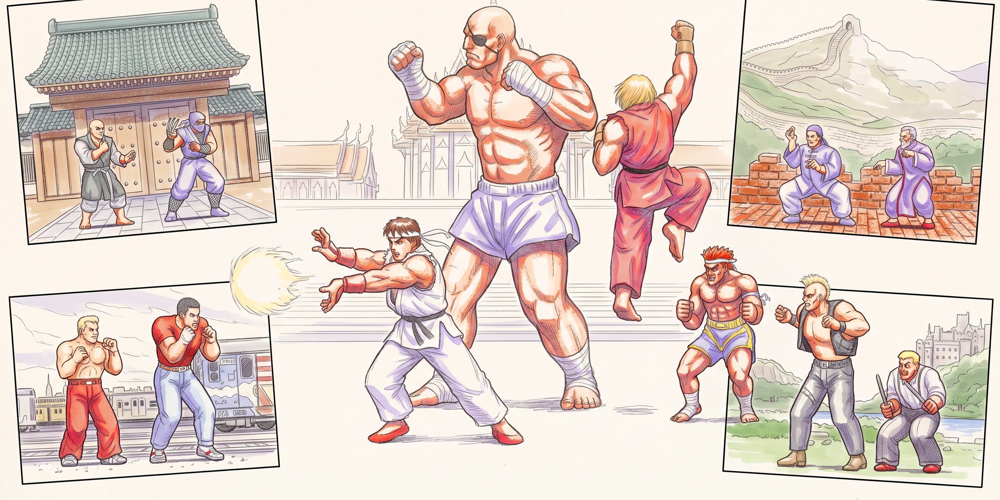
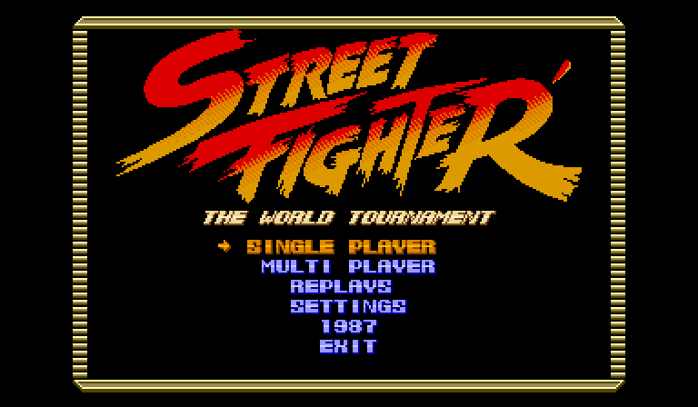
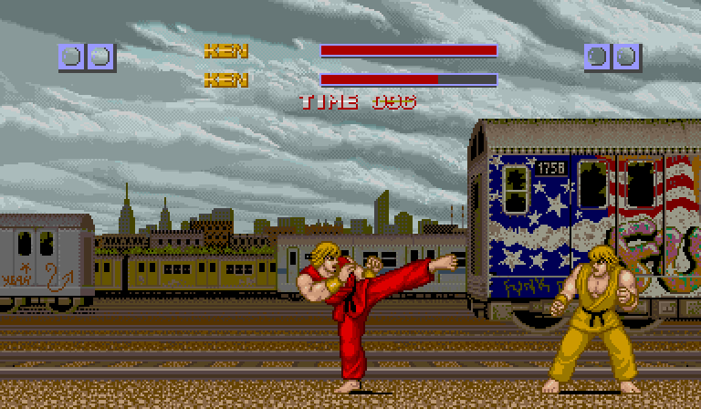
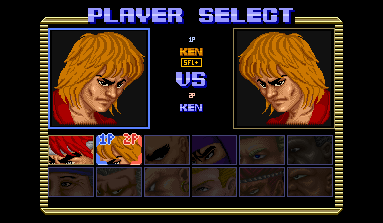
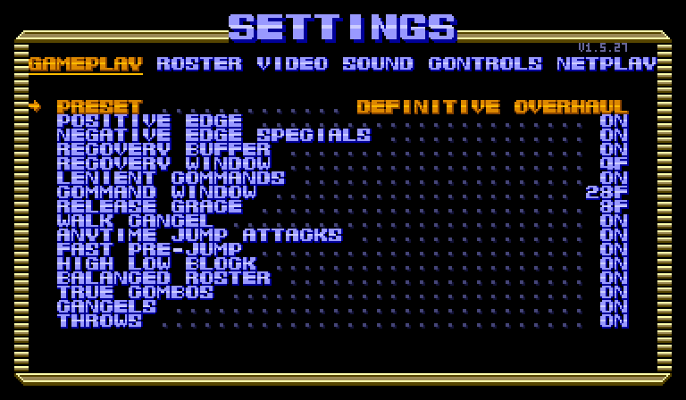
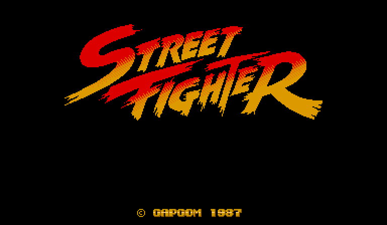
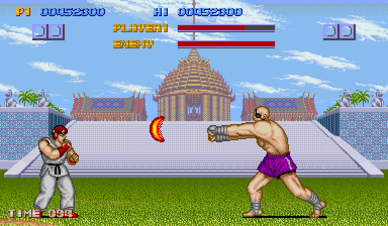

# Street Fighter': The World Tournament

  
   
  Fan-made key art, not affiliated with or endorsed by Capcom.

**Street Fighter': The World Tournament** is a PC port of Capcom's original 1987 arcade **Street Fighter**, expanded so that all twelve tournament fighters are playable, with online play, training tools and fighting styles from the later games.

The original game is still inside it, untouched: the 1987 arcade program was translated to run natively instead of in an emulator, and you can boot that cabinet from the Main Menu at any time.

**[Download for Windows](https://github.com/johnstreetfighter/sf1-port/releases/latest)** · [Play online](#play-online) · [Controls](#controls)

The game does not include Capcom's ROM files. You need your own copy of the arcade `sf` ROM set to play.

  
  

## Get playing

You need 64-bit Windows 10 or 11 and a graphics driver with Vulkan or Direct3D 12. A Linux build that also runs on Steam Deck is being tested and is not on the releases page yet ([#125](https://github.com/johnstreetfighter/sf1-port/issues/125), [#129](https://github.com/johnstreetfighter/sf1-port/issues/129)). There is no macOS version yet.

1. **Download** the newest `sf1-port-…-windows-x86_64.zip` from the [releases page](https://github.com/johnstreetfighter/sf1-port/releases/latest).
2. **Extract the whole ZIP** to a folder. Keep the `shaders` and `assets` folders beside `sf-game.exe`.
3. **Add your ROM set.** The game wants MAME's `sf` set (US set 1, the six-button version). Either:
   - put the ROM files in a `roms\sf` folder beside `sf-game.exe`, keeping their original names, or
   - skip this step and point the game at your `sf.zip`, `sf.7z` or ROM folder when it asks.
4. **Run `sf-game.exe`.** If it cannot find the ROM set, choose **BROWSE ARCHIVE** or **BROWSE FOLDER** and pick yours. The game checks the files and remembers the choice.
5. **Press Start** (`Space`, `Enter`, or `Options` on a pad) at the title to open the Main Menu.

If something goes wrong, see [Troubleshooting](#troubleshooting). `QUICKSTART.txt` in the ZIP repeats these steps.

## Controls

These are the defaults. Change them in **Settings → Controls**.

### In a fight

| | Move | Light Punch | Medium Punch | Heavy Punch | Light Kick | Medium Kick | Heavy Kick |
| --- | --- | --- | --- | --- | --- | --- | --- |
| **Keyboard, Player 1** | Arrow keys | `A` | `S` | `D` | `Z` | `X` | `C` |
| **Keyboard, Player 2** | `T` `F` `G` `H` | `U` | `I` | `O` | `J` | `K` | `L` |
| **PlayStation pad** | D-pad or left stick | `Square` | `Triangle` | `R1` | `Cross` | `Circle` | `R2` |
| **Xbox pad** | D-pad or left stick | `X` | `Y` | `RB` | `A` | `B` | `RT` |

Under the default preset an attack comes out when you press its button. The Faithful 1987 preset and the 1987 cabinet keep the arcade's behaviour, where an attack comes out when you **release** the button.

Pause a fight with `Space` or `Options`. The pause box's **MOVES** row lists your fighter's moves and their inputs.

### In menus

| Action | Keyboard | Pad |
| --- | --- | --- |
| Move | Arrow keys | D-pad or left stick |
| Confirm | `Enter` | `Cross` / `A` |
| Back | `Backspace` or `Esc` | `Circle` / `B` |
| Switch Settings tabs | `Q` / `E` | `L1` / `R1` |

### Pads

The first pad plugged in plays Player 1 and the second plays Player 2. A side without a pad plays on the keyboard. **Settings → Controls** has `P1 DEVICE` and `P2 DEVICE` rows to choose a device yourself or swap the pads, and `REBIND` rows to change keys and buttons. If a pad is unplugged during a fight, the fight pauses until it is plugged back in.

## Play online

Online rooms work by code. Neither player needs to forward a port or set anything up.

**To host:**

1. Open **Multi Player → Online → Host Match**.
2. Leave **VISIBILITY** on **INTERNET CODE** and open the room.
3. A six-character code such as `K7Q-MPX` appears. Press `Ctrl+C` to copy it and send it to your friend.

**To join:**

1. Open **Multi Player → Online → Direct Join**.
2. Type the code, or press `Ctrl+V` to paste it, and confirm **Join**.

Good to know:

- Both players need the same version of the game.
- Each player uses their own Player 1 controls.
- Up to four spectators can watch: choose **JOIN AS → SPECTATOR** with the same code.
- The rooms run through the project's relay server in the eastern United States. Players far from it will see more delay.
- On the same home network you can host a **PUBLIC** or **PRIVATE** room instead, which needs no internet connection.

The [netplay guide](docs/netplay.md) covers spectating, co-op rooms, connection settings and community relays.

## What you can play

  
  

### Arcade

**Single Player → Arcade Mode.** Pick any of the twelve tournament fighters (Ryu, Ken, Retsu, Geki, Joe, Mike, Lee, Gen, Birdie, Eagle, Adon or Sagat) and fight through Japan, the USA, England, China and Thailand, with the bonus stages between countries.

### Online and Local

**Multi Player → Online** for rooms by code, as above. **Multi Player → Local** for two players on one PC: each chooses a fighter, then Player 1 picks the stage.

### Training

**Single Player → Training** against a CPU opponent or a standing dummy. Nobody is knocked out, health refills and there is no clock. From the pause box:

- **MOVES** lists your moves. **SHOW** performs one with your fighter, and **TRY** watches your attempt and tells you what to fix.
- **OVERLAYS** turns on hitboxes and the frame meter.
- **RESET POSITIONS** puts both fighters back where the fight began.
- **TRAINING** holds full meters, drills and combo trials.

### Era styles

Under the default Definitive Overhaul preset, each fighter picks a style on Player Select. All twelve fighters have SF1+, an expanded set of moves built on the 1987 game. Fighters who appeared in Street Fighter II, Alpha, III, IV, V or 6 can pick a style from those games too. Each style brings that game's moves and gauges, such as parries in III or the Drive gauge in 6. Two players can pick different styles and fight each other.

### Also in the game

- **Dramatic Battle:** two fighters against one CPU boss, with a CPU partner, a second player on the same PC, or a friend online.
- **Replays:** watch saved matches from the Main Menu.
- **Presets:** **Settings → Gameplay → PRESET** switches the whole rule set. *Faithful 1987* plays every mode by the original rules.
- **Video:** CRT looks, true 4:3 and whole-number scaling in **Settings → Video**.
- **Jukebox:** play your own music files per stage or fighter, from **Settings → Sound**.

### 1987

  
  

**1987** on the Main Menu is the original arcade cabinet, exactly as it was: set its DIP switches, choose `POWER ON`, insert a coin with `5` and press `1` to start. A second player joins with `6` and `2`. Hold `Esc` for one second to return to the Main Menu.

## Troubleshooting

- **Windows says `VCRUNTIME140.dll` or `MSVCP140.dll` is missing.** Install Microsoft's [Visual C++ Redistributable (x64)](https://aka.ms/vc14/vc_redist.x64.exe) and run the game again.
- **The game keeps asking for the ROM set.** It accepts only the US set 1 `sf` set and checks every file. A different regional set, or one with renamed or missing files, is refused.
- **Something else.** The game writes a log to `%APPDATA%\sf1-port\sf-game.log` on every launch. Paste that path into File Explorer's address bar to find it, and attach the file if you [report a problem](https://github.com/johnstreetfighter/sf1-port/issues).

Settings are saved in the same `%APPDATA%\sf1-port` folder. Deleting the folder resets the game to its defaults.

## For developers

- [Building from source](docs/building.md), including the development launcher
- [Technical overview and verification](docs/technical-overview.md)
- [Roadmap and project history](docs/roadmap.md)
- [Domain glossary](CONTEXT.md)

## Credits

**SF KESSEN** is an era style in development that follows the design for a new Street Fighter which Clayton Chapman (@SaishuuKessen) set out in his "Game Theory" video series. Its system rules and its Ryu, Ken, Sagat and Evil Ryu kits are his design. The kits for the other fighters are this project's own work in the spirit of his rules, and every place the built style departs from his design is logged. He is not affiliated with this project and has not endorsed it. See the [design document](docs/design/2026-11-18-sf-kessen-era-style-design.md).

## Legal

Street Fighter is a trademark of Capcom. This project is not affiliated with or endorsed by Capcom. It contains no playable ROM binaries or extracted asset dumps from the original game, and it does not run without a legally obtained ROM set.

The `sf-engine` and `sf-audio` crate manifests declare MIT.

Tracker modules are played by libopenmpt 0.8.10, Copyright (c) 2004-2026 OpenMPT Project Developers and Contributors and (c) 1997-2003 Olivier Lapicque, under the BSD-3-Clause licence. Its source is vendored in `crates/sf-openmpt/vendor/libopenmpt` as an unmodified subset of the official release from lib.openmpt.org, together with the three small decoders that release carries: miniz (MIT), minimp3 (CC0) and stb_vorbis (MIT or public domain), and its `mpt` headers (BSL-1.0 or BSD-3-Clause). Each has its licence file beside it, and [`THIRD_PARTY_NOTICES.md`](THIRD_PARTY_NOTICES.md) lists them with the full BSD-3-Clause and MIT texts. The `sf-openmpt` crate's `license` field names them all.

In the beginning was the Word, and the Word was with God, and the Word was God.
