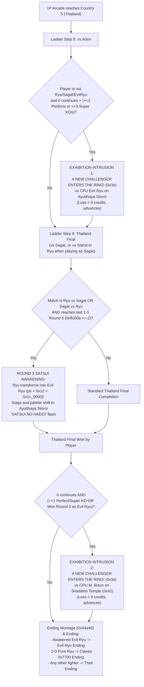

# Bonus Challengers — Wave 1 (*Super Street Fighter: Rising*): 40-Fighter Engine Readiness, 40-Slot Select Screen, Evil Ryu, and M. Bison

- **Date:** 2026-11-08
- **Status:** Approved by the user, 2026-11-09
- **Project:** Project 6 (Wave 1) of the 7-project roadmap (`SF1+ on the real engine` → `Rollback Netplay` → `Era styles and gauges` → `Endings, Dramatic Battle & World Tour` → **`Bonus Challengers`**)
- **Context:** [`CONTEXT.md`](../../CONTEXT.md), [`2026-11-03-bonus-roster-by-lore-design.md`](2026-11-03-bonus-roster-by-lore-design.md), [`2026-11-03-stages-and-music-design.md`](2026-11-03-stages-and-music-design.md), [`2026-11-08-era-styles-and-gauges-design.md`](2026-11-08-era-styles-and-gauges-design.md), [`2026-11-08-endings-dramatic-battle-and-world-tour-design.md`](2026-11-08-endings-dramatic-battle-and-world-tour-design.md), [`ADR-0004`](../adr/0004-reach-fights-by-driving-the-faithful-flow.md), [`ADR-0007`](../adr/0007-extended-sprite-bank.md), [`ADR-0008`](../adr/0008-bonus-roster-chosen-by-lore.md), [`ADR-0009`](../adr/0009-stages-and-themes-in-extended-banks.md), [`ADR-0014`](../adr/0014-bosses-become-1987-player-fighters.md), [`ADR-0015`](../adr/0015-era-styles-and-sub-hp-on-the-1987-engine.md), [`ADR-0016`](../adr/0016-dramatic-battle-and-composite-endings-on-the-1987-engine.md), [`ADR-0017`](../adr/0017-forty-fighter-roster-and-satsui-awakening-on-the-1987-engine.md)

---

ADR-0023 assigns Evil Ryu command `0x51` and keeps `0x41` for Ryu. Character themes and stage rotations follow the [approved character-theme design](2026-11-10-character-themes-design.md).

## 1. Intent

Per [`docs/design/2026-11-03-bonus-roster-by-lore-design.md`](2026-11-03-bonus-roster-by-lore-design.md) ([`ADR-0008`](../adr/0008-bonus-roster-chosen-by-lore.md)), *Street Fighter: The World Tournament* expands the 1987 roster from the **12 tournament fighters** to **40 fighters** (`12 + 28` lore-admitted bonus challengers) across **three ordered release waves**, where each wave gets its own spec and tickets when work on it starts and **ships whole**:
1. **Wave 1 — *Super Street Fighter: Rising* (2 challengers tied to the 1987 tournament itself):**
   - **Evil Ryu** — the Ryu who, on the brink of defeat in the 1987 Thailand final, taps the *Satsui no Hado* and scars Sagat's chest with the *Metsu Shoryuken*.
   - **M. Bison** — the Shadaloo dictator who approaches the defeated, scarred Sagat after the 1987 tournament and recruits him into the Four Heavenly Kings.
2. **Wave 2 — *Hyper Street Fighter: Bloodlines* (10 challengers tied to one of the 12)** *(separate future spec)*.
3. **Wave 3 — *Ultra Street Fighter: Final Round* (16 challengers who existed in 1987)** *(separate future spec)*.

Today, [`crates/sf-engine/src/bonus.rs`](../../crates/sf-engine/src/bonus.rs) and [`crates/sf-engine/src/bonus_arcade.rs`](../../crates/sf-engine/src/bonus_arcade.rs) are pre-[`ADR-0004`](../adr/0004-reach-fights-by-driving-the-faithful-flow.md) standalone 1D/struct prototypes using the superseded 13-fighter M.U.G.E.N list, while the real engine ([`crates/sf-engine/src/roster.rs`](../../crates/sf-engine/src/roster.rs), [`crates/sf-engine/src/data_bank.rs`](../../crates/sf-engine/src/data_bank.rs), [`crates/sf-engine/src/front/select.rs`](../../crates/sf-engine/src/front/select.rs)) is hardcoded to 12 `TournamentFighter` slots (`[Option<Bust>; 12]`, `DATA_BANK_END = 0x1f_ffff`).

This design specifies **Project 6 (Wave 1)**:
1. **40-Fighter Engine Readiness:** Widening the roster model, `DataBank` (`0x10_0000..=0x37_ffff`, 40 slots of `0x1_0000`), `SpriteBank` / sprite palette rows, and `BackgroundBank` (composite VS and ending screens) to support all 40 fighters (`0..40`) so Waves 2 and 3 plug in without architectural rework.
2. **The 40-Slot Character Select Screen:** Implementing the unified center-grid layout (`26×30` portrait tiles on a `27×32` pitch in "even rows" `6×2` / `7×2` / `8×3` / `8×5`, flanked by `64×108` P1/P2 frames that flip to Project 4's Option B `ERA`/`REV`/`LOAD` Style card on fighter lock, plus the `MenuInput::Filter` two-way toggle between `ALL` and `1987`).
3. **Complete Wave 1 (*Super Street Fighter: Rising*):** Delivering **Evil Ryu** and **M. Bison** on the real 1987 engine—including their native `SF1` & `SF1+` kits, canonical later Era Styles (`SF2`–`SF6`), What-If Era Styles (`enable_what_if_styles`), home stages (*Ayutthaya Storm* and *Shadaloo Temple*), YM2151 FM `.score` themes (`0x51` and `0x42`), 1P Arcade ladder runs, composite ending screens & win quotes, secret Arcade intrusions, the **Final-Round Ryu → Evil Ryu Transformation** in the 1P Arcade Thailand final (`Ryu vs. Sagat` and `Sagat vs. Ryu`), Wave 1 Dramatic Battle presets, and Wave 1 World Tour secret nodes.

---

## 2. Goals, Non-Goals, Anti-Goals

### Goals
1. **Widen the Engine & Banks Once for All 40 Fighters (`0..40`):**
   - Introduce the 28-variant `BonusChallenger` enum (in [`2026-11-03-bonus-roster-by-lore-design.md`](2026-11-03-bonus-roster-by-lore-design.md) wave order: `EvilRyu`, `Bison` in Wave 1; 10 in Wave 2; 16 in Wave 3) and the 40-fighter `RosterFighter` enum (`Tournament(TournamentFighter)` `0..12` | `Bonus(BonusChallenger)` `12..40`), widening `DATA_BANK_END` from `0x1f_ffff` to **`0x37_ffff`** (`40 × 0x1_0000 = 2.5 MB`, below `BackgroundBank::PALETTE_WINDOW = 0x40_0000` and video RAM at `0x80_0000`).
2. **Ship the 40-Slot Character Select Redesign (`SelectScreen`):**
   - Replace the 12-only select layout with the unified wide gold-framed (`framed_wide`, `cols 1..=46`, empty foot row `""`) center-grid layout (`64×108` left/right frames + `26×30` tile grid on `27×32` pitch with "even rows": `6×2` for 12, `7×2` for 14, `8×3` for 24, `8×5` for 40), integrating seamlessly with Project 4's (`ES1` `#270`) in-frame `ERA`/`REV`/`LOAD` Style card and `MenuInput::Filter` (`ALL` vs. `1987`).
   - Provide a deterministic face-window crop from each fighter's VS bust for the `26×30` select tile immediately, replaced by drawn-to-size `26×30` PixelLab portraits after the November 27 credit renewal.
3. **Deliver Evil Ryu & M. Bison's Complete Movesets & Era Styles (`DataBank` & `era.rs`):**
   - **`SF1` and `SF1+` are native styles** for every Bonus Challenger (lit on the Style card even when `enable_what_if_styles` is `false`, per Section 5.6 of [`2026-11-03-bonus-roster-by-lore-design.md`](2026-11-03-bonus-roster-by-lore-design.md)).
   - Build Evil Ryu and M. Bison's complete `SF1`, `SF1+`, canonical later eras (`SF2`–`SF6`), and What-If eras in `DataBank` using temporary ROM-derived stand-in sprites so headless `Fight` / `GameSession` tests verify all moves, eras, intrusions, endings, Dramatic Battle presets, and World Tour nodes immediately, while keeping `RELEASED_WAVES = 0` on default player menus until the November 27 PixelLab art tickets flip `RELEASED_WAVES = 1`.
4. **Deliver Wave 1 Stages, YM2151 FM Themes (`0x51`, `0x42`), Arcade Ladder & Endings:**
   - Register Evil Ryu's home stage (**Ayutthaya Storm (Night)**, Thailand, tune `0x51`) and M. Bison's home stage (**Shadaloo Temple (Bangkok)**, Thailand, tune `0x42`) in `BackgroundBank` (`wave = 1`), plus composite VS screens (`vs:{Left}:{Right}`) and composite congratulatory ending screens (`ending:Evil Ryu`, `ending:M. Bison`) with `TextWriter` epilogues and post-match win quotes (`0x4014c`).
5. **Deliver the Thailand Final Round 3 Transformation & Secret Arcade Intrusions:**
   - **Final-Round Ryu → Evil Ryu Transformation (1P Arcade Thailand Final, `opponent_index == 9`):** When `enable_bonus_challengers && enable_secret_arcade_intrusions` (`released_waves >= 1`) and the player reaches the Thailand final (`ladder step 9`) **as Ryu vs. CPU Sagat** or **as Sagat vs. CPU stand-in Ryu**, reaching the **deciding final round** (tied `1–1` entering Round 3, `0xffc00a == 2`) transforms **Ryu into Evil Ryu** during `Flow::AwaitWipe` (`0x3ec58`) before Round 3 starts (text-layer announce `SATSUI NO HADO!`, stage and palette shift to *Ayutthaya Storm (Night)*, and move-table pointer `ps + 0x12` swapped to `EvilRyu`). If human Ryu wins Round 3 as awakened Evil Ryu, the run plays **Evil Ryu's "Satsui no Hado / Scarring of Sagat" ending** (whereas winning `2–0` without Round 3 keeps pure Ryu's classic `0x7700` ending).
   - **Secret Arcade Intrusions (Exhibition Rule — `0` credit cost on loss):**
     1. **Evil Ryu Intrusion (*Satsui no Hado Awakening*):** On a qualifying high-skill run (`0` continues and `>= 2` Perfects or `>= 3` Special/Super KOs) by any fighter other than `Ryu`, `Sagat`, or `EvilRyu` after clearing ladder step 8 (Adon) and before ladder step 9 (Sagat) in Country 5 (Thailand).
     2. **M. Bison Intrusion (*Shadaloo Recruitment*):** After defeating ladder step 9 (Sagat, or stand-in Ryu when playing as Sagat) in Country 5 (Thailand) on a `0`-continue run (`>= 1` Perfect or Super KO, or after winning Round 3 as awakened Evil Ryu) before the ending montage (`0x3ef96 -> 0x44a40`).
6. **Integrate Wave 1 into 2v1 Dramatic Battle & 1987 World Tour, and Retire `bonus.rs` / `bonus_arcade.rs` Prototypes:**
   - Add 2 Wave 1 Dramatic Battle presets (*Preset 7: Satsui Awakening* and *Preset 8: Fall of the Emperor*) and 2 secret post-Thailand World Tour nodes (`th-3-satsui` and `th-4-shadaloo`), then retire the standalone 1D/struct prototype stepping code in [`crates/sf-engine/src/bonus.rs`](../../crates/sf-engine/src/bonus.rs) and [`crates/sf-engine/src/bonus_arcade.rs`](../../crates/sf-engine/src/bonus_arcade.rs).

### Non-Goals
- **Implementing Wave 2 (10 challengers) or Wave 3 (16 challengers) movesets, stages, or art:** Per [`2026-11-03-bonus-roster-by-lore-design.md`](2026-11-03-bonus-roster-by-lore-design.md) Section 5.7, Waves 2 and 3 get their own specs and tickets when work on them starts. Project 6 Wave 1 defines their enum variants and widens the engine/select screen to 40 slots so Waves 2 and 3 require zero structural changes.
- **Triggering the Round 3 Ryu → Evil Ryu transformation in Local Versus:** Per the maintainer's direction, the mid-match Round 3 transformation triggers **only in 1P Arcade mode at the Thailand final (`opponent_index == 9`)**, keeping Local Versus matchups strictly to the fighters locked on Character Select.

### Anti-Goals
- **Never expose a half-finished challenger on player menus:** Per the **"A wave ships whole"** rule (Section 5.2 of [`2026-11-03-bonus-roster-by-lore-design.md`](2026-11-03-bonus-roster-by-lore-design.md)), `RELEASED_WAVES` stays `0` on default player menus while Wave 1's engine/moveset/mode tickets land with temporary stand-in sprites, and flips to `1` only in the final gate ticket after Evil Ryu and M. Bison's PixelLab sprites, busts, `26×30` select portraits, and stage backdrops are generated and approved in `sf-art`.
- **Never mark `SF1` or `SF1+` as `[WHAT-IF]` on Bonus Challengers:** `SF1` and `SF1+` are every Bonus Challenger's native 1987 debut styles (Section 5.6 of [`2026-11-03-bonus-roster-by-lore-design.md`](2026-11-03-bonus-roster-by-lore-design.md)).
- **Never alter `Faithful 1987` or default 12-fighter Arcade when `enable_bonus_challengers` is `false`:** When `enable_bonus_challengers` is `false` (or in `Classic Competitive`), only the 12 tournament fighters (`6×2` grid), the 10 1987 stages, and the 10-opponent Arcade ladder exist.

---

## 3. Context & Existing Architecture

### 3.1 `DataBank` (`0x10_0000..=0x1f_ffff`) and Fighter Indexing (`crates/sf-engine/src/data_bank.rs`)
- In [`crates/sf-engine/src/data_bank.rs`](../../crates/sf-engine/src/data_bank.rs), `DATA_BANK_BASE = 0x10_0000`, `DATA_BANK_END = 0x1f_ffff`, and `FIGHTER_SPAN = 0x1_0000` (`64 KB` per fighter).
- Currently that `0x10_0000`-byte window holds at most `16` fighter slots (`0..16`).
- Meanwhile, on the 68000 bus ([`crates/sf-engine/src/data_bank.rs`](../../crates/sf-engine/src/data_bank.rs) lines 6–9), the program ROM ends at `0x05_ffff` and nothing is mapped on the main CPU bus until video RAM at `0x80_0000` (and `BackgroundBank::PALETTE_WINDOW = 0x40_0000` sits at `0x40_0000`).
- Therefore, widening `DATA_BANK_END` from `0x1f_ffff` to **`0x37_ffff`** (`40 × 0x1_0000 = 0x28_0000` bytes = `2.5 MB`, spanning `0x10_0000..=0x37_ffff`) gives all **40** `RosterFighter` slots (`0..40`) a dedicated `64 KB` slot below `0x40_0000` and `0x80_0000` with zero address collisions.

### 3.2 `SpriteBank` (`crates/sf-video/src/sprite_bank.rs`) and Sprite Palettes
- [`SpriteBank`](../../crates/sf-video/src/sprite_bank.rs) appends new `16×16` 4bpp sprite tiles above `ROM_SPRITE_TILES = 0x3800` in both bitplane halves of `gfx3`. Since `code` in a `0x20`-byte pose record (`0x1605c` format) is a 16-bit `u16` (`0x3800..=0xffff`, over `51,000` tiles), `SpriteBank` already has capacity for all 40 fighters' custom pose catalogues.
- For sprite palettes (`0x800400..0x8005ff`, 16 rows of 16 `xRGB_444` words in palette RAM, or `OverhaulScene` sprite palette overrides from `ES10` `#279`), a Bonus Challenger's P1 (`0x400`), CPU (`0xa00`), or Dramatic Ally 2 (`0x1000`) slot loads its fighter/era 16-color sprite palette (and a distinct P2 mirror palette when both sides pick the same challenger) via `OverhaulScene`'s per-fighter palette override table without clobbering the ROM's stage palettes.

### 3.3 `BackgroundBank` & `RELEASED_WAVES` (`crates/sf-video/src/background_bank.rs`)
- [`BackgroundBank`](../../crates/sf-video/src/background_bank.rs) already defines `StageListing { index, owner, place, wave }`, `RELEASED_WAVES: u8 = 0`, `shown_stages(listed, bonus_challengers, released)`, and `EXTENDED_THEME_FIRST: u16 = 0x40` (`art/themes/test-theme.score` uses `0x40`).
- Wave 1 stages register via `let idx = bank.add_stage(name, view); bank.list_wave_stage(idx, owner, place, 1);` (`"evil-ryu"` with theme `0x51` and `"bison"` with theme `0x42`), so `shown_stages(listed, true, 1)` automatically exposes all 10 1987 stages + the 2 Wave 1 stages (`12` stages + `RANDOM` = `13` tiles on `StageScreen`) the moment `released >= 1`.

### 3.4 `SelectScreen` (`crates/sf-engine/src/front/select.rs`)
- Currently `SelectScreen` uses `framed` (`cols 5..=42`) with `ONE_PLAYER` (a `104×104` left frame and `3×4` tiles of `46×30`) and `TWO_PLAYERS` (two `102×102` top frames and `6×2` tiles of `46×30` below).
- Project 4 (`ES1` `#270`) flips a locked side's frame from their bust to the `ERA` / `REV` / `LOAD` Style card (`Option B`).
- Replacing `ONE_PLAYER` and `TWO_PLAYERS` with the unified 40-slot center-grid layout on `framed_wide` (`cols 1..=46`, `foot = ""`) gives both 1-player and 2-player modes `64×108` left and right frames flanking the centered `26×30` tile grid (`6×2`, `7×2`, `8×3`, or `8×5`).

---

## 4. Approaches Considered

### Approach A (Chosen): 40-Fighter Engine + 40-Slot Select Redesign + Complete Wave 1 Now (with Temporary Stand-In Sprites & `RELEASED_WAVES` Gate)
- Widen `RosterFighter` (`0..40`) and `DataBank` (`0x10_0000..=0x37_ffff`) once for all 40 fighters.
- Ship the 40-slot Character Select layout (`6×2` / `7×2` / `8×3` / `8×5` even rows, `64×108` frames with Option B Style card, `MenuInput::Filter` toggle between `ALL` and `1987`, and VS-bust crop fallback).
- Implement Evil Ryu and M. Bison's full move/era tables, stages, FM `.score` themes (`0x51`, `0x42`), 1P Arcade ladder, Round 3 Ryu → Evil Ryu transformation, secret intrusions, Dramatic Battle presets, and World Tour nodes now using temporary ROM-derived stand-in sprites in tests, keeping `RELEASED_WAVES = 0` on default player menus until the November 27 PixelLab art tickets (`Evil Ryu`, `M. Bison`, 2 stages, 14 `26×30` portraits) are approved and flip `RELEASED_WAVES = 1`.
- **Pros:** Unblocks all engine, UI, audio, and gameplay tickets immediately before November 27; strictly honors **"A wave ships whole"**; requires zero rework for Waves 2 and 3.

### Approach B: Wait Until After November 27 to Build Engine & Moveset Support
- Block all Wave 1 code tickets on the November 27 PixelLab credit renewal.
- **Cons:** Leaves engine, Character Select, audio, Arcade intrusion, Dramatic Battle, and World Tour work idle when all of it can be built and deterministically tested today.

### Approach C: Keep Separate Select Screen Layouts for 12 Fighters vs. Bonus Challengers
- Use the old `3×4` / `6×2` (`46×30`) layout for 12 fighters and switch to the center-grid layout only when Bonus Challengers are shown.
- **Cons:** Violates Section 6 of [`2026-11-03-bonus-roster-by-lore-design.md`](2026-11-03-bonus-roster-by-lore-design.md) (*"The select screen is redesigned once, for 40, and that redesign ships with wave 1"*), forces two separate Style-card geometries (`102×102` vs. `64×108`), and jumps the entire screen layout whenever the player toggles the `1987` filter.

---

## 5. Design

### 5.1 Pillar 1 — 40-Fighter Engine Readiness (`RosterFighter`, `DataBank`, `SpriteBank`, `BackgroundBank`)

#### A. Unified 40-Fighter Roster Model (`crates/sf-engine/src/roster.rs`)
1. **`BonusChallenger` Enum (28 Variants in Wave Order):**
   - Replaces the legacy 13-variant `Challenger` enum from `bonus.rs` with the canonical 28 lore-admitted challengers from [`2026-11-03-bonus-roster-by-lore-design.md`](2026-11-03-bonus-roster-by-lore-design.md):
     - **Wave 1 (`wave() == 1`, indices `0..2`, roster slots `12..14`):** `EvilRyu`, `Bison`.
     - **Wave 2 (`wave() == 2`, indices `2..12`, roster slots `14..24`):** `GouHibiki`, `Dan`, `Gouken`, `Akuma`, `Goutetsu`, `ChunLi`, `Guile`, `Dhalsim`, `Oro`, `Dorai`.
     - **Wave 3 (`wave() == 3`, indices `12..28`, roster slots `24..40`):** `Guy`, `Cody`, `Rolento`, `Sodom`, `Rose`, `Nash`, `Haggar`, `Zangief`, `Vega`, `Balrog`, `Zeku`, `Belger`, `Poison`, `Hugo`, `Abigail`, `Damnd`.
   - Helper methods on `BonusChallenger`:
     - `pub const ALL: [BonusChallenger; 28]`
     - `pub const WAVE_1: [BonusChallenger; 2] = [BonusChallenger::EvilRyu, BonusChallenger::Bison]`
     - `pub const fn wave(self) -> u8` (`1`, `2`, or `3`)
     - `pub const fn name(self) -> &'static str` (e.g. `"Evil Ryu"`, `"M. Bison"`)
     - `pub const fn short_name(self) -> &'static str` (up to 8 uppercase chars for HUD/select labels: `"EVIL RYU"`, `"M.BISON"`)
     - `pub const fn slug(self) -> &'static str` (`"evil-ryu"`, `"bison"`, …)
2. **`RosterFighter` Enum (40 Total Slots `0..40`):**
   ```rust
   #[derive(Debug, Clone, Copy, PartialEq, Eq, Hash)]
   pub enum RosterFighter {
       Tournament(TournamentFighter), // slots 0..12
       Bonus(BonusChallenger),        // slots 12..40
   }
   ```
   - `RosterFighter::ALL: [RosterFighter; 40]` lists the 12 `TournamentFighter`s (`0..12`) followed by the 28 `BonusChallenger`s (`12..40`).
   - `RosterFighter::slot(self) -> usize` returns `0..40`; `RosterFighter::from_slot(slot: usize) -> Option<RosterFighter>` maps `0..40` back.
   - `RosterFighter::wave(self) -> u8` returns `0` for `Tournament(_)` and `1..=3` for `Bonus(c)`.
   - `RosterFighter::released(released_waves: u8, enable_bonus: bool) -> Vec<RosterFighter>` returns the 12 tournament fighters when `!enable_bonus || released_waves == 0`, or all fighters with `f.wave() <= released_waves` (`14` in Wave 1, `24` in Wave 2, `40` in Wave 3).
   - `From<TournamentFighter>` and `From<BonusChallenger>` are implemented for `RosterFighter`.
3. **Widening `RosterSettings`, `SelectScreen`, `StageScreen`, `Transition`, and `BanFormat`:**
   - `RosterSettings` (`roster.rs`) widens `p1` and `p2` from `TournamentFighter` to `RosterFighter` (with convenience methods `p1_tournament()` / `p2_tournament()` for 1987 ROM code paths).
   - `SelectScreen`, `StageScreen`, and `Transition::Fighter` / `Transition::Fighters` (`front/mod.rs`) widen to `RosterFighter`.
   - `StageScreen::home_owner(fighter: RosterFighter)` returns `fighter.name()` (`"Evil Ryu"`, `"M. Bison"`, etc.), falling back to `"Sagat"` if a challenger's stage is not yet listed in `StageListing`.
   - `SelectScreen::arcade` allows all 12 tournament fighters when `config.full_cast` is `true` (`SP14` `#266`) plus released `RosterFighter::Bonus(c)` (`c.wave() <= released_waves`) when `config.enable_bonus_challengers` is `true`.
   - `BanFormat::allows_roster(self, fighter: RosterFighter, side: PlayerSide, balanced: bool, enable_bonus: bool) -> bool`:
     - When `!enable_bonus`, any `RosterFighter::Bonus(_)` returns `false`.
     - When `enable_bonus` is `true`: `BanFormat::Unrestricted` allows all released `BonusChallenger`s; `BanFormat::LowTierNoShoto` bans shoto challengers (`EvilRyu`, `Gouken`, `Akuma`, `Goutetsu`, `GouHibiki`, `Dan`) alongside Ryu/Ken/Sagat; `BanFormat::StandardTournament` bans boss-tier challengers (`EvilRyu`, `Bison`, `Akuma`, `Goutetsu`) while `balanced` is `false` and allows them when `balanced` is `true`.

#### B. Widening `DataBank` to 40 Slots (`0x10_0000..=0x37_ffff`, `crates/sf-engine/src/data_bank.rs`)
1. **Address Range:**
   - `pub const DATA_BANK_BASE: u32 = 0x10_0000;`
   - `pub const DATA_BANK_END: u32 = 0x37_ffff;` (`40 * 0x1_0000 = 0x28_0000` bytes; ends below `BackgroundBank::PALETTE_WINDOW = 0x40_0000` and video RAM `0x80_0000`).
   - `pub const FIGHTER_SPAN: u32 = 0x1_0000;`
2. **Lookup, Table Addressing & Extended Special Slots:**
   - `pub fn table_address_for(fighter: RosterFighter) -> u32` returns `DATA_BANK_BASE + (fighter.slot() as u32) * FIGHTER_SPAN`:
     - `TournamentFighter` `0..12` keep their exact addresses `0x10_0000..0x1b_ffff`.
     - `BonusChallenger::EvilRyu` (`slot 12`) lives at **`0x1c_0000`**.
     - `BonusChallenger::Bison` (`slot 13`) lives at **`0x1d_0000`**.
     - Waves 2 and 3 (`slots 14..40`) occupy `0x1e_0000..=0x37_ffff`.
   - `pub fn roster_fighter_of_table(table: u32) -> Option<RosterFighter>` resolves any bank address back to its `RosterFighter` (while `fighter_of_table(table) -> Option<TournamentFighter>` remains for `0..12`).
   - Building on Project 3 (`SP4` `#250`) and Project 4 (`ES2` `#271`), `DataBank::validate_specials` checks both the 3 classic special slots (`0x19..=0x1b`) and the extended special/super slots (`0x1f..=0x23`), supporting motion trackers (`236`, `623`, `214`, `421` backward DP, `63214` HCB) and charge trackers (`[4]6` back-forward, `[2]8` down-up).

#### C. Sprite Catalogue, Stand-In Fallback, & Composite VS/Ending Screens
1. **Stand-In Catalogue Builder for Unpacked Wave 1 Sprites (`DataBank::build` & `SpriteBank`):**
   - When `sf-art` catalogues for `"evil-ryu"` and `"bison"` are present on disk, `DataBank::build` compiles their move streams against their dedicated `SpriteBank` tile codes (`>= 0x3800`).
   - When a Wave 1 fighter's dedicated PixelLab sprite pack is not yet present (during headless development before the November 27 art pass, or in tests that pass only the 1987 ROM), `DataBank::build` synthesizes a **deterministic ROM-backed stand-in catalogue**:
     - **Evil Ryu stand-in:** Reuses Ryu's ROM pose tiles with Evil Ryu's crimson/charcoal Satsui palette row (`OverhaulScene` sprite palette override) and maps his Satsui moves (*Zugaihasatsu*, *Ryusokyaku*, *Ashura Senku*, *Shakunetsu Hadoken*, *Messatsu-Goshoryu*, *Shun Goku Satsu*) onto Ryu's pose sequences with purple/crimson afterimage & flame tints.
     - **M. Bison stand-in:** Uses a synthesized ROM boss pose catalogue (Gen/Eagle/Retsu cloak/strike frames + purple Psycho flame projectile/aura tiles in `SpriteBank`) with M. Bison's crimson uniform + steel shoulder-plate palette row so every normal, command normal, special (*Psycho Crusher*, *Double Knee Press*, *Head Press* / *Somersault Skull Diver*, *Devil Reverse*, *Psycho Shot*, *Psycho Blast*, *Bison Warp*), and super runs through the real 68000 `fighter.rs` stream and hitbox engine.
2. **Composite VS Screens (`vs:{Left}:{Right}`) & Ending Screens (`ending:{Fighter}`) in `BackgroundBank`:**
   - Extend `BackgroundBank::add_vs_screens` ([`crates/sf-video/src/vs_screens.rs`](../../crates/sf-video/src/vs_screens.rs)) and `BackgroundBank::add_ending_screens` (`ED1` `#284`) to include Wave 1 challengers (`Evil Ryu` and `M. Bison`), using their packed 6×6-tile VS bust + 4×2 nameplate when loaded (or their synthesized dark-palette Satsui Ryu / Shadaloo boss bust + nameplate tiles in `BackgroundBank` before the Nov 27 art pass).
   - In HUD (`round_hud` at `0x3b812` / `OverhaulScene`), when P1 or P2/CPU is a `BonusChallenger`, write their HUD portrait/name tiles cleanly above the lifebar (`EVIL RYU`, `M.BISON`).

---

### 5.2 Pillar 2 — The 40-Slot Character Select Screen (`crates/sf-engine/src/front/select.rs`)

```
+--------------------------------------------------------------------------+
|                              PLAYER SELECT                               |
|  +--------------+                                      +--------------+  |
|  |              |              P1   VS   P2            |     ERA      |  |
|  |   [P1 BUST]  |   +--+ +--+ +--+ +--+ +--+ +--+ +--+ |   < SFZ >    |  |
|  |    64x108    |   |RY| |KE| |RE| |GE| |JO| |MI| |LE| |     REV      |  |
|  |  (Mirrored   |   +--+ +--+ +--+ +--+ +--+ +--+ +--+ |   < Z3 >     |  |
|  |   to face    |   +--+ +--+ +--+ +--+ +--+ +--+ +--+ |     LOAD     |  |
|  |    right)    |   |GN| |BI| |EA| |AD| |SA| |ER| |MB| |   < A-ISM >  |  |
|  |              |   +--+ +--+ +--+ +--+ +--+ +--+ +--+ |    LOCKED    |  |
|  +--------------+                                      +--------------+  |
|   EVIL RYU                                              M. BISON         |
|   WAVE 1: RISING         [FILTER] ALL RELEASED (14)     WAVE 1: RISING   |
|                                                                          |
+--------------------------------------------------------------------------+
```

#### A. Unified Wide-Frame Geometry (`framed_wide`, `384×224`)
1. **Frame & Outer Dimensions:**
   - `SelectScreen::render` switches from `framed` (`cols 5..=42`) to `framed_wide(font, "PLAYER SELECT", "")` (`cols 1..=46`, inner pixel area `x = 16..368`, `y = 24..200`, `352×176` px, leaving `FOOT_ROW = 25` empty per `CONTEXT.md`) across **all** play modes (`Arcade`, `Local`, `Training`, `DramaticSetup`, `WorldTour`).
2. **Left & Right Tall Panels (`64×108` px):**
   - **Left Panel (`side 0` / P1):** `PANEL_LEFT = (20, 32, 64, 108)` (`x = 20..84`, `y = 32..140`).
   - **Right Panel (`side 1` / P2, CPU, Dummy, or Arcade Style Panel):** `PANEL_RIGHT = (300, 32, 64, 108)` (`x = 300..364`, `y = 32..140`).
   - **Bust Window Inside `64×108` (`60×104` inner window):**
     - A `96×96` VS bust is horizontally center-cropped to `60` px (`sx = (b.width as isize - 60) / 2 = 18`, `sy = (b.height as isize - 104) / 2 = -4`) via `blit_window(argb, px + 2, py + 2, 60, 104, ...)`.
   - **Under Each Panel (`y = 144..188`):**
     - `y = 144`: Side tag & fighter name (`EVIL RYU` on left in `ink::YELLOW`, `M. BISON` on right in `ink::P2_BLUE`).
     - `y = 156`: Wave / origin caption rendered in compact `3×5` text (`fallback_text`, 4 px pitch):
       - Wave 0 (`TournamentFighter`): `"1987 TOURNAMENT"`
       - Wave 1 (`EvilRyu`, `Bison`): `"WAVE 1: RISING"`
       - Wave 2: `"WAVE 2: BLOODLINES"`
       - Wave 3: `"WAVE 3: FINAL ROUND"`
3. **Center Portrait Grid (`26×30` Tiles on a `27×32` Pitch, "Even Rows" Rule):**
   - Horizontal band between the two tall panels: `x = 84..300` (`216` px wide).
   - Tile size: **`TILE = (26, 30)`** (`24×28` inner portrait pixel area inside the `1`-px border); grid pitch: **`PITCH = (27, 32)`**.
   - **"Even Rows" Column Calculation (`grid_cols(count)`):**
     - Given `N` visible fighters (`12`, `14`, `24`, or `40`), pick the widest column count in `[8, 7, 6]` that evenly divides `N` (falling back to `8` if none divides evenly):
       - `N = 12` (`1987` filter, or `RELEASED_WAVES == 0`): **`6` columns × `2` rows** (`width = 5 * 27 + 26 = 161` px, centered at `origin_x = 84 + (216 - 161) / 2 = 111`).
       - `N = 14` (Wave 1 `ALL`): **`7` columns × `2` rows** (`width = 6 * 27 + 26 = 188` px, centered at `origin_x = 84 + (216 - 188) / 2 = 98`).
       - `N = 24` (Wave 2 `ALL`): **`8` columns × `3` rows** (`width = 7 * 27 + 26 = 215` px, centered at `origin_x = 84`).
       - `N = 40` (Wave 3 `ALL`): **`8` columns × `5` rows** (`width = 215` px, `height = 4 * 32 + 30 = 158` px, spanning `x = 84..299`, `y = 32..190`).
     - Vertical centering: `grid_h = (rows - 1) * 32 + 30`; `origin_y = 32 + (158 - grid_h) / 2` (for 2 rows: `grid_h = 62`, `origin_y = 80`, leaving room at `y = 44` above the 2-row grid for the `P1  VS  P2` header in 2-side modes).

#### B. Integration with Project 4's Option B Style Card (`ES1` `#270`) inside `64×108`
- Because each panel has a `60`-px inner width (`pw - 4 = 60`), an `8×8` `RomFont::text_px` line holds at most **7 characters** (`56` px), while `3×5` `fallback_text` (4 px pitch) holds up to **15 characters** (`60` px).
- Therefore, the `64×108` Style Card stacks each spinner's short `8×8` label above its centered value line (`8×8` when `<= 7` chars like `<SFZ>`, or `3×5` `fallback_text` when `8..=15` chars like `< A-ISM >`):
  - **Two-Side Modes (`Local`, `Training`, `Dramatic`, `Online`):**
    - While `side` is in `FighterPick`, `panel_rect(side)` (`64×108`) displays that fighter's bust.
    - When `side` locks their fighter and enters `StylePickPhase` (`ES1` `#270`) in `DefinitiveOverhaul`, that side's `64×108` frame flips in-place to the Style Card (`ERA` / `< VALUE >`, `REV` / `< VALUE >`, `LOAD` / `< VALUE >`, and `NATIVE` / `WHAT-IF` / `LOCKED`).
    - When `era_select` is `false` (`Classic Competitive` or `Pure Footsies`), locking a fighter immediately locks `side` without flipping to spinner rows.
  - **One-Side Modes (`1P Arcade`, `World Tour` Fighter Switch):**
    - The left `64×108` frame (`panel_rect(0)`) displays P1's bust.
    - When `era_select` is `true` (`DefinitiveOverhaul`), the right `64×108` frame (`panel_rect(1)`) displays P1's Era Style card (with **`SF1` and `SF1+` lit as native** for all 40 fighters, becoming interactive once P1 locks their fighter). When `era_select` is `false` (`Classic Competitive` or `Custom` without Era Styles), the right `64×108` panel shows a static non-interactive summary (`STYLE` / `1987`).

#### C. Two-Way Roster Filter (`MenuInput::Filter`)
- Per Section 5.8 of [`2026-11-03-bonus-roster-by-lore-design.md`](2026-11-03-bonus-roster-by-lore-design.md) and [`crates/sf-engine/src/roster.rs`](../../crates/sf-engine/src/roster.rs) (`MenuInput::Filter`: *"One button. Switches the roster view and the style view when those toggles are on"*), when `config.enable_bonus_challengers && released_waves >= 1`:
  - Pressing **`MenuInput::Filter`** while in `FighterPick` (while neither side has locked a `BonusChallenger`) toggles `RosterFilter`:
    1. **`RosterFilter::AllReleased` (default when `enable_bonus_challengers` is `true`):** Shows all released fighters (`14` in Wave 1 in a `7×2` grid).
    2. **`RosterFilter::Tournament1987`:** Shows only the 12 original tournament fighters (`12` in a `6×2` grid).
  - A compact `3×5` caption centered at `y = 192` (above `FOOT_ROW = 25`) displays `[FILTER] ALL RELEASED (14)` or `[FILTER] 1987 TOURNAMENT (12)`.
  - If a cursor was on slot `>= 12` when switching to `Tournament1987`, the cursor clamps cleanly onto the nearest legal slot in `0..12`.

#### D. `26×30` Portrait Tile Rendering & Fallback
- `SelectScreen::render` accepts `&[Option<Bust>]` (up to 40 busts) and an optional `&[Option<SelectTilePortrait>]` (`24×28` inner / `26×30` drawn-to-size portraits loaded from `.sf1pack`).
- For each slot `0..visible_count`:
  1. If a dedicated `24×28` drawn-to-size portrait exists for that `RosterFighter`, blit it directly at `(x + 1, y + 1)`.
  2. Otherwise, if a `Bust` exists for that `RosterFighter`, blit a `24×28` face window (`sx = (b.width as isize - 24) / 2`, `sy = (b.height as isize * 2 / 5 - 14).max(0)`) via `blit_window`.
  3. Otherwise, draw the fighter's 3-char uppercase initials (`RYU`, `KEN`, …, `ERY`, `MBI`) centered in `ink::BLUE`.

---

### 5.3 Pillar 3 — Wave 1 Fighters, Movesets & Era Styles (`Evil Ryu` & `M. Bison`)

Per Section 5.6 of [`2026-11-03-bonus-roster-by-lore-design.md`](2026-11-03-bonus-roster-by-lore-design.md), **`SF1` and `SF1+` are native styles for both Evil Ryu and M. Bison** (never badged `[WHAT-IF]`). Their canonical later eras and What-If eras are detailed below:

#### A. Challenger #13 (`slot 12`, `0x1c_0000`) — **Evil Ryu** (*Satsui no Hado Awakening*)
- **1987 Lore & Archetype:** High-offense glass-cannon Ansatsuken (`864` max Sub-HP = `90%` of standard `960` Sub-HP in `DefinitiveOverhaul` / `Balanced`, or `1.10×` incoming damage multiplier in `SF1`) with heavier walk speed, crimson/purple Satsui aura, and multi-hit / teleport specials.
- **Native 1987 Styles (`SF1` & `SF1+`):**
  - **Normals & Command Normals:** Ryu's 6-button normals (`L/M/H` Punch & Kick) plus **`6+MP` *Zugaihasatsu* (Collarbone Breaker, 2-hit overhead)** and **`6+MK` *Senpukyaku* (Hop Kick)** in `SF1+`.
  - **Special Moves (`DataBank` `0x1c_0000`, slots `0x19..=0x1b` and extended slots `0x1f..=0x20`):**
    1. **`236 + P` (slot `0x1a`) — *Hadoken* / *Shakunetsu Hadoken* (Heavy Punch):** Light/Medium fire a dark purple surge Hadoken; Heavy (or `63214 + P` in `SF2+`) fires a scorching red 2-hit *Shakunetsu Hadoken* that knocks down on hit.
    2. **`623 + P` (slot `0x19`) — *Metsu / Messatsu Shoryuken*:** Rising dragon uppercut with 2 hits (Light/Medium) or 3 hits (Heavy, leaving a crimson Satsui trail; the move that scarred Sagat).
    3. **`214 + K` (slot `0x1b`) — *Tatsumaki Senpukyaku* (Dark Gale):** Faster horizontal travel with dark purple afterimage.
    4. **`623 + K` (slot `0x1f`) / `421 + K` (slot `0x20`) — *Ashura Senku* (Satsui Teleport):** Invulnerable shadow glide forward (`623+K`) or backward (`421+K`) with purple afterimage (`ROUTINE_TELEPORT` in `DataBank`).
- **Canonical & What-If Later Era Styles:**
  | Era Family | Status | Revisions | Loadouts & Signature Mechanics |
  |---|---|---|---|
  | **`SF1`** | **Native** | `1987` | Strict 1987 rules, high-damage *Shakunetsu* / *Shoryuken* / *Tatsumaki* / *Ashura Senku* |
  | **`SF1+`** | **Native** | `Definitive` | Combos, special cancels, *Zugaihasatsu* (`6+MP`), *Senpukyaku* (`6+MK`), *Ashura Senku* |
  | **`SF2`** | **What-If** (`enable_what_if_styles`) | `ST` | `SUPER` bar (`236236+P` *Messatsu-Goshoryu*, or `LP, LP, 6, LK, HP` *Shun Goku Satsu* / *Raging Demon*) |
  | **`SFZ` (Alpha)** | **Canonical** (*SFA2* / *SFA3*) | `Alpha 2`, `Alpha 3` | `A-ISM` (*Messatsu-Gohado*, *Messatsu-Goshoryu*, Lv3 *Shun Goku Satsu*), `V-ISM`, `X-ISM` |
  | **`SF3`** | **What-If** (`enable_what_if_styles`) | `3rd Strike` | Parries + Super Art `SA I: Messatsu-Gohado`, `SA II: Messatsu-Goshoryu`, `SA III: Shun Goku Satsu` |
  | **`SF4`** | **Canonical** (*SSF4 AE* / *USF4*) | `USF4` | Adds **`236 + K` *Ryusokyaku* (Axe Kick)** (slot `0x21`); `Ultra I: Messatsu-Gohado`, `Ultra II: Metsu Shoryuken`, `Ultra Dual` |
  | **`SF5`** | **Canonical** (*Kage* / Satsui lineage) | `CE` | `V-Trigger I: Taigyaku Mudo` (teleport/stomp cancels), `V-Trigger II: Rikudo Osatsu` (*Misogi*), Critical Art *Shun Goku Satsu* |
  | **`SF6`** | **What-If** (`enable_what_if_styles`) | `Year 1` | Full Drive Gauge (`OD Shakunetsu`, `OD Ryusokyaku`, `SA1: Messatsu-Gohado`, `SA2: Messatsu-Goshoryu`, `SA3: Shun Goku Satsu`) |

#### B. Challenger #14 (`slot 13`, `0x1d_0000`) — **M. Bison** (*Emperor of Shadaloo*)
- **1987 Lore & Archetype:** Relentless charge-based dictator (`960` Sub-HP, fast forward walk, teleport dash, oppressive chip damage and plus-on-block scissor kicks) infused with purple **Psycho Power**.
- **Native 1987 Styles (`SF1` & `SF1+`):**
  - **Normals & Command Normals:** Cape-sweeping standing/crouching punches, long horizontal double kicks, and **`6+HP` *Psycho Axe* (lunging chop)** in `SF1+`.
  - **Special Moves (`DataBank` `0x1d_0000`, slots `0x19..=0x1b` and extended slots `0x1f..=0x21`, using charge trackers `[4]6` and `[2]8` from `SP4` `#250` + motion trackers):**
    1. **`[4]6 + P` (slot `0x1a`) — *Psycho Crusher*:** Full-screen spinning torpedo cloaked in purple Psycho flames (`SPECIAL_MELEE`, multi-hit chip on guard, knocks down on hit).
    2. **`[4]6 + K` (slot `0x1b`) — *Double Knee Press* (Scissor Kicks):** Two-hit low-profile advancing somersault kick, safe on block.
    3. **`[2]8 + K` (slot `0x19`) — *Head Press* & *Somersault Skull Diver*:** Leaps high onto the opponent's head for a stomp bounce; pressing `P` after the stomp (or during descent) transitions into the diving *Somersault Skull Diver* chop (`SPECIAL_LOW_IN_AIR = false`, overhead).
    4. **`[2]8 + P` (slot `0x1f`) — *Devil Reverse*:** Leaps backward/upward and arcs down with a Psycho-charged flying chop.
- **Canonical & What-If Later Era Styles:**
  | Era Family | Status | Revisions | Loadouts & Signature Mechanics |
  |---|---|---|---|
  | **`SF1`** | **Native** | `1987` | 1987 rules, high-chip *Psycho Crusher*, *Double Knee Press*, *Head Press*, *Devil Reverse* |
  | **`SF1+`** | **Native** | `Definitive` | Combos, cancels, *Psycho Axe* (`6+HP`), follow-up *Somersault Skull Diver* |
  | **`SF2`** | **Canonical** (*SF2:CE* / *HF* / *ST*) | `CE`, `HF`, `ST` | `CE` full-screen *Psycho Crusher* + *Double Knee Press* loop; `ST` adds **`[4]646+K` *Knee Press Nightmare* Super** |
  | **`SFZ` (Alpha)** | **Canonical** (*SFA1*–*SFA3*) | `Alpha 1`, `Alpha 2`, `Alpha 3` | In `Alpha 1` & `Alpha 2`, `[4]6+P` fires ***Psycho Shot*** (while *Mega Psycho Crusher* is his `[4]646+P` Super); in `Alpha 3`, `[4]6+P` is ***Psycho Crusher*** and `236+P` is ***Psycho Shot***; all revisions add **`623+P/K` *Bison Warp*** teleport (`A-ISM`, `V-ISM`, `X-ISM`) |
  | **`SF3`** | **What-If** (`enable_what_if_styles`) | `3rd Strike` | Parries + `SA I: Knee Press Nightmare`, `SA II: Mega Psycho Crusher`, `SA III: Final Psycho Power` |
  | **`SF4`** | **Canonical** (*SF4*–*USF4*) | `USF4` | Focus Cancel, `Ultra I: Nightmare Booster`, `Ultra II: Psycho Punisher`, `Ultra Dual` |
  | **`SF5`** | **Canonical** (*SF5*–*SF5:CE*) | `CE` | **`214+P` *Psycho Blast***, **`236+P` *Psycho Inferno***; `V-Trigger I: Psycho Power` (teleport dashes & chained EX), `V-Trigger II: Psycho Nightmare` (*Psycho Crusher* + command grab), CA *Ultimate Psycho Crusher* |
  | **`SF6`** | **Canonical** (*SF6 Year 2*) | `Year 2` | Drive System + **`214+P` *Backfist Combo* (plants Psycho Mine)**, **`[4]6+P` *Psycho Crusher Attack***, `SA1: Knee Press Nightmare`, `SA2: Psycho Punisher`, `SA3: Unlimited Psycho Crusher` |

---

### 5.4 Pillar 4 — Wave 1 Stages, YM2151 FM Themes (`0x51`, `0x42`), Arcade Ladder, Endings & Win Quotes

#### A. Home Stages (`BackgroundBank`, `wave = 1`)
Per [`docs/design/2026-11-03-stages-and-music-design.md`](2026-11-03-stages-and-music-design.md) Sections 5–7, each Wave 1 challenger has a distinct home stage in `BackgroundBank` registered via `let idx = bank.add_stage(name, view); bank.list_wave_stage(idx, owner, place, 1);`:
1. **Evil Ryu — *Ayutthaya Storm (Night)* (`stage: "evil-ryu"`, `owner: "Evil Ryu"`, `place: "Thailand"`, `wave: 1`, `theme: 0x51`):**
   - Set in the storm-lashed ruins of Ayutthaya at midnight (lightning-lit monsoon clouds in `bg`, fractured Reclining Buddha stone courtyard with wind-whipped torches in `fg`).
   - Before the Nov 27 PixelLab stage art pass, `BackgroundBank` builds a deterministic night-storm re-palette and tile assembly of Country 5 (Thailand, `bg` dark indigo/crimson lightning sky, `fg` storm-darkened temple stone) so `"evil-ryu"` is a valid, scrollable 512×256 `StageView` in all tests immediately.
2. **M. Bison — *Shadaloo Temple (Bangkok)* (`stage: "bison"`, `owner: "M. Bison"`, `place: "Thailand"`, `wave: 1`, `theme: 0x42`):**
   - Set at the brass-winged skull altar and towering bell pagoda of Shadaloo's Bangkok headquarters at dusk.
   - Before the Nov 27 PixelLab stage art pass, `BackgroundBank` builds a deterministic dusk-purple/gold temple `StageView` from Thailand/China architectural tiles so `"bison"` is a valid, scrollable `StageView` in all tests immediately.

#### B. Native YM2151 FM Themes and the Local Music Pack

Evil Ryu uses the *Black Power* arrangement from the original arcade *Street Fighter Alpha 3* at `0x51`. M. Bison uses his *World Warrior* arrangement at `0x42`. The scores live in the local `sf1-port-music` folder beside the ROMs. See the [character-theme design](2026-11-10-character-themes-design.md) for source and listening checks.

#### C. 1P Arcade Ladder, Composite Endings (`0x44b00`), & Post-Match Win Quotes (`0x4014c`)
1. **1P Arcade Ladder as Evil Ryu or M. Bison:**
   - When P1 selects **Evil Ryu** or **M. Bison** in 1P Arcade mode, they choose a starting country (`Japan`, `USA`, `China`, `England`) and fight the full 10-opponent 1987 tournament ladder (`Retsu..=Sagat`, plus bonus stages). Because neither Evil Ryu nor M. Bison is one of the 10 country bosses, no stand-in Ryu replacement is needed on their ladder.
2. **Composite Congratulatory Ending Views (`ending:Evil Ryu`, `ending:M. Bison` at `0x44b00..0x44b86`):**
   - Built in `BackgroundBank::add_ending_screens` (`ED1` `#284`) using each challenger's 6×6 left-facing bust (`cols 4..=9`, `rows 3..=8`), 4×2 nameplate (`cols 6..=9`, `rows 10..=11`), and home-stage palette, paired with `TextWriter` (`0x3bb98`) epilogues stored in `DataBank`:
     - **Evil Ryu Epilogue:** *"CONSUMED BY THE SATSUI NO HADO, RYU STANDS OVER THE FALLEN EMPEROR OF MUAY THAI. SAGAT BEARS A BURNING SCAR ACROSS HIS CHEST, AND RYU VANISHES INTO THE STORM TO FIGHT THE DARKNESS WITHIN."*
     - **M. Bison Epilogue:** *"FROM THE SHADOWS OF AYUTTHAYA, LORD BISON STEPS BEFORE THE BROKEN EMPEROR SAGAT. OFFERING VENGEANCE AND PSYCHO POWER, HE FORGES THE FOUR HEAVENLY KINGS OF SHADALOO."*
3. **Character-Specific Post-Match Win Quotes (`Screen::WinText` at `0x4014c`, `ED2` `#285`):**
   - Stored in `DataBank` and displayed beneath the defeated opponent card on event `0xb` (`0x4014c`):
     - **Evil Ryu:**
       - Standard (`0..=8`): *"MY FISTS DEMAND MORE... ONLY LIFE OR DEATH REMAINS ON THIS PATH!"*
       - Final vs. Sagat (`#9`): *"THIS SURGE IN MY BLOOD... STAND UP, SAGAT! SHOW ME EVERYTHING YOU HAVE!"*
     - **M. Bison:**
       - Standard (`0..=8`): *"KNEEL BEFORE MY PSYCHO POWER! YOUR STRENGTH NOW BELONGS TO SHADALOO!"*
       - Final vs. Sagat (`#9`): *"YOUR HATRED FOR THAT BOY WILL MAKE YOU MIGHTIER STILL, SAGAT. JOIN SHADALOO!"*

---

### 5.5 Pillar 5 — Thailand Final Round 3 Transformation & Secret Arcade Intrusions

All features in this section are gated on **`!config.is_faithful_1987() && config.enable_bonus_challengers && config.enable_secret_arcade_intrusions && released_waves >= 1`**.



#### A. Thailand Final Round 3 Transformation (`Ryu vs. Sagat` and `Sagat vs. Ryu` in 1P Arcade Ladder Step 9)
1. **Trigger Condition (`tasks.rs` `Flow::AwaitWipe` at `0x3ec58` when `opponent_index(bus) == 9` in 1P Arcade):**
   - The match is 1P Arcade (`GAME_MODE == 2` or `4`, not `Local` or `Training`), at the Thailand final (`opponent_index(bus) == 9`, i.e., `0xffc003 == 4` and `0xffc004 == 1`), and between-round setup (`Flow::AwaitWipe` at `0x3ec58`) enters **Round 3** (`bus.rb(0xffc00a) == 2`, with `bus.rb(P1_STRUCT + 8) == 1` and `bus.rb(CPU_STRUCT + 8) == 1`).
   - Either:
     - **Case 1 (`Human Ryu vs. CPU Sagat`):** The human player started the match as `RosterFighter::Tournament(TournamentFighter::Ryu)` (`!bus.core.awakened_evil_ryu`) against CPU `Sagat`.
     - **Case 2 (`Human Sagat vs. CPU Stand-In Ryu`):** The human player is `RosterFighter::Tournament(TournamentFighter::Sagat)` fighting CPU stand-in `Ryu` (`SP14` `#266`).
2. **Awakening Sequence in `Flow::AwaitWipe` (`0x3ec58`) & `intro_frame`:**
   - **Fighter & Move-Table Pointer (`ps + 0x12`) Swap:**
     - In **Case 1 (Human Ryu):** P1's active fighter switches to `RosterFighter::Bonus(BonusChallenger::EvilRyu)` (`bus.core.awakened_evil_ryu = true`), updating the move-table pointer at **`P1_STRUCT + 0x12`** (`0xff86c2`) to `table_address_for(EvilRyu)` (`0x1c_0000`) while **preserving P1's chosen Era Style family & gauge** (e.g., if P1 was playing `SFZ3` Ryu, P1 becomes `SFZ3` Evil Ryu with current meter intact; if P1 picked an era where Evil Ryu's style is What-If, Evil Ryu uses that era's kit for Round 3 regardless of `enable_what_if_styles`).
     - In **Case 2 (Human Sagat vs. CPU Ryu):** CPU's active fighter (`CPU_STRUCT`) switches from stand-in `Ryu` to `RosterFighter::Bonus(BonusChallenger::EvilRyu)`, updating **`CPU_STRUCT + 0x12`** (`0xffc676`) and the overhaul CPU AI profile to `EvilRyu`.
   - **Sub-HP, Satsui Awakening Meter Surge, & Dynamic `Pause -> MOVES` Switch:**
     - The awakened Evil Ryu side initializes Round 3 with Evil Ryu's **`864` max Sub-HP** (`90%` of `960`, filling the full 48-px HUD bar) and receives a **Satsui Awakening meter surge** (`+1` Super / `A-ISM` / `V-ISM` stock, `+50%` Ultra / `V-Gauge`, or full `6`-stock Drive Gauge) on top of any meter carried over from Round 2.
     - Both Evil Ryu and M. Bison have full entries and coach tips in `crates/sf-engine/src/move_list.rs` (`ML1`–`ML6`), and opening `Pause -> MOVES` during Round 3 after the transformation dynamically displays **Evil Ryu's move list** (`Shakunetsu Hadoken`, `Metsu Shoryuken`, `Ashura Senku`, etc.).
   - **Stage, Palette & Visual Shift:**
     - Set `bus.core.arcade_stage_override = Some("evil-ryu")`, consulted by `picked_stage(bus)` in `PlayMode::Arcade`.
     - In `Flow::AwaitWipe` (`0x3ec58`), call `request_stage_palette(bus, idx)` alongside `stage_reset(bus)` so the background bank's `fg` (`0x200`) and `bg` (`0x000`) palettes for **`"evil-ryu"` (*Ayutthaya Storm (Night)*)** upload to palette RAM. The selected match theme carries into the deciding round.
     - Update the transformed fighter's sprite palette override in `OverhaulScene` to Evil Ryu's dark charcoal/crimson Satsui palette, and update the HUD nameplate to **`EVIL RYU`**.
     - During `intro_frame` at the start of Round 3, trigger a `20`-frame crimson/purple screen flash and draw **`SATSUI NO HADO!`** centered on the text layer before `ROUND 3 / FIGHT!`.
3. **Ending Branch When Human Ryu Wins Round 3 as Awakened Evil Ryu:**
   - If the human player started Arcade as **Ryu**, transformed into **Evil Ryu** in Round 3 against Sagat (`bus.core.awakened_evil_ryu == true`), and wins Round 3:
     - The post-match win card (`0x4014c`) displays Evil Ryu's final win quote, and the ending sequence (`0x44b00..0x44b86`) plays **Evil Ryu's composite ending screen (`ending:Evil Ryu`) and Satsui no Hado epilogue** (*Metsu Shoryuken* scarring Sagat), followed by the 1987 staff roll.
   - Conversely, if human Ryu defeats Sagat **`2–0`** without needing Round 3 (or when `enable_secret_arcade_intrusions` is `false`), Ryu overcomes the tournament without succumbing to the Satsui no Hado and receives his classic **True Warrior ending (`0x7700` / `0x44d60`)**.
   - If human Ryu loses Round 3 as Evil Ryu and presses `Start` to continue (`Flow::ContinueAccept` `0x3f172`), `bus.core.awakened_evil_ryu` and `bus.core.arcade_stage_override` reset so the rematch against Sagat starts Round 1 as normal **Ryu** on Sagat's Thailand stage (until Round 3 is reached again).

#### B. Secret Arcade Intrusions Under the Bonus Rival Exhibition Rule
Per Section 5.5 of [`2026-11-03-bonus-roster-by-lore-design.md`](2026-11-03-bonus-roster-by-lore-design.md), secret challenger intrusions obey the **Bonus Rival Exhibition Rule**:
- **Run-Stat Tracking on `CoreToggleState`:**
  - `CoreToggleState` tracks `continues_used: u8`, `perfect_rounds: u8`, `special_or_super_kos: u8`, and `active_intrusion: Option<BonusChallenger>`.
  - All four reset at the start of a new 1P Arcade run (`country_select_exit` at `0x43606`).
  - `continues_used` increments in `Flow::ContinueAccept` (`0x3f172`).
  - When a round is won by the human player (`round_end`), `perfect_rounds` increments if `p1_sub_hp == p1_max_sub_hp`, and `special_or_super_kos` increments if the KO blow was a special move or Era Super/Critical Art.
- **State Machine & Exhibition Rule in `tasks.rs` (`next_opponent` `0x3ef96`, `opponent_intro_start` `0x3f9ec`, `match_end` `0x3ebea`):**
  1. **Intrusion 1 — Evil Ryu (*Satsui no Hado Awakening*, between ladder steps 8 and 9 in Thailand):**
     - **Trigger:** In `next_opponent` (`0x3ef96`), right after the player wins ladder step 8 (Adon, `0xffc003 == 4, 0xffc004 == 0`), if the player's fighter is **not** `Ryu`, `Sagat`, or `EvilRyu`, and `continues_used == 0 && (perfect_rounds >= 2 || special_or_super_kos >= 3)` (and `!intrusion_1_played`):
       - Set `active_intrusion = Some(BonusChallenger::EvilRyu)`, `intrusion_1_played = true`, and `arcade_stage_override = Some("evil-ryu")`, leaving `0xffc003 == 4` and `0xffc004 == 0` untouched until the intrusion finishes.
     - **Presentation & Fight:** Plays the challenger fanfare sequence (`0x423b8`: stops music with `0x3f`, plays challenger sound **`0x3e`**, and draws text block `0x15ba2` `A NEW CHALLENGER ENTERS THE RING!`), shows the composite VS screen `vs:{Player}:Evil Ryu` in `opponent_intro_start` (`0x3f9ec`), and runs a 2-out-of-3 exhibition match against **CPU Evil Ryu** on **Ayutthaya Storm (Night)** (`theme 0x51`).
     - **Post-Match (`match_end` `0x3ebea`):**
       - Whether the player **wins** or **loses** (`winner == CPU_STRUCT`), clear `active_intrusion` and `arcade_stage_override`, do **not** increment `continues_used` or enter `continue_start` (`0x3efda`), advance `0xffc004` from `0` to `1`, and proceed directly to ladder step 9 (Sagat).
  2. **Intrusion 2 — M. Bison (*Shadaloo Recruitment*, after defeating ladder step 9 in Thailand):**
     - **Trigger:** In `next_opponent` (`0x3ef96`), right after the player wins ladder step 9 (`0xffc003 == 4, 0xffc004 == 1`, before transitioning to event `7` `ending_start` at `0x44a40`), if the player is not `M. Bison`, `continues_used == 0`, and `(perfect_rounds >= 1 || special_or_super_kos >= 1 || awakened_evil_ryu)` (and `!intrusion_2_played`):
       - Set `active_intrusion = Some(BonusChallenger::Bison)`, `intrusion_2_played = true`, and `arcade_stage_override = Some("bison")`.
     - **Presentation & Fight:** Plays the challenger fanfare sequence (`0x423b8`, sound **`0x3e`**, text `0x15ba2`), shows `vs:{Player}:M. Bison` in `opponent_intro_start` (`0x3f9ec`), and runs a 2-out-of-3 exhibition match against **CPU M. Bison** on **Shadaloo Temple (Bangkok)** (`theme 0x42`).
     - **Post-Match (`match_end` `0x3ebea`):**
       - Whether the player **wins** or **loses**, clear `active_intrusion` and `arcade_stage_override`, skip `Screen::WinText` (`0x4014c`, which only has defeated cards for the 10 country bosses) and `continue_start` (`0x3efda`), and transition directly to event `7` (`ending_start` at `0x44a40`) for the 5-country defeated montage, the player's congratulatory ending screen (`0x44b00`), the 1987 staff roll (`0x44b88`), and high-score name entry (`0x42486`).

---

### 5.6 Pillar 6 — Wave 1 in 2v1 Dramatic Battle & 1987 World Tour

When `config.enable_bonus_challengers && released_waves >= 1`:

#### A. 2v1 Dramatic Battle (`DramaticSetupScreen`, building on `ED3` `#286` & `ED4` `#287`)
1. **Two New Wave 1 Signature Rivalry Presets (`Presets 7 & 8`):**
   | # | Preset Title | Allies (Team of 2) | Boss (1536 Sub-HP, 1.25× Dmg) | Stage & Theme | Lore Tie |
   |---|---|---|---|---|---|
   | 7 | **Satsui Awakening** | **Ryu & Ken** | **Evil Ryu** | Thailand — *Ayutthaya Storm (Night)* (`0x51`) | Ryu and Ken confront the dark Ansatsuken unleashed at the end of the 1987 tournament |
   | 8 | **Fall of the Emperor** | **Ryu & Sagat** | **M. Bison** | Thailand — *Shadaloo Temple (Bangkok)* (`0x42`) | The newly scarred Emperor of Muay Thai and his rival stand against Lord Bison's Shadaloo recruitment |
2. **Full `CUSTOM 2V1` Selectability:**
   - Opening `CUSTOM 2V1` on `DramaticSetupScreen` uses the 40-slot `SelectScreen` and `StageScreen`, so **Evil Ryu** and **M. Bison** (and their stages *Ayutthaya Storm* and *Shadaloo Temple*) can be picked as `Ally 1`, `Ally 2`, or `Boss`.

#### B. 1987 World Tour (`WorldTourScreen`, building on `ED5`–`ED7` `#288`–`#290`)
1. **Two Secret Post-Thailand Wave 1 Nodes (`Nodes #19 & #20`):**
   - Unlocked on the Thailand region of `WorldTourScreen` once the player clears Node `#18` (`th-2-era` Grand Finale) while `enable_bonus_challengers && released_waves >= 1`:
   | # | Node ID | Country | Mission Type | Opponent(s) & Stage | Reward |
   |---|---|---|---|---|---|
   | 19 | `th-3-satsui` | Thailand | **Secret Rival Bout (No Blocking or Era Mastery)** | **Evil Ryu** (`SFZ3` / `USF4` Satsui kit on *Ayutthaya Storm (Night)*, `0x51`) | `+350 XP` + unlocks Evil Ryu badge in `world_tour.toml` |
   | 20 | `th-4-shadaloo` | Thailand | **Secret 2v1 Dramatic Boss** | **Player + Emperor Sagat** vs **Boss M. Bison** (`2v1` Dramatic Battle on *Shadaloo Temple (Bangkok)*, `0x42`) | `+500 XP` + *Wave 1: Rising* ★ Star |
2. **Playable Across All World Tour Nodes:**
   - Pressing `Tab Left` (`Fighter / Style Select`) on `WorldTourScreen` opens the 40-slot `SelectScreen`, allowing the player to run any of the 20 World Tour nodes as **Evil Ryu** or **M. Bison** in any of their Era Styles.

---

### 5.7 Pillar 7 — November 27 PixelLab Art Generation Pass, `RELEASED_WAVES = 1` Flip & Retiring `bonus*.rs` Prototypes

#### A. Sequenced PixelLab Art Tickets (Gated on the November 27 Renewal)
To keep credit usage disciplined and explicit (`sf-art` pipeline from `ADR-0006` / `AP1`–`AP8`), the PixelLab generation pass is split into dedicated tickets that require the maintainer's explicit approval of the credit estimate before calling PixelLab:
1. **Evil Ryu Art & Bust Ticket:**
   - Derive Evil Ryu's base gi poses by re-paletting Ryu's 1987 ROM sheets (dark charcoal gi, torn hem, glowing red eyes, darker skin tone — `0` PixelLab credits), and generate only his **bespoke Satsui frames** (*Zugaihasatsu* collarbone breaker, *Ryusokyaku* axe kick, *Ashura Senku* shadow posture, *Raging Demon* grab/strike, *Shakunetsu* crimson fireball impact) plus his **6×6-tile (`96×96`) VS bust & nameplate** (`Evil Ryu`).
2. **M. Bison Full 1987 Sprite Sheet & Bust Ticket:**
   - Generate M. Bison's full 1987-proportioned sprite sheet (`idle`, `walk`, `crouch`, `jump`, 6 normals, `Psycho Axe`, `Psycho Crusher`, `Double Knee Press`, `Head Press`, `Somersault Skull Diver`, `Devil Reverse`, `Psycho Shot`, `Psycho Inferno`, `Bison Warp`, hit/guard/KO poses) plus his **6×6-tile (`96×96`) VS bust & nameplate** (`M. Bison`) via `sf-art` and pack into `SpriteBank` / `BackgroundBank`.
3. **Wave 1 Stage Backdrops & Drawn-to-Size `26×30` Select Portraits Ticket:**
   - Generate and pack the 1987-style pixel-art `bg`/`fg` tilemaps for **Ayutthaya Storm (Night)** (`"evil-ryu"`) and **Shadaloo Temple (Bangkok)** (`"bison"`).
   - Generate the **14 drawn-to-size `26×30` (`24×28` inner) Character Select portraits** (the 12 tournament fighters + Evil Ryu + M. Bison) so the 40-slot select grid uses purpose-drawn CPS-style small portraits instead of the VS-bust crop fallback.
   - **Flip `RELEASED_WAVES` from `0` to `1`** in [`crates/sf-video/src/background_bank.rs`](../../crates/sf-video/src/background_bank.rs) (and `roster.rs`), making Wave 1 (*Super Street Fighter: Rising*) live on all player-facing menus when `enable_bonus_challengers` is `true`.

#### B. Retiring the Standalone `bonus.rs` and `bonus_arcade.rs` Prototype Modules
- Once the real-engine integration tests cover `RosterFighter` (`0..40`), the 40-slot `SelectScreen`, Evil Ryu and M. Bison's `DataBank` move/era tables, stages/FM themes (`0x51`, `0x42`), 1P Arcade runs & endings, the Thailand Final Round 3 transformation, secret Arcade intrusions, Wave 1 Dramatic Battle presets, and Wave 1 World Tour nodes:
  - Delete the standalone 1D/struct prototype stepping code in [`crates/sf-engine/src/bonus.rs`](../../crates/sf-engine/src/bonus.rs) (`BonusMatch`, `Side`, `Challenger` 13-list, `tiles_for`, `cue`) and [`crates/sf-engine/src/bonus_arcade.rs`](../../crates/sf-engine/src/bonus_arcade.rs) (`BonusRun`, `ending_panels`).

---

### 5.8 Domain Glossary Additions (`CONTEXT.md`, staged for `BC1`)
To avoid merge conflicts with active Project 3 worktrees, the first ticket (`BC1`) adds these entries to `CONTEXT.md`:
- **Roster fighter (`RosterFighter`)** — Any of the **40 fighters** (`0..40`) in the complete roster: the 12 **Tournament fighters** (`0..12`, wave `0`) plus the 28 lore-admitted **Bonus challengers** (`12..40`, waves `1..=3`: Wave 1 *Super Street Fighter: Rising* slots `12..14`, Wave 2 *Hyper Street Fighter: Bloodlines* slots `14..24`, Wave 3 *Ultra Street Fighter: Final Round* slots `24..40`), each with a dedicated `0x1_0000`-byte (`64 KB`) slot in the **Extended data bank** (`0x10_0000..=0x37_ffff`). (`ADR-0008`, `ADR-0014`.)
- **Final-Round Satsui Awakening** — In 1P Arcade mode at the Thailand final (`opponent_index == 9`) when `enable_bonus_challengers` and `enable_secret_arcade_intrusions` are on, reaching a tied `1–1` deciding final round (Round 3, `0xffc00a == 2`) in **Ryu vs. Sagat** or **Sagat vs. Stand-In Ryu** transforms Ryu into **Evil Ryu** (`ps + 0x12 = 0x1c_0000`), shifts the stage and palettes to **Ayutthaya Storm (Night)** while preserving the match theme, and (if human Ryu wins Round 3) routes to Evil Ryu's *Satsui no Hado* ending instead of pure Ryu's `0x7700` ending.

---

## 6. What's Left to the Builder

The following implementation details are intentionally left to engineering judgment during ticket execution:
- Exact byte offsets inside `0x1c_0000` (Evil Ryu) and `0x1d_0000` (M. Bison) in [`crates/sf-engine/src/data_bank.rs`](../../crates/sf-engine/src/data_bank.rs) for each special move's stream, projectile template, and teleport routine record.
- Local YM2151 scores use the approved individual assignments for Evil Ryu (`0x51`) and M. Bison (`0x42`).
- Exact `(x, y)` coordinates of the two post-Thailand secret node markers (`th-3-satsui` and `th-4-shadaloo`) on the Thailand region of `WorldTourScreen`.
