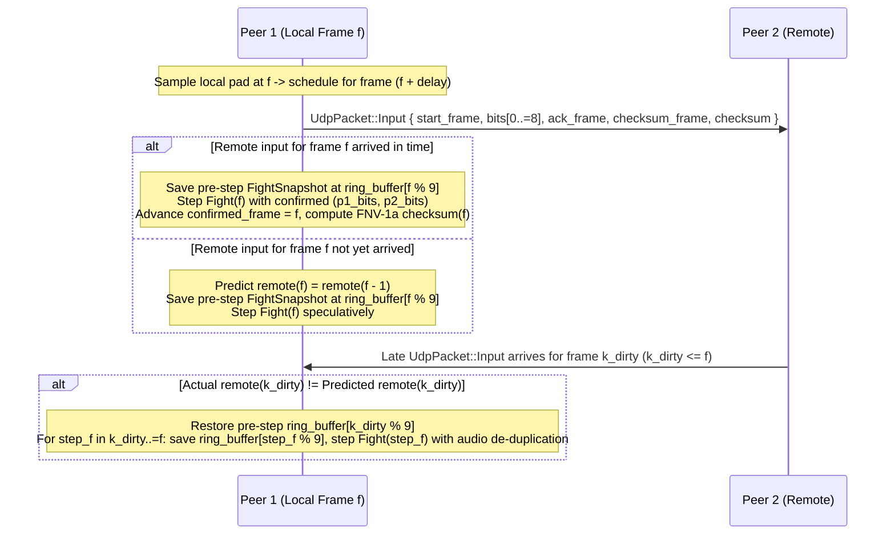

# Rollback Netplay on the Real Engine: Deterministic `Fight` Ring Buffer, P2P & Open Room Browser, Online Co-Op Dramatic, and Live Spectating

- **Date:** 2026-11-09
- **Status:** Approved
- **Project:** Project 7 of the 7-project roadmap (`SF1+ on the real engine` → **`Rollback Netplay`** → `Era styles and gauges` → `Endings, Dramatic Battle & World Tour` → `Bonus Challengers`)
- **Context:** [`CONTEXT.md`](../../CONTEXT.md), [`2026-10-27-definitive-overhaul-design.md`](2026-10-27-definitive-overhaul-design.md), [`2026-11-02-overhaul-front-end-design.md`](2026-11-02-overhaul-front-end-design.md), [`2026-11-07-sf1plus-on-the-real-engine-design.md`](2026-11-07-sf1plus-on-the-real-engine-design.md), [`2026-11-08-era-styles-and-gauges-design.md`](2026-11-08-era-styles-and-gauges-design.md), [`2026-11-08-endings-dramatic-battle-and-world-tour-design.md`](2026-11-08-endings-dramatic-battle-and-world-tour-design.md), [`2026-11-08-bonus-challengers-wave-1-design.md`](2026-11-08-bonus-challengers-wave-1-design.md), [`ADR-0004`](../adr/0004-reach-fights-by-driving-the-faithful-flow.md), [`ADR-0005`](../adr/0005-game-binary-pure-screens-shared-host.md), [`ADR-0009`](../adr/0009-stages-and-themes-in-extended-banks.md), [`ADR-0015`](../adr/0015-era-styles-and-sub-hp-on-the-1987-engine.md), [`ADR-0016`](../adr/0016-dramatic-battle-and-composite-endings-on-the-1987-engine.md), [`ADR-0017`](../adr/0017-forty-fighter-roster-and-satsui-awakening-on-the-1987-engine.md)

---

## Delivery sequencing amendment (2026-11-10)

The maintainer authorized finishing VR1 and correcting the netplay dependencies so NP1 can start. The initial NP1-NP8 milestone uses the game available now: the twelve `TournamentFighter` values, existing `DataBank` and stages, and native SF1/SF1+ rules. It delivers online 1v1, pre-match/mid-match live spectating and host transport. Completed SF1+ #246 and VR1 #346 are its prerequisites. The forty-fighter roster, later-era systems and local Dramatic Battle are not yet implemented in real fights.

This amendment takes precedence over assumptions about future features in the original detailed design. Keep the architecture and retain the full feature intent through these gates:

| Work | Delivery prerequisite and retained obligation |
| --- | --- |
| NP1 #304 | Current `FightKind::Local`, current tournament fighters and bank. Remove BC1 #293 as a blocker. |
| NP2-NP3 #305-#306 | Rollback and protocol on current authoritative rules. Use current fighter IDs and native SF1/SF1+ configuration, without requiring a live Style card. |
| NP4-NP5 #307-#308 | Existing select/stage screens and menu inputs. Remove BC2 #294 as a blocker; Wired Only works through its existing lobby row. The RANDOM tile resolves to the same `StagePick::Bank` from the shared seed; `StagePick::Random` is not a current variant. |
| NP6 #309 | Spectating only; remove ED4 #287 as a blocker. |
| NP7-NP8 #310-#311 | Host transport, prototype retirement and current SF1+ rollback torture cases: specials, combos, cancels, throws/techs, projectiles, KOs and round transitions. NP8 triggers the baseline netplay minor-version bump. |
| NP9 #352, online Dramatic follow-up under #303 | Preserve the original co-op setup, shared/independent lifebars, friendly fire, CPU boss, rollback and spectator requirements. Blocked by #308, #309 and local Dramatic setup #287. Enable Dramatic hosting/joining only here. |
| ES1-ES8 #270-#277 | Synchronize style/revision/loadout and new cross-era/gauge rules. Include every newly active era state in snapshots/checksums and delayed-input rollback tests as each system lands. |
| BC1/BC2/BC6 #293/#294/#298 | Extend fighter wire IDs and roster/wave/bank compatibility; preserve online select routing; add Satsui Awakening rollback coverage. Keep existing tournament wire IDs stable. |
| ED3 #286 | Include third-fighter, CPU and team-health state in snapshots/checksums for later online co-op. |
| TRD1 #313 | Normalize or synchronize gameplay-affecting control-scheme and shortcut-scaling rules; physical device bindings stay local. |

The approved #286, #287 and #352 delivery uses native SF1+ for all three
fighters. Later-era style selection and gauge mechanics are tracked in #402
and depend on the native era work in #269.

The initial lobby advertises only supported modes/fighters. Reserve future protocol values if useful, but reject unsupported selections. Future gameplay additions extend the same synchronized rules and compatibility hashes rather than blocking the baseline.

For NP1, reuse the existing complete `PowerOnSnapshot` and audit all current mutable `Fight` wrapper state affecting simulation or reconstructed frame output. The original list below omits mutable `setup`, `continuing`, `round_start`, `fed_reads`, `hold_combo`, `show` and `coach`; account for each as applicable and document state unreachable in an online Local fight. Preserve current local `overlay`, `gauge_art` and `notation` choices on restore. `Fight` and `CalloutBoard` already derive `Clone`.

Use explicit stable field-by-field bytes for the 64-bit FNV-1a checksum of authoritative future-determining machine, scheduler, I/O, configuration, toggles and wrapper flow. Exclude local presentation, diagnostics and emitted-audio delivery bookkeeping. Never hash native memory, pointers, padding or Debug formatting. Compare canonical state and authoritative per-frame simulation events before local rendering/audio delivery as well as checksums. Different local cosmetics or corrected audio delivery need not produce identical displayed or played output.

Memory size, clone timing and implementation line-count estimates in the original design are not measurements. Measure the completed implementation before making performance claims; a complete wrapper snapshot can include another machine snapshot at `round_start`.

### NP1 implementation boundary (2026-11-10)

`FightSnapshot.frame` names the caller's next netplay step, independent of the cabinet machine's frame counter. Save before stepping, including frame 0. The snapshot reuses the complete `PowerOnSnapshot` and captures all current wrapper state except the receiving peer's `overlay`, `gauge_art` and `notation`. Restore retains those three current choices. Immutable ROM/data/art compatibility remains NP3's responsibility. `continuing` is Arcade-only; Show and Coach are Training-only and absent from online Local fights, but their state is still saved for complete wrapper replay.

`Fight::state_checksum` uses 64-bit FNV-1a, explicit little-endian scalars, length-prefixed collections/UTF-8 strings and tagged options/variants. Exhaustive record destructuring and enum matches require an encoding audit when fields or variants change. It hashes native machine/work/configuration/toggle/training/scheduler/I/O/freeze/fair-CPU state, wrapper setup/flow and the saved round-start machine state. An active Training Show also contributes its input-driver state and current/queued fighter observations, because these can change future inputs.

Checksum exclusions are peer-local presentation and observer state (overlay history, readers, HUD/combo/moment/call-out bookkeeping and Coach advice), pending audio/announcer delivery, untranslated-address/effect-call diagnostic sets, the missing-theme log note and the cancel observer count. The actual machine sound latch and timing remain included. The current control-scheme selectors have no translated-input effect and stay local; TRD1 must normalize or synchronize their gameplay effects before activating them. Output and observer state remain in snapshots even where excluded from gameplay identity. NP2 owns resimulation audio de-duplication and the rollback ring; these foundations do not enable online play by themselves.

The input codec uses only bits 0..9 and ignores all reserved bits on decode. Room codes use uppercase `SF1-`, accept hexadecimal digits in either case, omit port 7000 and reject port zero. Raw IPv4 endpoints are accepted as `IP:PORT`; room-code encoding requires a nonzero remote port.

### Wire and compatibility implementation boundary (2026-11-10)

`SyncedMatchRules` explicitly encodes every current match field, selected fighters,
DIPs, resolved stage, seed and engine/data/art identities. Duplicate fighter,
stage and DIP fields are normalized by construction and checked on decode.
The immutable identities include the effective program/data/background bank and
graphics regions. Local availability of theme audio is excluded; current online
stages use native themes. Extended-stage integration must normalize any
gameplay-side sound fallback before enabling such stages online. Inert scheme
selectors are normalized to Classic; TRD1 owns synchronizing their future effects.

Handshake request nonces reject stale Welcomes. Lobby picks, after-match votes
and spectator chunks carry a match generation. Fighter and stage picks also
carry an explicit phase and sequence; the RANDOM cursor is represented separately
from its resolved bank stage. A Welcome supplies the authoritative lobby phase,
stage picker and monotonic wire frame base for that generation, so a lost vote
cannot change the meaning of a rematch. Input packets retain their exact 50-byte
schema; the session maps match-local frames through the wire base and rejects
previous-match traffic. Their `current_frame` names the first unsimulated frame,
including stalls: delayed inputs can reach four frames beyond that counter.
These are protocol details within the existing design,
not additional room modes.

Transport routes identify addresses, rather than player roles: a spectator may
connect before the challenger. The session admits one challenger and at most four
spectators independently of the transport's sixteen pending/admitted routes.
Caller-supplied monotonic milliseconds measure RTT; deterministic game-frame
ticks drive pure connection retries and timeouts. OS adapter discovery and HTTP
directory requests run in bounded host workers away from the frame thread.

## 1. Intent

Today, [`crates/sf-engine/src/netplay.rs`](../../crates/sf-engine/src/netplay.rs) is a 200-line pre-[`ADR-0004`](../adr/0004-reach-fights-by-driving-the-faithful-flow.md) standalone prototype (`struct Sim { x: i32, hash: u64 }`) that moves a single integer `x` left and right, while `MenuItem::Online` (`Multi Player -> Online` in [`crates/sf-engine/src/front/menu.rs`](../../crates/sf-engine/src/front/menu.rs)) and the 6th Settings tab (`NETPLAY` in [`crates/sf-engine/src/front/settings.rs`](../../crates/sf-engine/src/front/settings.rs)) sit greyed out and unselectable.

Meanwhile, [`PowerOnMachine`](../../crates/sf-engine/src/run.rs) (`save_snapshot` / `restore_snapshot`) and [`Fight`](../../crates/sf-engine/src/front/fight.rs) already step the real translated 1987 engine deterministically at 60 Hz and support full bit-for-bit frame snapshots.

This design specifies **Project 7 (`Rollback Netplay on the real engine`)**:
1. **Pure Deterministic Rollback Engine in `sf-engine` (`RollbackEngine` & `FightSnapshot`):** Wrapping the real `Fight` machine in an 8-frame (`MAX_ROLLBACK_FRAMES = 8`) snapshot ring buffer with last-input prediction, configurable input delay (`AUTO` or `0F..=4F`), rollback audio de-duplication, rift/frame-advantage pacing, and per-frame FNV-1a state checksum desync detection—kept 100% socket-free in `sf-engine` per [`ADR-0005`](../adr/0005-game-binary-pure-screens-shared-host.md) so packet loss, jitter, reordering, and rollbacks are tested deterministically in-process.
2. **All Three Online Room Modes (`RoomKind`):** Supporting **1v1 Online Versus** (`RoomKind::Versus`), **2P Online Co-Op Dramatic Battle** (`RoomKind::Dramatic`, Peer 1 = `Ally 1`, Peer 2 = `Ally 2` vs. CPU `Boss`, building on `ED3`/`ED4`), and **Zero-Impact Live Spectating** (`RoomKind::Spectate`, where spectators receive the host's confirmed input stream without affecting the combatants).
3. **Complete Front-End Integration (`OnlineScreen`, `Tab::Netplay`, Non-Blocking Online Pause & Telemetry):** Enabling `MenuItem::Online` (`HOST MATCH`, `JOIN BY IP / CODE`, and `BROWSE ROOMS` with LAN broadcast discovery, optional community directory URL, and the **Wired-Only Auto-Filter**), enabling `Settings -> NETPLAY` (`Tab::Netplay`), keeping `Fight` running at 60 Hz under a non-blocking Pause/`MOVES` overlay during online matches, and displaying a compact top-edge `PING / RBF / DLY / LINK` telemetry strip.
4. **`sf-host` Non-Blocking UDP Transport & Adapter Detection:** Implementing the non-blocking UDP socket transport, compact shareable room-code encoder (`SF1-XXXX-XXXX`), LAN broadcast beacon, and OS Ethernet/Wi-Fi link detection in `crates/sf-host/`.

---

## 2. Goals, Non-Goals, Anti-Goals

### Goals
1. **Bit-Exact Rollback & Resimulation on the Real `Fight` Machine (`crates/sf-engine/src/netplay.rs` & `front/fight.rs`):**
   - Implement `Fight::save_netplay_snapshot(&self) -> FightSnapshot` and `Fight::restore_netplay_snapshot(&mut self, snap: &FightSnapshot)` capturing `PowerOnSnapshot` (`state`, `work`, `match_config`, `toggle_state`, `training`, `scheduler`, `io`, `freeze_vblank_cycles`, `latch_writes`) plus every piece of `Fight` wrapper state (`over`, `last_flow`, `black`, `sounds`, `country`, `reader`, `read`, `combo`, `callouts`, `moments`, `era_hud`, `pending_callouts`, and `pending_combos`).
   - Guarantee the **Rollback Determinism Invariant**: simulating frames `0..=N` with late remote inputs arriving up to `window` frames (`1..=8`) behind and triggering rollback/resimulation yields the **exact same `MachineState`, `work_ram`, `CoreToggleState`, `Fight` state, and `state_checksum` at frame `N`** as simulating frames `0..=N` with all inputs known upfront.
2. **Handshake That Syncs Rules & Bank/Art Hashes While Keeping Presentation Local:**
   - Synchronize `protocol_version`, `MatchConfig` (`config_hash` covering preset, core toggles, difficulty/round time DIPs, `what_if_styles`, `bonus_challengers`, `released_waves`, and Dramatic Battle `LifebarMode`/`friendly_fire`), `bank_hash` and `art_pack_hash` (verifying compatible `DataBank` / `StageListing` tables), `prng_seed`, `StagePick`, and each player's `RosterFighter` + `StylePick`.
   - Keep **Costume, CRT Look (`crt_look`), Gauge Art (`gauge_art`), Announcer/FM/Sample volumes, Move Input Notation (`move_inputs`), Control Scheme/Bindings, Overlay Mode, and Jukebox track** strictly local to each peer.
3. **Both Direct P2P (`Host` / `Join by IP or Room Code`) and Open Room Browser (`LAN` + Configurable Directory):**
   - Players can always host or join directly via IP:Port (`127.0.0.1:7000`, LAN/VPN/port-forwarded IP) or a compact shareable room code (`SF1-XXXX-XXXX` with optional `-PPPP` when `port != 7000`) with zero external infrastructure.
   - The **Open Room Browser** discovers rooms automatically on the local network via UDP broadcast (`255.255.255.255:7001`) and optionally queries/announces to a lightweight JSON HTTP directory URL (`lobby_url` in `settings.toml`), displaying Ping (`MS`), Rollback Frames (`RBF`), Jitter (`MS`), Link (`ETH` / `WIFI`), Room Kind (`VS` / `2V1` / `SPEC`), Ruleset Badge, and the **Wired-Only Auto-Filter** (`MenuInput::Filter` or toggling the `WIRED ONLY` row).
4. **Support 1v1 Versus, 2P Online Co-Op Dramatic Battle, and Live Spectating:**
   - `RoomKind::Versus`: Peer 1 drives `P1_STRUCT` (`0xff86b0`), Peer 2 drives `P2_STRUCT` (`0xff86da`).
   - `RoomKind::Dramatic`: Peer 1 drives `Ally 1` (`P1_STRUCT`), Peer 2 drives `Ally 2` (`P2_STRUCT` + `0x1000..0x15ff`), and both peers deterministically step the shared CPU `Boss` (`CPU_STRUCT` `0xffc664`) under the host's synced `DramaticSetup`.
   - `RoomKind::Spectate`: Up to 4 spectators connect to the host (either before match start or mid-match), receive the active match's `Welcome` + sequential `SpectatorChunk` packets from frame `0` (`confirmed_inputs`), and step their local `Fight` over confirmed frames with a 15-frame jitter buffer and zero rollback impact on the combatants.
5. **Enable `Settings -> NETPLAY` (`Tab::Netplay`), Non-Blocking Online Pause, and Top-Edge Telemetry:**
   - Un-grey `Tab::Netplay` (the 6th tab in `SettingsScreen`) with `PLAYER TAG`, `INPUT DELAY` (`AUTO`, `0F..=4F`), `MAX ROLLBACK` (`1F..=8F`), `WIRED ONLY` (`OFF`/`ON`), `NETPLAY HUD` (`OFF`/`COMPACT`/`FULL`), and `UDP PORT`, persisted in `settings.toml`.
   - During an online fight, pressing `Start` opens `PauseBox` (`RESUME`, `OVERLAYS`, `LOOK`, `GAUGE ART`, `QUIT TO MENU`, `MOVES`) **without pausing the 60 Hz `Fight` step**, feeding neutral (`0`) inputs for the local fighter while the box or `MovesPanel` is up and never holding a frame when closing.
6. **Keep `sf-engine` Pure and Socket-Free (`ADR-0005`):**
   - `sf-engine` communicates exclusively through serializable `NetPacket` / `NetTransportCommand` / `NetTransportEvent` queues on `GameSession`, while `sf-host` owns `std::net::UdpSocket`, LAN broadcast, OS network adapter detection (`detect_link`), and optional HTTP directory requests.

### Non-Goals
- **Proprietary matchmaking servers, ELO/ranked leaderboards, or account sign-ins:** Matchmaking is strictly open P2P + LAN broadcast + optional self-hosted/community room directory with zero accounts or region locks.
- **Synchronizing Jukebox audio files over the network:** Each peer plays their own local Jukebox track or YM2151 stage theme locally.

### Anti-Goals
- **Never call `std::net` or OS network APIs inside `sf-engine`:** Per [`ADR-0005`](../adr/0005-game-binary-pure-screens-shared-host.md), `sf-engine` must remain 100% deterministic and pure so tests drive multi-peer rollback sessions in-memory without OS sockets or timers.
- **Never freeze the remote peer when a player opens or closes the Pause box or Move List:** In online matches, `PauseBox` and `MovesPanel` are local-only overlays over the live 60 Hz fight and must never set `play.held = true`.
- **Never re-trigger already-played sound latches or voice call-outs during rollback resimulation:** Resimulating rolled-back frames `k_dirty..=current_frame` must not re-emit `sound_latch` commands or `AnnouncerLine`s that were already emitted when those frames first ran, while still emitting any newly discovered hit/block sound latch caused by the corrected input.

---

## 3. Context & Existing Architecture

### 3.1 `PowerOnMachine` & `PowerOnSnapshot` (`crates/sf-engine/src/run.rs`)
- [`PowerOnMachine::save_snapshot`](../../crates/sf-engine/src/run.rs) (`line 1623`) and `restore_snapshot` (`line 1641`) already save and restore the complete 68000 machine state:
  - `state: MachineState` (`videoram` `4 KB`, `objectram` `8 KB`, `paletteram` `2 KB`, scroll registers, `gfxctrl`, `sound_latch`, `frame`, `bg_page`, `fg_page`).
  - `work: Vec<u8>` (`24 KB` work RAM `0xff8000..0xffe000`).
  - `match_config`, `toggle_state` (`CoreToggleState`), `training`, `scheduler` (`TaskScheduler`), `io`, `freeze_vblank_cycles`, `latch_writes`, and `overlay`.
- The **8-frame rollback ring buffer** stores nine complete pre-step `FightSnapshot` values. Measure their total memory and save/restore timing after implementation, including nested wrapper snapshots.

### 3.2 `PlayerInputs` Wire Encoding (`crates/sf-engine/src/front/session.rs`)
- In [`crates/sf-engine/src/front/session.rs`](../../crates/sf-engine/src/front/session.rs) (`line 50`), `PlayerInputs` has `directions: [bool; 4]` (`right`, `left`, `down`, `up`) and `buttons: [bool; 6]` (`LP`, `MP`, `HP`, `LK`, `MK`, `HK`)—10 bits total, which pack losslessly into a single **`u16` button mask** (`bits 0..=3` = directions, `bits 4..=9` = buttons; bit `15` = `forfeit/disconnect` sentinel).

### 3.3 `MenuItem::Online` (`menu.rs`) & `Tab::Netplay` (`settings.rs`)
- [`MenuItem::Online`](../../crates/sf-engine/src/front/menu.rs) (`line 27`, label `"ONLINE"`) is already in `MULTI` (`[MenuItem::Local, MenuItem::Online, MenuItem::LocalCoopDramatic]`), waiting to be added to `MenuItem::available()`.
- [`TAB_NAMES`](../../crates/sf-engine/src/front/settings.rs) (`line 593`) already includes `"NETPLAY"` as the 6th tab header on `SettingsScreen`.

---

## 4. Approaches Considered

### Approach A (Chosen): Custom Deterministic 8-Frame Ring-Buffer `RollbackEngine` in `sf-engine` + Non-Blocking UDP Driver in `sf-host`
- Build the rollback state machine (`RollbackEngine`) directly in [`crates/sf-engine/src/netplay.rs`](../../crates/sf-engine/src/netplay.rs) around `FightSnapshot` and 16-bit `PlayerInputs` masks, with redundant-window UDP packets (each `InputPacket` carries the sender's inputs for `frame` plus the previous `8` frames `frame - 8 ..= frame` and the sender's latest confirmed frame checksum) so single-packet UDP drops are healed immediately without waiting for a retransmit!
- **Pros:** Zero external C/networking dependencies in `sf-engine`; preserves [`ADR-0005`](../adr/0005-game-binary-pure-screens-shared-host.md); supports 1v1 Versus, 2P Co-Op Dramatic Battle, and Spectating with one unified packet format; 100% deterministic in-memory unit & integration tests under simulated packet loss, jitter, and reordering.

### Approach B: Pull in an External Crate (`ggrs` / `matchbox`) Inside `sf-engine`
- Add `ggrs` as a dependency of `sf-engine`.
- **Cons:** Adds external dependencies and trait constraints to `sf-engine`; the chosen approach keeps the snapshot and input-mask protocol inside the existing deterministic engine boundary. Its implementation size has not been measured.

---

## 5. Design

### 5.1 Pillar 1 — Pure Deterministic Rollback Engine on `Fight` (`crates/sf-engine/src/netplay.rs` & `front/fight.rs`)



#### A. Complete `FightSnapshot` & Pre-Step 9-Slot Ring Buffer (`MAX_ROLLBACK_FRAMES = 8`)
1. **`FightSnapshot` (`crates/sf-engine/src/front/fight.rs`):**
   To ensure rolling back across a round transition or a predicted round-ending KO restores `Fight` completely (for example, preventing a rolled-back speculative KO from leaving `self.over = true`), `FightSnapshot` captures every field on `Fight` except the immutable `rom: Arc<RomSet>`:
   ```rust
   #[derive(Clone)]
   pub struct FightSnapshot {
       pub frame: u32,
       pub machine: PowerOnSnapshot,
       pub over: bool,
       pub last_flow: u32,
       pub black: u32,
       pub sounds: VecDeque<u8>,
       pub country: Option<u8>,
       pub reader: FightReader,
       pub read: FightRead,
       pub combo: ComboCounter,
       pub callouts: CalloutBoard,
       pub moments: RoundMoments,
       pub era_hud: EraHud,
       pub pending_callouts: Vec<CalloutEvent>,
       pub pending_combos: Vec<AnnouncerLine>,
   }
   ```
   - `Fight::save_netplay_snapshot(&self, net_frame: u32) -> FightSnapshot` and `Fight::restore_netplay_snapshot(&mut self, snap: &FightSnapshot)` save and restore all simulation-relevant state in `Fight` (deriving `Clone` on `CalloutBoard` alongside `FightReader`, `FightRead`, `ComboCounter`, `RoundMoments`, and `EraHud`).
   - `Fight::state_checksum(&self) -> u64` computes a fast deterministic 64-bit FNV-1a hash over `machine.work_ram()`, `machine.state.objectram`, `machine.state.bg_scroll`, `machine.state.fg_scroll`, `machine.toggle_state()` (including Sub-HP and Era gauges), and `self.over as u8`.
2. **Input Encoding (`encode_inputs` / `decode_inputs`):**
   - `pub fn encode_inputs(inp: PlayerInputs) -> u16` packs `directions[0..4]` into bits `0..=3` and `buttons[0..6]` into bits `4..=9`.
   - `pub fn decode_inputs(bits: u16) -> PlayerInputs` unpacks bits `0..=9` back into `PlayerInputs`.

#### B. Prediction, Pre-Step Ring Indexing, Resimulation & Audio De-Duplication
1. **Input Delay (`delay: u8`, `0..=4` frames):**
   - At local simulation frame `f`, the local player's sampled pad input is placed at `local_inputs[f + delay]` (with frames `0..delay` seeded to `0` at match start).
   - When `Settings.netplay_input_delay` is `InputDelaySetting::Auto`, the handshake initializes `delay = (rtt_ms / 34).clamp(0, 4) as u8` (e.g., `0..33 ms` -> `0F`, `34..67 ms` -> `1F`, `68..101 ms` -> `2F`).
2. **Pre-Step Ring Buffer Indexing (`step_f % 9`) & Misprediction Rollback:**
   - Immediately **before** stepping frame `step_f` (including `step_f = 0`), `RollbackEngine` saves the pre-step snapshot into **`ring_buffer[(step_f as usize) % 9]`**.
   - When stepping frame `f`, if `remote_inputs[f]` has not yet arrived over UDP, `RollbackEngine` predicts `predicted_remote[f] = if f == 0 { 0 } else { remote_inputs[f - 1] }`.
   - When an `InputPacket` arrives containing true `remote_inputs[k..=m]`:
     - Find the earliest frame `k_dirty` (`confirmed_frame < k_dirty <= current_frame`, with `confirmed_frame: i64` starting at `-1`) where the newly received `remote_inputs[k_dirty]` differs from the value used when frame `k_dirty` was simulated.
     - If such a `k_dirty` exists:
       1. Restore the pre-step state of `k_dirty` from **`ring_buffer[(k_dirty as usize) % 9]`** via `fight.restore_netplay_snapshot(...)` (safe even when `k_dirty == 0`).
       2. For `step_f` in `k_dirty..=current_frame`:
          - Save the pre-step snapshot into `ring_buffer[(step_f as usize) % 9]`.
          - Step `fight` with `(p1_inputs[step_f], p2_inputs[step_f])` under **`resimulating = true`**.
     - Advance `confirmed_frame` up to the highest contiguous frame `c` where both `local_inputs[c]` and `remote_inputs[c]` are confirmed.
3. **Rollback Audio De-Duplication Across Multi-Frame Resimulation:**
   - Each ring-buffer slot `(step_f as usize) % 9` also records `emitted_latch: u8` and `emitted_announcements: Vec<AnnouncerLine>` from the previous execution of `step_f`.
   - When a multi-frame rollback (`k_dirty..=current_frame`) runs inside a single `GameSession::step`:
     - For each resimulated frame `step_f <= highest_audio_frame`, if the resimulated step produces a `sound_latch` that equals `slot.emitted_latch` (or `0xff`), it is suppressed; if it produces a **new** non-idle `sound_latch != 0xff && sound_latch != slot.emitted_latch` (e.g., an unpredicted attack connected on frame `k_dirty`), `slot.emitted_latch` is updated and that latch is pushed into `fight.sounds` so `GameSession` emits it on the current frame's `FrameOutput` (or subsequent frames via `fight.sounds`) without dropping it or machine-gunning already-heard sounds.
     - Likewise, any `AnnouncerLine` produced at `step_f` that was not in `slot.emitted_announcements` is appended to the current step's `announcements` output and recorded in `slot.emitted_announcements`.
4. **Rift / Frame-Advantage Pacing & Stall Handling:**
   - Each `InputPacket` includes `remote_frame_advantage: i8 = (sender_current_frame as i32 - sender_last_received_remote_frame as i32) as i8`.
   - If the local peer is ahead of the remote peer by `>= 2` frames more than the remote peer's advantage (`local_advantage - remote_advantage >= 2`), `GameSession` holds for `1` tick (repeating the presented frame once) to let the remote peer catch up smoothly.
   - If `current_frame - confirmed_frame >= max_rollback_frames` (`8` by default), the simulation pauses advancing `current_frame` (displaying `WAITING FOR PEER...` in the top telemetry strip) until the next UDP packet arrives or the disconnect timeout (`5` seconds = `300` frames) expires.
5. **Per-Frame Checksum Desync Detection:**
   - Every `InputPacket` carries `(checksum_frame: u32, checksum: u64)` for the sender's latest `confirmed_frame`.
   - When both peers have confirmed frame `c`, `RollbackEngine` compares `local_checksum[c]` against `remote_checksum[c]`. If they ever differ, `RollbackEngine` raises `NetplayEvent::Desync { frame: c, local: local_checksum[c], remote: remote_checksum[c] }`, logs the full diagnostic state, and displays a clear `DESYNC DETECTED AT FRAME {c}` notice on the after-match / lobby screen.

---

### 5.2 Pillar 2 — Wire Protocol, Handshake, Online Co-Op Dramatic, and Live Spectating

#### A. Compact Binary UDP Wire Protocol & Room Code Format (`crates/sf-engine/src/netplay.rs`)
All packets begin with a 6-byte header (`b"SF1N"` magic `0x53, 0x46, 0x31, 0x4e`, 1-byte `PROTOCOL_VERSION = 1`, and 1-byte packet variant tag):
1. **Room Code Format (`encode_room_code` / `decode_room_code`):**
   - Encodes a 32-bit IPv4 address as 8 uppercase hex characters grouped as **`SF1-XXXX-XXXX`** when `port == 7000` (e.g., `127.0.0.1:7000` -> `SF1-7F00-0001`, `192.168.1.10:7000` -> `SF1-C0A8-010A`), and appends `-PPPP` (4 uppercase hex characters for the 16-bit UDP port) when `port != 7000` (e.g., `127.0.0.1:7001` -> `SF1-7F00-0001-1B59`).
   - `decode_room_code` accepts both `SF1-XXXX-XXXX` (defaulting port to `7000`), `SF1-XXXX-XXXX-PPPP`, and raw `IP:PORT` strings (`127.0.0.1:7000`).
2. **`NetPacket::Ping { seq: u32, sent_ms: u32, link: Link }` / `NetPacket::Pong { seq: u32, echo_ms: u32, link: Link }`:**
   - Exchanged every `30` frames (`0.5 s`) in the lobby and during fights to measure `ping_ms` (RTT) and `jitter_ms` (exponential moving average of `|rtt - prev_rtt|`).
3. **`NetPacket::Hello { tag: [u8; 12], kind: RoomKind, link: Link, config_hash: u64, bank_hash: u64, art_pack_hash: u64 }`:**
   - Client -> Host join request (or Spectator join request when `kind == RoomKind::Spectate`).
4. **`NetPacket::Welcome { accepted: bool, reason: RejectReason, config: SyncedMatchRules, seed: u64, assigned_delay: u8, max_rollback: u8, host_tag: [u8; 12] }`:**
   - Host -> Client handshake response. `RejectReason` covers `None`, `WiredOnlyRequired` (when host has `wired_only == true` and client `link == Link::Wifi`), `PackHashMismatch` (incompatible `bank_hash` / `art_pack_hash`), `RoomFull`, or `VersionMismatch`.
5. **`NetPacket::LobbyPick { side: u8, fighter: RosterFighter, style: StylePick, stage: StagePick, locked: bool }`:**
   - Synchronizes cursor/lock picks during Online Character Select and Stage Select (or `DramaticSetupScreen`).
6. **`NetPacket::Input { current_frame: u32, start_frame: u32, count: u8, bits: [u16; 9], ack_frame: u32, frame_advantage: i8, checksum_frame: u32, checksum: u64 }`:**
   - Sent every frame during a fight (`6`-byte header + `44`-byte payload = **`50` bytes total**). Carries up to `9` consecutive frame input masks (`start_frame .. start_frame + count`), so up to 8 consecutive dropped UDP packets are recovered automatically by the next packet that lands.
7. **`NetPacket::SpectatorChunk { start_frame: u32, count: u8, pairs: [(u16, u16); 16] }` & `NetPacket::SpectatorAck { next_expected_frame: u32 }`:**
   - Host retains the current match's `confirmed_inputs: Vec<(u16, u16)>` from frame `0` and streams `16`-frame `SpectatorChunk` packets starting from each spectator's `next_expected_frame`, so spectators joining either before match start or mid-match catch up deterministically from frame `0`.
8. **`NetPacket::AfterMatchVote { choice: AfterMatchChoice }` (`Rematch`, `Reselect`, `Leave`):**
   - Synchronizes post-match decisions across both peers.

#### B. Synced vs. Local-Only State (`config_hash`, `bank_hash`, & `art_pack_hash`)
| Synchronized in `Welcome` (`config_hash` / `bank_hash` / `art_pack_hash`) | Strictly Local to Each Peer (Never Sent Over Wire) |
|---|---|
| `RulesetPreset` & all 20 `CoreToggles` | Fighter Costume (`costume`) & Mirror Palette preference |
| `FightDips` (`difficulty`, `round_time`) | Video `scale`, `fullscreen`, `aspect`, `vsync`, `frame_delay_ms` |
| `GaugeMode`, `disable_raw_drive_rush`, `disable_comeback_scaling` | `crt_look` shader & `gauge_art` (`Ruled`/`Blocks`/`Plate`) |
| `full_cast`, `four_country`, `ban`, `what_if_styles`, `bonus_challengers`, `released_waves` | Sound volumes (`master`, `fm`, `samples`, `announcer`) & `Jukebox track` |
| `prng_seed`, `StagePick`, `RosterFighter` & `StylePick` for P1/P2 | `devices`, `Binds`, Control Scheme (`Classic`/`Pneumatic`/`Modern`), `move_inputs` |
| Dramatic Battle `LifebarMode`, `friendly_fire`, and CPU `Boss` | `OverlayMode` (`Hitboxes`/`FrameMeter`) & `netplay_hud` strip mode |

#### C. Three Online Room Modes (`RoomKind`) & Online `SelectScreen` / `StageScreen` Routing
1. **Local-Side Routing on Online `SelectScreen`, `StageScreen`, and `DramaticSetupScreen`:**
   - Today, local `SelectScreen` routes `FrameInputs.p1` to side `0` (`P1`) and `FrameInputs.p2` to side `1` (`P2`).
   - In an online session (`local_side: u8`, where `0` = Host and `1` = Client), `GameSession` routes the local player's `FrameInputs.p1` pad/keyboard into `local_side`, emits a `NetPacket::LobbyPick { side: local_side, ... }` whenever the local cursor/style/lock changes, and applies incoming `NetPacket::LobbyPick` packets from the remote peer to `remote_side = 1 - local_side`.
   - On `StageScreen`, the active stage-picking side (`0` on match 1, or the previous match's loser on subsequent matches) drives the stage cursor and emits `NetPacket::LobbyPick` while the other peer sees the stage cursor move live; `StagePick::Random` resolves deterministically from the shared `prng_seed`.
2. **`RoomKind::Versus` (1v1 Online Versus):**
   - Host is Player 1 (`P1_STRUCT`), Client is Player 2 (`P2_STRUCT`). Both pick concurrently on the 40-slot `SelectScreen`, followed by `StageScreen`.
3. **`RoomKind::Dramatic` (2P Online Co-Op Dramatic Battle, building on `ED3` `#286` & `ED4` `#287`):**
   - Host is `Ally 1` (`P1_STRUCT`), Client is `Ally 2` (`P2_STRUCT` + `0x1000..0x15ff`), and both machines deterministically step the shared CPU `Boss` (`CPU_STRUCT` `0xffc664`) in lockstep (`FightKind::Dramatic { co_op: true }`).
   - On `DramaticSetupScreen`, Host chooses the Rivalry Preset (or `CUSTOM 2V1`), `LifebarMode`, and `Friendly Fire`, and both peers lock their characters/styles before the fight starts.
4. **`RoomKind::Spectate` (Zero-Impact Live Spectating):**
   - A spectator joining a room receives the active match's `Welcome` + locked fighters/stage and buffers `15` frames (`0.25 s`) of confirmed `(p1_bits, p2_bits)` from `SpectatorChunk` packets before stepping their local `Fight` forward (fast-forwarding up to `8` frames per display tick if joining mid-match until within `15` frames of the host's live tip).
   - Spectators never send `InputPacket`s and have zero impact on the combatants' rollback window or frame pacing.

---

### 5.3 Pillar 3 — Front-End Screens: `OnlineScreen`, `Tab::Netplay`, Non-Blocking Pause & Telemetry

```
+--------------------------------------------------------------------------+
|                              ONLINE LOBBY                                |
| >MODE: < BROWSE ROOMS >    KIND: < 1V1 VERSUS >   WIRED ONLY: < ON >     |
|                                                                          |
|  CODE           HOST         MODE   RULESET       PING  RBF  JIT   LINK  |
|  SF1-7F00-0001  RYU_87       1V1    DEF OVERHAUL  24MS  1F   2MS   [ETH] |
|  SF1-C0A8-010A  SAGAT_TH     2V1    ALL+BONUS     38MS  1F   4MS   [ETH] |
|  SF1-0A00-0014  KEN_US       SPEC   COMPETITIVE   52MS  2F   6MS   [ETH] |
|                                                                          |
|  ----------------------------------------------------------------------  |
|  STATUS: 3 ROOMS FOUND ON LAN / DIRECTORY                                |
|  CONTROLS: UP/DN SELECT   L/R CHANGE MODE/FILTER   CONFIRM JOIN          |
|                                                                          |
+--------------------------------------------------------------------------+
```

#### A. `OnlineScreen` (`Multi Player -> Online`, `crates/sf-engine/src/front/online.rs`)
1. **Menu Entry:**
   - Enable `MenuItem::Online` in [`crates/sf-engine/src/front/menu.rs`](../../crates/sf-engine/src/front/menu.rs) (`MenuItem::available()`) to open `Screen::Online(Box<OnlineScreen>)` in [`crates/sf-engine/src/front/session.rs`](../../crates/sf-engine/src/front/session.rs).
2. **Three Lobby Views inside `framed_wide(font, "ONLINE LOBBY", "")` (`384×224`, empty `FOOT_ROW`), switched via `Left`/`Right` on the top `MODE` header row:**
   - **View 1 — `BROWSE ROOMS` (default):**
     - Lists discovered LAN broadcast rooms and community directory rooms (`Browser::visible`), showing each room's shareable `CODE`, `HOST` tag, `MODE` (`1V1`, `2V1`, `SPEC`), `RULESET` badge (`COMPETITIVE`, `DEFINITIVE`, `WHAT-IF`, `BONUS`), `PING` (`MS`), recommended `RBF` (`1F..8F`), `JIT` (`MS`), and `LINK` (`[ETH]` or `[WIFI]`).
     - Toggling the **`WIRED ONLY`** header row via `Left`/`Right`/`Confirm` (or pressing `MenuInput::Filter` once `BC2` `#294` lands) flips `wired_only` (`ON / OFF`) live, immediately hiding `Link::Wifi` rooms when `ON`.
     - Pressing `Confirm` on a room row joins the highlighted room as a challenger (or spectator if the room is already in-match / set to `SPEC`).
   - **View 2 — `HOST MATCH`:**
     - Lets the host cycle `ROOM KIND` (`1V1 VERSUS` / `2V1 CO-OP DRAMATIC`), `VISIBILITY` (`PUBLIC LAN+LOBBY` / `PRIVATE CODE ONLY`), and `WIRED ONLY` (`ON` / `OFF`), and press `Confirm` on `OPEN ROOM`.
     - Displays the host's shareable **Room Code** (`SF1-XXXX-XXXX`) and waits for a peer to connect (`WAITING FOR CHALLENGER...`), showing the connecting peer's tag, `PING`, `JITTER`, and `LINK` before transitioning into `SelectScreen` (or `DramaticSetupScreen`).
   - **View 3 — `DIRECT JOIN (CODE / IP)`:**
     - Inline text/character entry box where `GameSession::step` forwards `inputs.typed` (`TypedKey` from [`crates/sf-engine/src/front/tune.rs`](../../crates/sf-engine/src/front/tune.rs)) and pad navigation over `NET_ENTRY_CHARS = b"ABCDEFGHIJKLMNOPQRSTUVWXYZ0123456789-_.: "` (adding `.` and `:` to `ENTRY_CHARS` so both `SF1-7F00-0001` and `127.0.0.1:7000` can be entered by keyboard or arcade pad) and connects on `Confirm`.

#### B. `Settings -> NETPLAY` Tab (`Tab::Netplay` in `crates/sf-engine/src/front/settings.rs`)
1. **Un-grey `Tab::Netplay` (the 6th tab in `SettingsScreen`):**
   - Widen `TABS` in `settings.rs` from `[Tab; 5]` to `[Tab; 6]` by adding `Tab::Netplay`, widen `SettingsScreen.cursor` from `[usize; 5]` to `[usize; 6]`, remove the hardcoded `if i == 5 { ink::DIM }` in `SettingsScreen::render` (`line 599`), and add `Tab::Netplay` to `SettingsScreen::reset_tab`.
   - Forward `FrameInputs.typed` (`TypedKey`) to `SettingsScreen` when the `PLAYER TAG` row is being edited on `Tab::Netplay`.
   - `rows(Tab::Netplay)` exposes:
     | Row Label | `Settings` Field | Values & Default |
     |---|---|---|
     | **`PLAYER TAG`** | `player_tag: String` | Up to 12 uppercase ASCII chars (default `"PLAYER"`) |
     | **`INPUT DELAY`** | `netplay_input_delay: InputDelaySetting` | `AUTO` (default), `0F`, `1F`, `2F`, `3F`, `4F` |
     | **`MAX ROLLBACK`** | `netplay_max_rollback: u8` | `1F`..=`8F` (default `8F`) |
     | **`WIRED ONLY`** | `wired_only: bool` | `OFF` (default), `ON` |
     | **`NETPLAY HUD`** | `netplay_hud: NetplayHudMode` | `COMPACT` (default), `FULL`, `OFF` |
     | **`UDP PORT`** | `netplay_port: u16` | Default `7000` (`1024..=65535`) |
     | **`RESET TAB`** | `Row::ResetTab` | Resets Netplay settings to defaults |
   - In `settings.toml`, persist `player_tag`, `netplay_input_delay`, `netplay_max_rollback`, `wired_only`, `netplay_hud`, `netplay_port`, and optional `lobby_url: Option<String>` (leniently loaded with defaults when absent from older `settings.toml` files).

#### C. Non-Blocking Online Pause, Netplay HUD Telemetry Strip, & Synced `AfterMatchBox`
1. **Non-Blocking Online Pause (`PauseBox` & `MovesPanel` in `front/session.rs`):**
   - In an online match (`Play` in `front/session.rs` with `netplay: Option<RollbackEngine>`), pressing `Start` opens `PauseBox::open_online()` with rows: `RESUME`, `OVERLAYS`, `LOOK`, `GAUGE ART`, `QUIT TO MENU`, and `MOVES` (omitting `RESTART ROUND`), while `now.pad_lost` opens `PauseBox::with_online_notice("CONTROLLER DISCONNECTED")`.
   - While `PauseBox` or `MovesPanel` is open in an online match:
     - **`GameSession::step` continues stepping `RollbackEngine` and `Fight` at 60 Hz**, feeding neutral (`PlayerInputs::default()`) as the local fighter's input for that frame.
     - Closing `PauseBox` (`PauseOutcome::Resume`) or `MovesPanel` in an online match leaves **`play.held = false`** (never stalling the 60 Hz `RollbackEngine` for a frame).
     - When `PauseBox` is open, `PauseBox::render_over` dims the stepped `384×224` pixels locally; when `MovesPanel` is open (`PauseOutcome::Moves`), `GameSession` populates `FrameOutput.panel` over the live undimmed `Fight` frame.
   - Choosing `QUIT TO MENU` sends a disconnect/forfeit sentinel (`bit 15` in `InputPacket`) to the remote peer and returns to `OnlineScreen`.
2. **Top-Edge Netplay HUD Telemetry Strip (`NetplayHudMode`):**
   - Drawn at the top of the `384×224` frame (`y = 2`, above the score row) in `3×5` `fallback_text`:
     - `NetplayHudMode::Off`: Nothing drawn.
     - `NetplayHudMode::Compact` (default): `PING 24MS  RBF 1F  DLY 1F  [ETH]`
     - `NetplayHudMode::Full`: `PING 24MS  JIT 2MS  RBF 1/8F  DLY 1F  ADV +0F  [ETH]`
3. **Synced Online `AfterMatchBox`:**
   - When an online match ends (`match_over()`), both peers see `AfterMatchBox` (`REMATCH`, `RESELECT`, `MENU`) with a live peer vote indicator (`P1: REMATCH | P2: WAITING...`):
     - If both choose `REMATCH`, the match restarts immediately on the next stage/seed.
     - If either chooses `RESELECT` (and neither chose `MENU`), both return to `SelectScreen` (or `DramaticSetupScreen`).
     - If either chooses `MENU` (or disconnects), the session returns to `OnlineScreen` with a `PEER LEFT ROOM` notice.

---

### 5.4 Pillar 4 — `sf-host` Non-Blocking UDP Transport, LAN Broadcast, & Retiring Legacy `netplay.rs`

#### A. Pure Boundary Between `sf-engine` and `sf-host` (`ADR-0005`)
1. **In `sf-engine` (`FrameInputs` / `FrameOutput` / `GameSession`):**
   - `GameSession` exposes `push_net_events(&mut self, events: &[NetTransportEvent])` and emits `drain_net_commands(&mut self) -> Vec<NetTransportCommand>`:
     - `NetTransportCommand`: `BindHost { port: u16, room: RoomAnnouncement }`, `ConnectPeer { addr: String }`, `SendPacket { to_peer: u8, bytes: Vec<u8> }`, `RefreshRooms`, `Close`.
     - `NetTransportEvent`: `Bound { local_addr: String, room_code: String, link: Link }`, `PacketReceived { from_peer: u8, addr: String, bytes: Vec<u8> }`, `RoomsDiscovered { rooms: Vec<Room> }`, `TransportError { message: String }`.
   - Because all packets are plain `Vec<u8>` bytes passed through `push_net_events` / `drain_net_commands`, an in-memory **`VirtualNetBus`** test harness in `sf-engine` connects two (or more, with spectators) `GameSession` instances in a single test thread and simulates arbitrary latency (`ms`), jitter, packet loss (`%`), packet duplication, and out-of-order delivery deterministically!
2. **In `sf-host` (`crates/sf-host/src/net.rs`):**
   - Owns a non-blocking `std::net::UdpSocket` (`set_nonblocking(true)`) polled once per 60 Hz frame in the main host loop.
   - Implements LAN broadcast room discovery on UDP port `7001` (`255.255.255.255:7001`), so any two machines on the same LAN/Wi-Fi/virtual LAN see each other's open rooms in `BROWSE ROOMS` automatically with zero configuration.
   - Detects the active network interface's link type (`Link::Ethernet` vs. `Link::Wifi`) via [`detect_link`](../../crates/sf-engine/src/netplay.rs) and passes it to `GameSession`.
   - Encodes/decodes compact room codes (`SF1-XXXX-XXXX` / `SF1-XXXX-XXXX-PPPP` <-> `IPv4:Port`).

#### B. Replacing the Standalone `Sim` Prototype in `crates/sf-engine/src/netplay.rs`
- Replace the 1D integer `struct Sim { x: i32, hash: u64 }` and legacy `Peer` in [`crates/sf-engine/src/netplay.rs`](../../crates/sf-engine/src/netplay.rs) with the real `RollbackEngine`, `NetPacket` wire serializer/deserializer, room-code codec (`encode_room_code` / `decode_room_code`), `Browser` (updated for the 40-fighter roster badges), and `VirtualNetBus` test harness, keeping `Link`, `detect_link`, `RoomKind`, `Room`, `Browser`, and `config_hash` (extended to cover all `MatchConfig` fields, Dramatic settings, and `released_waves`).

---

### 5.5 Domain Glossary Additions (`CONTEXT.md`, staged for `NP1`)
To avoid merge conflicts with active Project 3 worktrees, the first ticket (`NP1`) adds these entries to `CONTEXT.md`:
- **Rollback engine (`RollbackEngine`)** — The pure, socket-free state machine in `crates/sf-engine/src/netplay.rs` that wraps a real `Fight` and an 8-frame (`MAX_ROLLBACK_FRAMES = 8`) pre-step ring buffer of `FightSnapshot`s, predicting unarrived remote inputs from the previous frame, rolling back and resimulating on misprediction with rollback audio de-duplication, and verifying per-frame FNV-1a state checksums. (`ADR-0005`, `ADR-0018`.)
- **Virtual net bus (`VirtualNetBus`)** — An in-memory packet router in `sf-engine` that connects two or more `GameSession` / `RollbackEngine` instances in headless tests under scripted latency, jitter, packet drop, and reordering without opening OS sockets. (`ADR-0005`, `ADR-0018`.)

---

## 6. What's Left to the Builder

The following implementation details are intentionally left to engineering judgment during ticket execution:
- Exact byte offsets within each `NetPacket` variant after the 6-byte `SF1N\x01<tag>` header.
- Exact Windows/cross-platform adapter name query in `sf-host` that feeds `sf_engine::netplay::detect_link(adapter_name)`.
- Exact frame threshold for the `1`-frame rift catch-up hold when one peer's clock drifts ahead of the other.
