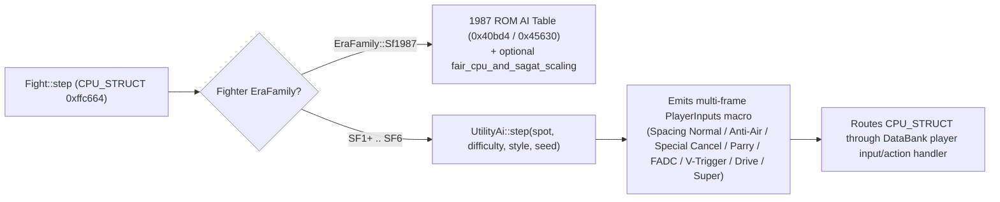

# Training Drills, Combo Trials, Match Replay Takeover, Style-Aware Utility AI, and Control Schemes (`Classic` / `Pneumatic` / `Modern`) on the Real Engine

- **Date:** 2026-11-09
- **Status:** Approved
- **Project:** Project 8 (`Training Drills, Combo Trials, Replay Takeover, Utility AI & Control Schemes on the real engine`)
- **Context:** [`CONTEXT.md`](../../CONTEXT.md), [`2026-10-27-definitive-overhaul-design.md`](2026-10-27-definitive-overhaul-design.md), [`2026-11-02-overhaul-front-end-design.md`](2026-11-02-overhaul-front-end-design.md), [`2026-11-07-sf1plus-on-the-real-engine-design.md`](2026-11-07-sf1plus-on-the-real-engine-design.md), [`2026-11-08-era-styles-and-gauges-design.md`](2026-11-08-era-styles-and-gauges-design.md), [`2026-11-09-rollback-netplay-design.md`](2026-11-09-rollback-netplay-design.md), [`ADR-0004`](../adr/0004-reach-fights-by-driving-the-faithful-flow.md), [`ADR-0005`](../adr/0005-game-binary-pure-screens-shared-host.md), [`ADR-0012`](../adr/0012-the-coach-reads-the-engines-command-state.md), [`ADR-0013`](../adr/0013-training-rules-run-in-the-engine-under-every-preset.md), [`ADR-0015`](../adr/0015-era-styles-and-sub-hp-on-the-1987-engine.md), [`ADR-0018`](../adr/0018-rollback-netplay-and-virtual-net-bus-on-the-1987-engine.md)

---

## 1. Intent

Today, two pre-[`ADR-0004`](../adr/0004-reach-fights-by-driving-the-faithful-flow.md) standalone modules sit disconnected from [`GameSession`](../../crates/sf-engine/src/front/session.rs) and [`Fight`](../../crates/sf-engine/src/front/fight.rs):
1. [`crates/sf-engine/src/utility.rs`](../../crates/sf-engine/src/utility.rs) defines an abstract `decide(...) -> Decision`, `DrillRun` (`AntiAir`, `WhiffPunish`, `ThrowTech`, `Survival`), and `ComboTrial`, none of which drive the real `Fight` machine, `TrainingBox`, or `Coach` strip.
2. [`crates/sf-engine/src/replay.rs`](../../crates/sf-engine/src/replay.rs) defines `ReplayTakeoverSession` around the legacy checkpoint-2450 `FightMachine` (`crate::fight::FightMachine`) rather than the real `PowerOnMachine`-backed [`front::fight::Fight`](../../crates/sf-engine/src/front/fight.rs) and its `FightSnapshot` (`NP1` `#304`).
3. Meanwhile, even though [`MatchConfig`](../../crates/sf-engine/src/config.rs) (`lines 349–353`) already stores `pub p1_scheme: ControlScheme`, `pub p2_scheme: ControlScheme`, and `pub modern_control_damage_penalty: bool`, [`crates/sf-engine/src/front/settings.rs`](../../crates/sf-engine/src/front/settings.rs) (`line 986`, `1074`, `1158`) still hardcodes `Row::Scheme(0)` (`P1 SCHEME`) and `Row::Scheme(1)` (`P2 SCHEME`) on `Tab::Controls` to `"CLASSIC"` with a no-op `change(...)` handler, and `Fight::step` does not yet execute `ControlScheme::Pneumatic` or `ControlScheme::Modern`.

This design brings all four capabilities onto the real 1987 `Fight` engine and `GameSession` front-end:
1. **Style-Aware Utility AI (`UtilityAi`) on the Real `Fight` Engine:** Driving `SF1+` through `SF6` CPU opponents (`CPU_STRUCT` `0xffc664` in Arcade, `TrainingCpu`, 2v1 Dramatic Battle, and World Tour) with a deterministic, seed-driven utility controller that executes special cancels, anti-airs, throw techs, Parries, FADCs, V-Triggers, Drive Impact/Rush, and Supers scaled by `difficulty` (`1..=4`), while keeping raw `SF1` (`EraFamily::Sf1987`) on the 1987 table AI (`0x40bd4` / `0x45630`).
2. **Live Training Drills & Per-Fighter/Era Combo Trials in `TrainingBox` and `Coach`:** Expanding `TrainingBox` (`PauseBox -> TRAINING`) with `DRILL` (`OFF`, `ANTI-AIR`, `WHIFF PUNISH`, `THROW TECH`, `DEFENSE`) and `TRIAL` (`OFF`, `TRIAL 1..=5`), where the opponent executes real scenarios on `Fight` and the top-left `Coach` strip (`ADR-0012`) tracks live step-by-step progress and concise `CalloutKind::fix` feedback.
3. **Auto-Saved Match Replays, `ReplaysScreen`, Keyframe Scrubbing, & 10-Second Replay Takeover:** Recording every completed match into a compact `.sf1replay` stream (`MatchConfig`, `FightKind`, `FightDips`, `flag`, fighters/styles, `prng_seed`, and per-frame `(u16, u16)` inputs), adding `MenuItem::Replays` to browse and watch replays on the real `Fight` engine with 60-frame keyframe scrubbing, and allowing **`TAKEOVER P1`** / **`TAKEOVER P2`** from `PauseBox` for a 10-second (`600`-frame) live branch with 1-button `TabLeft` (`REWIND TO BOOKMARK`).
4. **Deterministic Control Schemes (`CLASSIC`, `PNEUMATIC`, `MODERN`) on `Tab::Controls` & `Fight::step`:** Enabling `Row::Scheme(0)` and `Row::Scheme(1)` in `Settings -> Controls` backed by `MatchConfig::p1_scheme` / `p2_scheme`, exposing `"MODERN PENALTY"` (`modern_control_damage_penalty`) on `Tab::Gameplay`, and running the `Pneumatic` (1987 2-pad hold/impulse) and `Modern` (4-button + `SP` + `ASSIST` + `MACRO` with toggleable 20% shortcut scaling in `0x3c034`) translators deterministically via `CoreToggleState` inside `Fight::step` so Replays and Online Rollback Netplay remain 100% bit-exact with 10-bit `PlayerInputs`.

---

## 2. Goals, Non-Goals, Anti-Goals

### Goals
1. **Deterministic Style-Aware Utility AI (`UtilityAi`) on `Fight`:**
   - When a CPU-controlled fighter (`CPU_STRUCT` `0xffc664` in 1P modes/Dramatic/World Tour/TrainingCpu) uses `EraFamily::Sf1987`, keep the translated 1987 ROM decision table (`0x40bd4` / `0x45630`, respecting `fair_cpu_and_sagat_scaling`).
   - When `CPU_STRUCT` uses `SF1+` through `SF6`, route `CPU_STRUCT`'s decision step in `fighter.rs` through the player-style input/action pipeline driven by `UtilityAi::step`, executing spacing normals, anti-airs, throw techs, special cancels, Supers/Ultras/Critical Arts, Alpha Counters, `SF3` Parries, `SF4` Focus/FADC, `SF5` V-Skill/V-Trigger/V-Reversal/V-Shift, and `SF6` Drive Parry/Impact/Rush deterministically from `machine.state.frame` and `prng_seed`.
2. **Interactive Training Drills & Combo Trials inside `Training` (`TrainingBox` + `Coach`):**
   - Widen `TrainingBox` (`PauseBox -> TRAINING` in [`crates/sf-engine/src/front/pause.rs`](../../crates/sf-engine/src/front/pause.rs)) from 3 rows (`PRESET`, `HOLD COMBO`, `FILL METERS`) to 5 rows by adding **`DRILL`** (`MenuItem::TrainingDrill`: `OFF`, `ANTI-AIR`, `WHIFF PUNISH`, `THROW TECH`, `DEFENSE`) and **`TRIAL`** (`MenuItem::ComboTrial`: `OFF`, `TRIAL 1`..`TRIAL 5`, mutually exclusive with `DRILL` and `Moves -> Try/Show`).
   - Drive the Training opponent (`P2_STRUCT` in `FightKind::TrainingDummy` or `CPU_STRUCT` in `FightKind::TrainingCpu`) through real `Fight` input scripts during a `Drill`, and display live multi-step combo recipes and attempt counters on the `Coach` strip (`Strip::Input`) with concise uppercase ASCII `CalloutKind::fix` call-outs.
3. **Match Replay Recording, `ReplaysScreen`, & 10-Second Replay Takeover on `front::fight::Fight`:**
   - Automatically record `(p1_bits: u16, p2_bits: u16)` (with `start` packed in bit `10` of `p1_bits`) every frame after `DRIVE_BLACK_FRAMES` during any fight and keep the last `20` completed matches in `GameSession` (`with_replays` / `set_replays` / `take_saved_replay` polled by `sf-host` to write `%APPDATA%\sf1-port\replays\`).
   - Add `MenuItem::Replays` to the Main Menu (`MAIN` in `front/menu.rs`, shifting `MAIN_FIRST_ROW` from `16` to `14` and the title logo to rows `2..=13` so all 6 items sit on rows `14..=24` above `MAIN_NOTICE_ROW = 25`) to open `ReplaysScreen` (`crates/sf-engine/src/front/replays.rs`).
   - Watching a replay runs a real `front::fight::Fight` with pre-cached 60-frame (`1 s`) `FightSnapshot` keyframes for instant `Left`/`Right` scrubbing (`±1 s`) and `TabLeft`/`TabRight` scrubbing (`±5 s`), plus `PauseBox` (`PauseKind::Replay { has_bookmark }`) offering **`TAKEOVER P1 (10S)`**, **`TAKEOVER P2 (10S)`**, and **`REWIND TO BOOKMARK`** (also bound to `MenuInput::TabLeft` during live Takeover).
4. **Full Control Schemes (`Classic`, `Pneumatic`, `Modern`) on `Tab::Controls` & `Fight::step`:**
   - Wire `Row::Scheme(0)` (`P1 SCHEME`) and `Row::Scheme(1)` (`P2 SCHEME`) on `Tab::Controls` directly to the existing `MatchConfig::p1_scheme` and `MatchConfig::p2_scheme` (`crate::session_io::ControlScheme`: `Classic`, `Pneumatic`, `Modern`), preserving `(p1_scheme, p2_scheme)` across preset changes in `MatchConfig::apply_preset` and `SettingsScreen::change(Row::Preset)`, and exposing `"MODERN PENALTY"` (`MatchConfig::modern_control_damage_penalty`) in `TOGGLES` on `Tab::Gameplay`.
   - Store per-side `SchemeState` (including `modern_scaled_move: [bool; 2]`) inside `CoreToggleState` (`config.rs`) so `0x3c034` (`drain`) in `fighter.rs` applies the 20% shortcut penalty directly and `PowerOnMachine::save_snapshot()` snapshots `SchemeState` automatically for both Replays and `Spec #303` Rollback Netplay.

### Non-Goals
- **Cloud replay hosting or video file (`.mp4`) encoding:** Replays are deterministic engine input logs (`.sf1replay`, `~4–10 KB` each) re-simulated live on the real `Fight` engine.

### Anti-Goals
- **Never break `Faithful 1987` determinism or MAME 0.289 parity:** Under `RulesetPreset::Faithful1987`, `Fight::step` forces `ControlScheme::Classic`, `UtilityAi` is inactive (`EraFamily::Sf1987` uses the 1987 ROM AI), and zero MAME comparison tests are affected.
- **Never perform file I/O inside `sf-engine` (`ADR-0005`):** `sf-engine` serializes/deserializes `.sf1replay` bytes in memory and exchanges them with `sf-host` via `with_replays` / `take_saved_replay` on `GameSession`, keeping `sf-engine` 100% pure.
- **Never break existing public symbols in `utility.rs` or `replay.rs`:** Keep `utility::decide`, `Drill::Survival`, `DrillRun`, `ComboTrial`, and `replay::ReplayTakeoverSession` intact so existing unit/integration tests continue to pass while the new real-engine controllers are added alongside them.

---

## 3. Design

### 3.1 Pillar 1 — Style-Aware Utility AI (`UtilityAi`) on the Real `Fight` Engine (`crates/sf-engine/src/utility.rs` & `front/fight.rs`)



1. **Routing `CPU_STRUCT` (`0xffc664`) in `fighter.rs` When `EraFamily != EraFamily::Sf1987`:**
   - In 1P modes (`FightKind::Arcade`, `FightKind::TrainingCpu`, `WorldTour`, and `DramaticBattle`), `GAME_MODE == 2` and the CPU opponent lives at **`CPU_STRUCT` (`0xffc664`)**, which in the 1987 ROM executes `0x40bd4` / `0x45630` instead of reading `P2` pad latches.
   - When `CPU_STRUCT`'s active `StylePick.family != EraFamily::Sf1987` (or when a `Drill` is active in `FightKind::TrainingCpu`), `fighter.rs`'s CPU update gate feeds synthetic `PlayerInputs` from `UtilityAi` (or `DrillController`) into `CPU_STRUCT`'s `DataBank` player input/posture/recognizer pipeline (`0x3b3ae` / `0x403d4` / `0x40ae4`), allowing `CPU_STRUCT` to execute any `DataBank` normal, command normal, special, or Era mechanic.
2. **Reading Live Combat `Spot` from `Fight` (`UtilityAi::observe`):**
   - Each frame, `UtilityAi` reads a deterministic `Spot` from `PowerOnMachine`:
     - Horizontal distance (`|attacker_x - defender_x|`), opponent airborne state (`opp_entity +9` / jump stream), opponent attack startup/active state (`opp_entity +0x24` / projectile proximity), own cancel window (`hit_contact` + cancel flag), own blockstun (`move 4` or `8`), and own Era gauge stocks/bars (`CoreToggleState.era_gauges[side]`).
3. **Multi-Frame Macro Execution (`UtilityState` in `CoreToggleState`):**
   - Because 68000 engine specials, Parries, FADCs, and Supers require multi-frame directional/button sequences (e.g., `2, 3, 6 + P` for *Hadoken*, `6, 2, 3 + P` for anti-air *Shoryuken*, `LP+LK` for throw tech, `MP+MK` for Focus/Drive Parry, `HP+HK` for V-Trigger/Drive Impact), `UtilityState` stores a bounded `1..=12`-frame input queue and `cooldown: u8` inside `CoreToggleState` (automatically snapshotted by `PowerOnMachine::save_snapshot()`).
   - When `UtilityState` is idle and `cooldown == 0`, it calls `decide(mode, family, difficulty, fair_cpu, frame_seed, spot) -> Decision` and enqueues the corresponding multi-frame input macro.
4. **Difficulty Scaling (`1..=4` from `FightDips.difficulty`):**
   - `Easy (1)`: `12F` reaction delay, `40%` optimal action rate, rarely cancels into Super.
   - `Normal (2)`: `8F` reaction delay, `70%` optimal action rate.
   - `Hard (3)`: `4F` reaction delay, `90%` optimal action rate.
   - `Very Hard (4)`: `1F` reaction delay, `100%` optimal action rate (anti-airs jump-ins, techs throws, parries incoming projectiles, and cashes out Super/Ultra/Critical Art/Level 3 on confirm).

---

### 3.2 Pillar 2 — Live Training Drills & Per-Fighter/Era Combo Trials in `TrainingBox` & `Coach`

#### A. Expanding `TrainingBox` Geometry & Rows (`PauseBox -> TRAINING` in `crates/sf-engine/src/front/pause.rs`)
1. **Box Geometry (`pause.rs:40–49`):**
   - In `pause.rs`, the outer `PauseBox` in Training spans rows `6..=26` (`BOX_COL = 10`, `BOX_ROW = 6`, `BOX_COLS = 28`, `8` items on rows `10..=24`).
   - Update `TrainingBox` constants so 5 rows and their values fit with generous spacing inside `PauseBox`:
     - `SETTINGS_COL: usize = 11` (1 cell inside `BOX_COL = 10`)
     - `SETTINGS_COLS: usize = 26` (`SETTINGS_LABEL_COL = 14`, `SETTINGS_VALUE_END_COL = 35`, providing `21` cells between label start and value end)
     - `SETTINGS_ROW: usize = 8`
     - `SETTINGS_SLOTS: usize = 5` (items on rows `12, 14, 16, 18, 20`; bottom border on row `22`, well inside row `26`).
2. **Five Rows in `TrainingBox::items()`:**
   | Row | `MenuItem` | Label (`item.label()`) | Values (`TrainingBox::render`) |
   |---|---|---|---|
   | 1 | `MenuItem::LivePreset` | `"PRESET"` | `"DEFINITIVE"` / `"COMPETITIVE"` / `"FOOTSIES"` |
   | 2 | `MenuItem::HoldCombo` | `"HOLD COMBO"` | `"OFF"` / `"ON"` |
   | 3 | `MenuItem::FillMeters` | `"FILL METERS"` | `"OFF"` / `"ON"` |
   | 4 | **`MenuItem::TrainingDrill`** | **`"DRILL"`** | `"OFF"` / `"ANTI-AIR"` / `"WHIFF PUNISH"` / `"THROW TECH"` / `"DEFENSE"` |
   | 5 | **`MenuItem::ComboTrial`** | **`"TRIAL"`** | `"OFF"` / `"TRIAL 1"` / `"TRIAL 2"` / `"TRIAL 3"` / `"TRIAL 4"` / `"TRIAL 5"` |
3. **Lifecycle Across Pause, `ResetPositions`, and `Moves -> Try/Show`:**
   - Selecting a non-`OFF` `DRILL` sets `TRIAL` to `OFF` and clears any active `Moves -> Try` coach target (`stop_try()`), and vice versa; starting `Moves -> Try` or `Moves -> Show` from the Move List sets both `DRILL` and `TRIAL` to `OFF`.
   - Unlike `Moves -> Try` (which stops when `PauseBox` opens in `session.rs:1036`), an active `DRILL` or `TRIAL` **persists** across opening/closing `PauseBox` and across `MenuItem::ResetPositions` (where `ResetPositions` resets the round to `ROUND_START` `0x3ea3e` and restarts the current drill attempt or trial at step `0` without clearing the selected drill/trial).

#### B. Four Live Training Drills on the Real `Fight` Engine (`crates/sf-engine/src/utility.rs` & `front/coach.rs`)
When a `Drill` is active in Training, `DrillController` feeds real `PlayerInputs` to the opponent (`P2_STRUCT` in `FightKind::TrainingDummy`, where `fight.rs:947` otherwise passes `PlayerInputs::default()`, or `CPU_STRUCT` in `FightKind::TrainingCpu`) and updates the top-left `Coach` strip (`Strip::Input { steps, lit }`) and P1 callout column (`CalloutKind::fix` using strictly `RomFont`-compatible uppercase ASCII):
1. **`Drill::AntiAir` (Strip: `["ANTI-AIR", "1/5" .. "5/5"]`):**
   - Opponent walks to jump-in spacing (`~88 px`) and performs a forward jump-in `HK` (varying jump timing by `0..=20` frames using the session PRNG).
   - **Success:** P1 hits the opponent out of the air before the jumping `HK` connects.
   - **Miss Fix (`CalloutKind::fix`):** `"ANTI-AIR EARLIER"` (when hit by the jump-in) or `"HIT IN THE AIR"` (when P1 blocked instead of anti-airing).
2. **`Drill::WhiffPunish` (Strip: `["WHIFF PUNISH", "1/5" .. "5/5"]`):**
   - Opponent walks just outside heavy range (`~72 px`) and whiffs a high-recovery heavy normal (`HP` or `HK`).
   - **Success:** P1 hits the opponent during their whiff recovery frames.
   - **Miss Fix (`CalloutKind::fix`):** `"PUNISH SOONER"` (when opponent recovered and blocked/idle) or `"BAIT THE WHIFF"` (when P1 attacked before the whiff).
3. **`Drill::ThrowTech` (Strip: `["THROW TECH", "1/5" .. "5/5"]`):**
   - Opponent walks into point-blank range and mixes between a tick-throw (`LP` -> walk up -> `LP+LK` throw) and a direct walk-up throw (`LP+LK`).
   - **Success:** P1 inputs `LP+LK` within the throw-tech window.
   - **Miss Fix (`CalloutKind::fix`):** `"PRESS LP+LK"`.
4. **`Drill::Defense` / `Drill::Survival` (Strip: `["DEFENSE", "1/3" .. "3/3"]`):**
   - Opponent executes a 4-hit high/low/jump/special pressure string (Jump `HK` -> Crouch `LK` -> Stand `MP` -> Special).
   - **Success:** P1 blocks (or Parries) all 4 hits without taking unblocked damage.
   - **Miss Fix (`CalloutKind::fix`):** `"HOLD DOWN-BACK"` (when hit low) or `"HOLD BACK"` (when hit high/overhead).

#### C. Per-Fighter & Per-Era Combo Trials (`Trial 1..=5`) on the `Coach` Strip
1. **5 Graded Trials per `(RosterFighter, EraFamily)` (`ComboTrialSpec`):**
   - `Trial 1 (Basic 2-Hit)`: `Close Normal -> Special` (e.g., Ryu `ST.MP -> HADOKEN`).
   - `Trial 2 (Jump-In 3-Hit)`: `Jump HK -> Crouch MK -> Special` (e.g., `J.HK -> CR.MK -> TATSUMAKI`).
   - `Trial 3 (Target / Command Confirm)`: `Close HP -> Command Normal / Heavy Special`.
   - `Trial 4 (Era Mechanic Extension)`: Uses the active `EraFamily`'s signature cancel (`SF1`/`SF1+`: Link into Heavy Special; `SF2`: Cancel into Super; `SFZ`: Alpha Custom Combo / EX link; `SF3`: EX Special -> Super Art; `SF4`: Special -> FADC -> Ultra; `SF5`: Normal -> V-Trigger Cancel -> Special; `SF6`: Cancel Drive Rush -> Normal -> Special).
   - `Trial 5 (Master Finisher)`: Full jump-in + era extension + Super/Ultra/Critical Art/Level 3 finisher.
2. **Live `Coach` Strip Progression (`Strip::Input`):**
   - The `Coach` strip renders the trial's move badges via `Strip::Input { steps, lit }` (e.g., `steps = ["J.HK", "CR.MK", "HADOKEN", "SUPER"]`, `lit = current_step`).
   - `lit` advances as each step connects while `ComboCounter` (`fight_reader.rs`) remains unbroken (`combo.count >= step_index`). If the opponent recovers out of hitstun before the final step lands, `lit` resets to `0` and emits `CalloutKind::fix("CANCEL FASTER")`.

---

### 3.3 Pillar 3 — Auto-Saved Match Replays, `ReplaysScreen`, Keyframe Scrubbing, & 10-Second Replay Takeover

```
+--------------------------------------------------------------------------+
|                              MATCH REPLAYS                               |
|                                                                          |
|  #   MATCHUP                  STYLES          MODE    LENGTH   SAVED     |
| >01  RYU VS SAGAT             SF6  VS SF2 ST  ARCADE  01:42    JUST NOW  |
|  02  KEN VS EVIL RYU          SF3  VS SF1+    ONLINE  02:15    5M AGO    |
|  03  RYU & KEN VS BISON       SFZ3 VS SF2 CE  2V1     01:18    12M AGO   |
|                                                                          |
|  ----------------------------------------------------------------------  |
|  [CONFIRM] WATCH REPLAY & TAKEOVER      [BACK] MAIN MENU                 |
|  IN REPLAY: L/R SCRUB +-1S   TAB L/R +-5S   START PAUSE / TAKEOVER P1/P2 |
+--------------------------------------------------------------------------+
```

#### A. `.sf1replay` Format & Host Bridge (`crates/sf-engine/src/replay.rs` & `front/session.rs`)
1. **`MatchReplay` Struct (Pure, Socket/File-Free in `sf-engine`):**
   To reproduce `Fight::start_banked` (`fight.rs:385`) and every post-drive `Fight::step(assets, p1, p2, start)` call bit-for-bit, `MatchReplay` records:
   ```rust
   #[derive(Clone, Debug, PartialEq, Eq)]
   pub struct MatchReplay {
       pub id: u64,
       pub title: String,
       pub kind: FightKind,
       pub config: MatchConfig,
       pub dips: FightDips,
       pub stage: StagePick,
       pub flag: Option<u8>,
       pub seed: u64,
       pub p1_fighter: RosterFighter,
       pub p2_fighter: RosterFighter,
       pub p1_style: StylePick,
       pub p2_style: StylePick,
       /// One entry per 60 Hz frame after `DRIVE_BLACK_FRAMES`:
       /// `p1_bits` packs directions (0..=3), buttons (4..=9), and `start` (bit 10).
       pub frames: Vec<(u16, u16)>,
   }
   ```
   - `MatchReplay::to_bytes(&self) -> Vec<u8>` and `MatchReplay::from_bytes(bytes: &[u8]) -> Result<Self, String>` serialize/deserialize with magic header `b"SF1R\x01"`.
   - Every `Play` session in `GameSession` records `(encode_inputs(p1) | ((start as u16) << 10), encode_inputs(p2))` on each stepped frame after `DRIVE_BLACK_FRAMES`. When a match finishes (or exits after at least `180` frames = `3 s`), `GameSession` pushes the `MatchReplay` into `replays: VecDeque<MatchReplay>` (capped at `20` entries) and sets `saved_replay: Option<MatchReplay>`.
   - Following `GameSession`'s established host-bridge pattern (`take_save_look`, `with_looks`/`set_looks`), `GameSession` exposes:
     - `pub fn with_replays(mut self, replays: Vec<MatchReplay>) -> Self` and `pub fn set_replays(&mut self, replays: Vec<MatchReplay>)`
     - `pub fn take_saved_replay(&mut self) -> Option<MatchReplay>` (polled by `sf-host` to write `%APPDATA%\sf1-port\replays\replay-{id}.sf1replay`).

#### B. `ReplaysScreen` & Main Menu Geometry (`crates/sf-engine/src/front/replays.rs` & `menu.rs`)
1. **Main Menu Wiring & Geometry (`front/menu.rs:156–185`):**
   - Add `MenuItem::Replays` (`"REPLAYS"`) to `MAIN` in `front/menu.rs` (`[SinglePlayer, MultiPlayer, Replays, Settings, Cabinet1987, Exit]`) and mark it `available()`.
   - Because `MAIN` now has `6` items instead of `5`, update `MenuKind::Main` in `menu.rs` so the title logo draws on rows `2..=13` (`LOGO_ROW = 2`) and `MAIN_FIRST_ROW = 14` (placing the 6 items on rows `14, 16, 18, 20, 22, 24`, keeping `Exit` above `MAIN_NOTICE_ROW = 25` and the bottom frame border on row `26`).
2. **Watching, Scrubbing, & 10-Second Replay Takeover on the Real `Fight` Engine:**
   - Pressing `Confirm` on a replay in `ReplaysScreen` starts a `ReplayPlayback` session inside `GameSession` wrapping a real `front::fight::Fight` initialized via `Fight::start_banked` with the replay's `kind`, `config`, `dips`, `stage`, `flag`, and `seed`:
     - **Keyframe Scrubbing (`ReplayMode::Playback` / `ReplayMode::Paused`):** As the replay advances (or on load), `ReplayPlayback` caches a `FightSnapshot` every `60` frames (`1` second). Pressing `Left` / `Right` jumps `-60` / `+60` frames (`±1 s`), and `TabLeft` / `TabRight` jumps `-300` / `+300` frames (`±5 s`) by restoring the nearest keyframe snapshot and stepping `0..59` frames to the target frame.
     - **`PauseBox` Replay Mode (`PauseKind::Replay { has_bookmark: bool }` in `pause.rs`):**
       Replace `training: bool` on `PauseBox` with `PauseKind { Fight, Training, Online, Replay { has_bookmark: bool } }`. In `PauseKind::Replay`, `PauseBox::items()` shows:
       - `RESUME` (`MenuItem::Resume`)
       - `TAKEOVER P1` (`MenuItem::TakeoverP1`)
       - `TAKEOVER P2` (`MenuItem::TakeoverP2`)
       - `REWIND TO BOOKMARK` (`MenuItem::RewindBookmark`, dimmed and skipped by the cursor when `!has_bookmark`)
       - `OVERLAYS` (`MenuItem::Overlays`)
       - `LOOK` (`MenuItem::Look`)
       - `QUIT TO REPLAYS` (`MenuItem::QuitToReplays`)
     - **10-Second Live Takeover (`DEFAULT_TAKEOVER_WINDOW_FRAMES = 600`):**
       - Choosing `TAKEOVER P1` or `TAKEOVER P2` saves a `TakeoverBookmark { frame_index, snapshot: fight.save_netplay_snapshot(frame_index) }` at the current replay frame and switches to `ReplayMode::Takeover { side, start_frame, window_frames: 600, elapsed: 0 }`.
       - During those `600` frames (`10 s`), the local player's `FrameInputs.p1` controls the chosen `side` (`P1` or `P2`), while the other fighter continues replaying their recorded `replay.frames[f]` inputs (or transitions seamlessly to `UtilityAi` once the opponent's fighter enters a new hit/block reaction that diverges from the recorded timeline).
       - A top-center banner displays `TAKEOVER P1  08.4S  [TAB L: REWIND]`: pressing **`MenuInput::TabLeft`** during live Takeover (or choosing `PauseBox -> REWIND TO BOOKMARK`) snaps back to `TakeoverBookmark` in `0 ms` with bit-exact state restoration.

---

### 3.4 Pillar 4 — Deterministic Control Schemes (`Classic`, `Pneumatic`, `Modern`) on `Tab::Controls` & `Fight::step`

#### A. Reusing `MatchConfig::p1_scheme`, `p2_scheme`, and `modern_control_damage_penalty` (`config.rs` & `settings.rs`)
1. **Existing `MatchConfig` Fields (`crates/sf-engine/src/config.rs:348–353`):**
   - `MatchConfig` already defines `pub p1_scheme: crate::session_io::ControlScheme`, `pub p2_scheme: crate::session_io::ControlScheme`, and `pub modern_control_damage_penalty: bool`, persisted in `match_config.toml` under `[controls]`.
   - Add `pub const fn label(self) -> &'static str` (`"CLASSIC"`, `"PNEUMATIC"`, `"MODERN"`), `next(self)`, and `prev(self)` to `crate::session_io::ControlScheme`.
   - In `MatchConfig::apply_preset` (`config.rs:457`) and `SettingsScreen::change(Row::Preset)` (`settings.rs:1003`), preserve `(p1_scheme, p2_scheme)` across preset switches just like `(roster.p1, roster.p2)` are preserved.
2. **Wiring `SettingsScreen` (`crates/sf-engine/src/front/settings.rs`):**
   - On `Tab::Controls`:
     - `SettingsScreen::full_value(Row::Scheme(0))` returns `self.config.p1_scheme.label().to_string()`, and `Row::Scheme(1)` returns `self.config.p2_scheme.label().to_string()`.
     - `SettingsScreen::change(Row::Scheme(side), delta)` cycles `p1_scheme` / `p2_scheme` through `[Classic, Pneumatic, Modern]`.
     - In `SettingsScreen::apply` (`settings.rs:1158` & `1174`), remove `Row::Scheme(_)` from the `Left | Right` early-return ignore list and add `Row::Scheme(_)` to the `MenuInput::Confirm` cycle arm.
     - In `SettingsScreen::reset_tab` for `Tab::Controls`, reset `self.config.p1_scheme = ControlScheme::Classic` and `self.config.p2_scheme = ControlScheme::Classic`.
   - On `Tab::Gameplay`:
     - Widen `TOGGLES` from `[ToggleRow; 20]` to `[ToggleRow; 21]` by adding `ToggleRow { label: "MODERN PENALTY", key: "modern_control_damage_penalty", frames: None }`, wired in `toggle_value()` and `MatchConfig::set_field_by_name()`.
   - Under `RulesetPreset::Faithful1987`, `Fight::step` forces both sides to `ControlScheme::Classic` at runtime so 1987 MAME parity is never altered.

#### B. How `ControlScheme::Pneumatic` Works Inside `Fight::step` (`SchemeState` in `CoreToggleState`)
- Simulates the 1987 deluxe cabinet's two pneumatic pressure pads (**Punch Pad** = any of `LP`/`MP`/`HP` held, **Kick Pad** = any of `LK`/`MK`/`HK` held):
  - When the player presses and releases the Punch Pad (or holds it across threshold frames):
    - A quick tap released after `1..=2` frames fires **Light Punch (`LP`)**.
    - A medium press released after `3..=4` frames fires **Medium Punch (`MP`)**.
    - A heavy press held for `>= 5` frames fires **Heavy Punch (`HP`)** on frame `5` without waiting for release.
    - Additionally, if the player explicitly presses only `MP` or only `HP` on a 6-button pad/keyboard while in `Pneumatic` mode, `MP` caps at Medium (`3F`) and `HP` triggers Heavy (`5F`) impulse immediately.
  - The Kick Pad (`LK`/`MK`/`HK`) applies the identical `1..=2F` Light, `3..=4F` Medium, `>= 5F` Heavy curve for kicks.
  - Per-side hold counters (`punch_hold: u8`, `kick_hold: u8`, `fired_punch: bool`, `fired_kick: bool`) live in `SchemeState` inside `CoreToggleState` (`config.rs:1350`) so `PowerOnMachine::save_snapshot()` snapshots them automatically.

#### C. How `ControlScheme::Modern` Works Inside `Fight::step` (`SchemeState` in `CoreToggleState`)
- Remaps the 6 logical buttons `[buttons[0]..buttons[5]]` for that side as:
  - `buttons[0]` (`LP` slot) = **`LIGHT` (`L`)** (standing/crouching/jumping light attack; if `ASSIST` `buttons[4]` is held, steps the Light Auto-Combo chain `Stand LP -> Stand LK -> Light Special`).
  - `buttons[1]` (`MP` slot) = **`MEDIUM` (`M`)** (medium attack; if `ASSIST` is held, steps the Medium Auto-Combo chain `Crouch MP -> Stand MP -> Medium Special / EX`).
  - `buttons[2]` (`HP` slot) = **`HEAVY` (`H`)** (heavy attack; if `ASSIST` is held, steps the Heavy Auto-Combo chain `Stand HP -> Heavy Special -> Super/Ultra/CA` when meter is full).
  - `buttons[3]` (`LK` slot) = **`SPECIAL` (`SP`)** (1-button directional Special / Super, triggered by marking the corresponding command tracker/recognizer ready in `CoreToggleState` + synthesizing the attack button press so `fighter.rs` still enforces normal actionability, ground/air posture, and cancel gates):
    - `Neutral + SP`: Primary projectile / **`0x1a` (*Hadoken*)** tracker slot (e.g., *Hadoken*, *Tiger Shot*, *Psycho Shot*).
    - `Forward + SP`: Anti-air / **`0x19` (*Shoryuken*)** tracker slot (e.g., *Shoryuken*, *Tiger Uppercut*, *Psycho Crusher*).
    - `Back + SP`: Advancing / **`0x1b` (*Tatsumaki*)** tracker slot (e.g., *Tatsumaki*, *Tiger Knee*, *Double Knee Press*).
    - `Down + SP`: Extended **`0x1f` / `0x20`** special slot (e.g., *Shakunetsu*, *Head Press*, *Ashura Senku*).
    - `Down + Forward + SP` (or `ASSIST + SP`): Fires the fighter's active Era **Super / Ultra / Critical Art**.
    - **Shortcut Penalty (`MatchConfig::modern_control_damage_penalty`):** When `modern_control_damage_penalty == true`, any special or Super triggered via the `SP` button sets `modern_scaled_move[side] = true` on `CoreToggleState` for the duration of that move, scaling its hit damage by **`80%` (`damage * 4 / 5`, minimum `1`)** inside `0x3c034` (`drain` in `fighter.rs`). Motion specials executed manually with `L`/`M`/`H` clear `modern_scaled_move[side] = false` and deal `100%` unscaled damage!
  - `buttons[4]` (`MK` slot) = **`ASSIST` (`AUTO`)** modifier.
  - `buttons[5]` (`HK` slot) = **`MACRO` (`THROW / PARRY / DRIVE IMPACT`)**:
    - Neutral/Forward/Back + `MACRO` at close range: inputs `LP + LK` (Throw / Throw Tech).
    - Down-Back + `MACRO` (or Neutral + `MACRO` in `SF4`/`SF6`): inputs `MP + MK` (Focus Attack / Drive Parry).
    - Forward + `ASSIST + MACRO`: inputs `HP + HK` (V-Trigger / Drive Impact).

---

### 3.5 Domain Glossary Additions (`CONTEXT.md`, staged for `TRD1`)
To avoid merge conflicts with active worktrees, the first ticket (`TRD1`) updates the **Training settings box** entry (`CONTEXT.md:322`) to include `DRILL` and `TRIAL` and adds these entries in `CONTEXT.md` format:

- **Utility AI**:
  The deterministic, seed-driven CPU controller (`crates/sf-engine/src/utility.rs`) that drives `SF1+` through `SF6` CPU fighters (`CPU_STRUCT` `0xffc664`) in real `Fight` sessions with multi-frame input macros for spacing normals, anti-airs, throw techs, special cancels, and Era gauge mechanics, while leaving raw `SF1` (`EraFamily::Sf1987`) on the 1987 ROM decision table (`0x40bd4`). (`ADR-0019`.)
  _Avoid_: "bot AI", "modern AI".

- **Combo trial**:
  One of five graded multi-hit combo recipes (`TRIAL 1`..`TRIAL 5`) per fighter and Era family selected from the **Training settings box** (`TRIAL` row), tracked step-by-step on the **Coach** strip as each hit connects in an unbroken combo. Distinct from **Try**, which practices a single move selected from the **Move list**. (`ADR-0019`.)
  _Avoid_: "challenge mode", "mission".

- **Match replay**:
  A compact, deterministic recording (`.sf1replay` / `MatchReplay` in `crates/sf-engine/src/replay.rs`) of a real `Fight` (`FightKind`, `MatchConfig`, `FightDips`, `StagePick`, `flag`, `seed`, fighters/styles, and per-frame `(u16, u16)` inputs) that can be browsed on `ReplaysScreen`, scrubbed via 60-frame `FightSnapshot` keyframes, and branched live for 10 seconds via **Replay takeover** (`TAKEOVER P1` / `TAKEOVER P2`). (`ADR-0019`.)
  _Avoid_: "video replay", "demo recording".

---

## 4. What's Left to the Builder

The following implementation details are intentionally left to engineering judgment during ticket execution:
- Exact frame delays between opponent attempts in `DrillController` (`30..60` frames after reset/recovery).
- Exact per-fighter move IDs selected for `Trial 3` and `Trial 4` in `ComboTrialSpec` where a fighter has multiple command normals or specials.
- Maximum number of `.sf1replay` files retained on disk in `%APPDATA%\sf1-port\replays\` (default `20`).
