# ROM box audit

Generated by `crates/sf-engine/tests/rom_box_audit.rs` (issue #249, `SP3` of spec #246) from the program ROM and the sprite ROM, with the measuring code in `crates/sf-engine/src/box_audit.rs`. It is read only: no box, move or behaviour anywhere is changed, and every adjustment it may lead to lives in the Balanced roster layer, tuned in SP20 after the maintainer has seen this report. Regenerate it with:

```
UPDATE_ROM_BOX_AUDIT=1 cargo test --release -p sf-engine --test rom_box_audit the_committed_report_is_current
```

The audit measures every ROM move the SF1+ fighters will use: the 31 table moves of Ryu and Ken (with their jump attacks and blocked-kick recoils), and every stream each of the ten bosses' 1987 CPU can start, plus each boss's own move table. Each frame's **attack boxes** are measured against the pixels the frame draws, its **hurtboxes** against the drawn body, and each move's **startup and reach** against the numbers in `docs/research/sf1plus-reference-numbers.md`. Outliers are listed with their numbers and a picture of the frame's boxes over its pose.

## Summary

- **Covered:** 335 moves of the 12 fighters (192 table moves, 14 Ryu/Ken jump attacks, 72 boss CPU attack streams, 51 boss CPU reaction streams, 6 blocked-kick recoils), 1981 distinct frame records; 119 of the moves have an attack box or throw a projectile. Their 288 hit-reaction and knock-out streams are measured too and summarised in their own section.
- **Outliers:** 56 findings on 50 moves, each pictured. By kind: 2 attack box that never goes live, 2 attack box over nothing, 3 attack box past the drawing, 5 hurtbox past the drawing, 24 drawing outgrows the hurtbox, 7 critical box outside the hurtbox, 7 point hurtbox mid-move, 3 faster than the research, 3 long reach.
- **How the measurements were checked:** the model of a move (which frame is on screen each tick, its flags, its raw boxes, its grid, where the diagnostic overlay draws its boxes on that grid, and for every attack tick the attack box's forward edge in pixels from the stance centre, steps included) was compared tick by tick with the translated engine running the same move, on every tick of every move below (`the_model_of_every_move_agrees_with_the_engine` in `tests/rom_box_audit.rs`), and the strength-dependent startups of the crouching punches too. They agree exactly.

### What stands out

- **Attack box that never goes live** (2): the worst is Sagat attack `0x13ec0`: 1 frame(s) carry an attack box and the hit function 0x47eaa, but the active bit is never set.
- **Attack box over nothing** (2): the worst is Ken sweep `0x03236`: an active box of 289 px holds no drawn pixel.
- **Attack box past the drawing** (3): the worst is Retsu attack `0x0cbe6`: 40 px past the drawing, forward.
- **Hurtbox past the drawing** (5): the worst is Joe standing block `0x0e370`: the hurtbox lies 33 px past the drawing (the pose is a single 32 px sprite, 42 drawn px, held 4 ticks).
- **Drawing outgrows the hurtbox** (24): the worst is Mike attack `0x0db1c`: 84% of the drawing outside the hurtbox, 67 points more than the stance.
- **Critical box outside the hurtbox** (7): the worst is Geki walk forward `0x0afd2`: the critical box sticks 64 px out of the hurtbox.
- **Point hurtbox mid-move** (7): the worst is Geki attack `0x0ba38`: 8 of 40 ticks with a zero-size hurtbox (a point at the centre offset: hit only by a box that covers it).
- **Faster than the research** (3): the fastest is Birdie attack `0x1141c`: startup 1; the research's fastest normal is 3.
- **Long reach** (3): the worst is Retsu attack `0x0cbe6`: reach 112 px from the stance centre.
- **Hit reactions and knock-outs** have a zero-size (point) loose hurtbox on 900 of their 901 frames and the invulnerable flag on 901 of them. In 1987 the invulnerable flag is what keeps a reacting fighter from being hit again (the judge skips a flagged target); under the modern rules (true combos) a reacting fighter must be hittable, so the reaction frames need real boxes written for them, not only the flag cleared.
- **Critical boxes outside the hurtbox, fighter-wide:** the stance of Joe (4 px), Eagle (4 px) already has its critical box sticking out of its hurtbox, so that figure is each such fighter's baseline for the finding of the same name.
- **Hurtboxes in general:** the 1987 hurtbox is a torso box, not an outline. In their stances the twelve fighters leave 16% to 43% of their drawn pixels outside the loose hurtbox (arms, legs, anything extended), so "drawn body not covered" is flagged against each fighter's own stance, not against zero.

## What is covered, and the open question

- **Ryu and Ken:** every move in their tables (slots `0x00` to `0x1e`: intro, stance, walks, blocks, crouches, jumps, win, the standing and crouching normals, sweep, Shoryuken, Hadoken, Tatsumaki), their seven jump-attack streams each (from the apex tables `0x45386`/`0x4539e` and `0x4545c`/`0x45474`) and their three blocked-kick recoils.
- **The ten bosses:** their move tables (slots `0x00` to `0x0c`) and **every stream the 1987 CPU can start**: the attack records (the near, middle and far tables of every difficulty and variant image, `0x4044`, `0x4048`, `0x404c` of the per-opponent arrays) and the reaction records (airborne and ground, `0x403c`, `0x4040`, the CPU's guards, jumps and the like). A reaction stream with an active frame is an attack and is measured as one.
- **Open question (not decided here):** which of a boss's streams become his player moves is for SP4 to SP12 to decide, and the project has not decided it yet. This audit therefore covers **all** of a fighter's attack streams, so the answer cannot leave an unmeasured move behind. Each row says which range class of the CPU's records (`n` near, `m` middle, `f` far) starts the stream and which button the roster binds it to today (`L`, `M`, `H` punch or kick; informational only).

- **Startup counts differ by where a stream starts.** A Ryu or Ken table move, and a boss's table slot, starts with its header pose and its startup counts that pose's ticks. A boss's CPU attack stream has no header: it starts on its first frame, and many of them start *on an active frame* (startup 1). The 1987 CPU begins an attack the moment its decision picks one, so the wind-up a player's move needs is not in these streams; a player-facing version of such a move may need one, and that is a design question for the move's ticket, not a defect of the ROM.

## Method

**What a frame is.** A move is a 0x30-byte header in its fighter's move table (the first pose and the move's data) and a stream of 0x20-byte frame records and control entries (`fighter::load_frame`, `animate`). A record holds a pose (a grid of 16 px sprites, or 32 px sprites when the attribute is `0x400` or more, at most 24 entries), how long it lasts, its boxes and its flags. The audit walks every stream the way `animate` does, keeping both the *primary path* (the order the move plays in when nothing interrupts it: gotos followed, the Tatsumaki's spin loop run its five times, Geki's teleport taking its first choice) and every other reachable frame (the other teleport choices, the CPU follow-up's resume).

**Where the boxes sit on the drawing.** `place_frame` (`0x43b6a`) always puts the pose's centre on the fighter's centre, and every box is an offset from that centre: a box is centred at `dx` to the right and `dy` above it, with half sizes `hw` and `hh`, and the judge (`0x43e82`) compares them inclusively. A left-facing frame negates the `dx` bytes and mirrors the grid, so the audit works on the pose facing right. The drawn pixels are decoded from the sprite ROM exactly as the renderer does (pen 15 transparent, big sprites as 2x2 tiles, tile code inversion). The diagnostic overlay's reading of the boxes on the engine's own grid agrees with this placement on every tick checked.

**Attack boxes** (`+0x22..+0x25`, live while the frame's flags bit 7 is set). *Overreach* is how far the box's outer edge lies past the farthest drawn pixel in its own band: the rows the box spans for forward and back, the columns it spans for up and down. A box with no drawn pixel inside it at all is *floating*. *Reach* is `x_offset + dx + hw`: the pixels from the fighter's stance centre to the box's forward edge. The frame's x-offset (`+0x26`) counts because `load_frame` writes it into the grid's first sprite, and the judge measures from the grid's centre, which moves with it (a stance's offset is 0). *Travel* is how far the frames' own steps (`+0x15`, applied on load and on each repeat) carry the fighter over the whole move: lunges, jumps and turns; it is reported apart and is not part of reach. The pictures draw the attack box in red (its inside tinted), the loose hurtbox in cyan, the tight (critical) box in yellow, the pose's edge in grey and its centre as a green cross; an attack box on a frame whose active bit is clear (it can never hit) is an orange outline; pens are drawn as greys because the game sets the palette at run time.

**Hurtboxes.** A hit must touch the *loose* box (`+0x1e..+0x21`); touching the *tight* box (`+0x1a..+0x1d`) as well makes it a critical hit. *Drawing outgrows the hurtbox* compares the share of drawn pixels outside the loose box with the fighter's own stance. *Hurtbox past the drawing* is the loose box's overreach, measured like an attack box's. *Critical box outside the hurtbox* is how far the tight box sticks out of the loose box (an attack cannot score a critical through that part alone, since it must touch the loose box first; one that also touches the loose box still can). *Point hurtbox* is a frame whose loose box has size zero. The judge has no empty-box test, so that is a single point at the box's offset from the centre, which an attack box can still touch (and a zero tight box makes a hit on that point critical); the fighter is hard to hit, not untouchable. Only the invulnerable flag (flags bit 3) makes a frame unhittable.

**Startup and active ticks.** A frame lasts `(repeat + 1) * (duration + 1)` ticks. Startup counts the first active frame (the research's convention: a move that hits on its fifth tick has startup 5) and so is `1 +` the ticks of every frame before it, counted from the tick the move starts, not from the button press (the 1987 game starts a move one frame after the button is released). The crouching punches that call `0x455fc` hold their first frames 0, 6 or 9 ticks longer for a light, medium or heavy button, shown as `7 (13/16 M/H)`. A projectile move shows the tick its fireball spawns (`spawn N`). *Active* counts every tick of a frame with the attack bit set; in the game a hit clears the bit, so a connecting move is active for fewer ticks than shown. *Total* is the primary path's length, which for a CPU stream ends at the follow-up call (`0x45630`).

## Thresholds

The thresholds are constants in `box_audit.rs`, chosen on the art's own grain (a sprite tile is 16 px) and on the ROM's own spread (the table below), and the research's numbers where it has them. A move below a threshold is not an error, only unremarkable; the per-fighter tables show the numbers for every move.

| Finding | Flagged when | Why this number |
| --- | --- | --- |
| Attack box that never goes live | a move none of whose frames sets the active bit (flags bit 7), though a frame carries an attack box and a hit function | the move can never hit |
| Attack box over nothing | an active attack box holds no drawn pixel | nothing is drawn where the move hits |
| Attack box past the drawing | overreach of 16 px or more | a whole sprite tile; Tukey's outer fence for the per-move figures below is 16 px and their median 5 px |
| Hurtbox past the drawing | the loose box lies 24 px or more past the drawn pixels | a tile and a half; the 90th percentile of the per-move figures below is 12 px |
| Drawing outgrows the hurtbox | the share of drawn pixels outside the loose box is 30 points or more above the fighter's stance | about the 90th percentile of the per-move figures below (28 points) |
| Critical box outside the hurtbox | the tight box sticks 16 px or more further out of the loose box than in the fighter's stance | a tile; an attack must touch the loose box first, so it cannot score a critical through that part alone |
| Point hurtbox mid-move | an attack move shows a zero-size loose hurtbox for 3 ticks or more | the fighter can be hit only at one point for that long |
| Faster than the research | a melee startup of 2 or less, or a projectile that spawns before tick 12 | the research's fastest normal is 3 (USF4 Adon and Gen, CvS2 Eagle, Alpha 3 Gen's close jab), light normals 4 to 5, projectiles 12 to 16 (section 5.2); a startup of 3 is at the floor and only shown |
| Long reach | reach of 96 px or more from the stance centre | six sprite tiles, a little under Tukey's outer fence for the ROM's attack moves (99 px: third quartile plus 1.5 interquartile ranges). The research's only pixel figure for reach is Super Turbo's throw range, 48 px from the axis (3.4); the median attack here reaches 64 px |

### The ROM's own spread

Over the 115 moves that have an attack box (reach, overreach, startup) and the moves with a hurtbox (the others).

| Measure | n | min | Q1 | median | Q3 | max |
| --- | --- | --- | --- | --- | --- | --- |
| reach, px from the stance centre (x-offset + dx + hw) | 115 | 32 | 54 | 64 | 72 | 112 |
| attack overreach, px (worst frame) | 113 | -3 | 4 | 5 | 9 | 40 |
| startup, ticks | 115 | 1 | 7 | 10 | 18 | 49 |
| active ticks | 115 | 2 | 5 | 8 | 10 | 37 |
| hurtbox overreach, px (worst frame) | 288 | -3 | 1 | 3 | 6 | 33 |
| drawing outside the hurtbox, points above the stance (worst frame) | 288 | -28 | 0 | 9 | 19 | 67 |
| stance: drawn pixels outside the hurtbox, % | 12 | 16 | 17 | 27 | 41 | 43 |

## Outliers

Each row is one move and the frame that crosses the threshold; the picture shows that frame's boxes over its pose (legend above). Rows are in order of the measure, largest first.

### Attack box that never goes live (2)

| Fighter | Move | Stream | Finding | Picture |
| --- | --- | --- | --- | --- |
| Gen | attack | `0x103b0` | 1 frame(s) carry an attack box and the hit function 0x47234, but the active bit is never set | 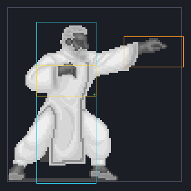 |
| Sagat | attack | `0x13ec0` | 1 frame(s) carry an attack box and the hit function 0x47eaa, but the active bit is never set | 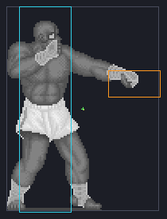 |

### Attack box over nothing (2)

| Fighter | Move | Stream | Finding | Picture |
| --- | --- | --- | --- | --- |
| Ryu | [0x18] sweep | `0x01158` | an active box of 289 px holds no drawn pixel | 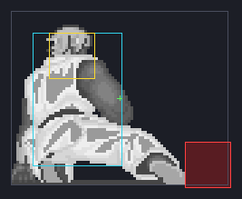 |
| Ken | [0x18] sweep | `0x03236` | an active box of 289 px holds no drawn pixel | 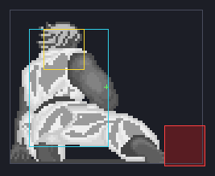 |

### Attack box past the drawing (3)

| Fighter | Move | Stream | Finding | Picture |
| --- | --- | --- | --- | --- |
| Retsu | attack | `0x0cbe6` | 40 px past the drawing, forward | 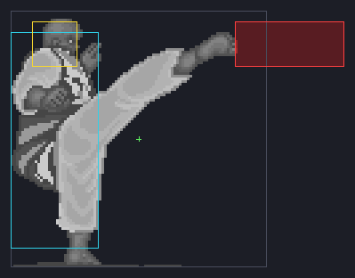 |
| Birdie | attack | `0x115cc` | 22 px past the drawing, forward | 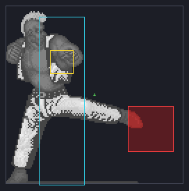 |
| Retsu | attack | `0x0c9b6` | 20 px past the drawing, forward | 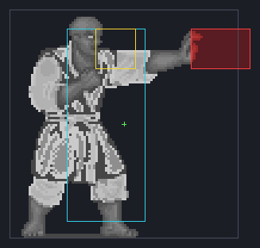 |

### Hurtbox past the drawing (5)

| Fighter | Move | Stream | Finding | Picture |
| --- | --- | --- | --- | --- |
| Joe | [0x04] standing block | `0x0e370` | the hurtbox lies 33 px past the drawing (the pose is a single 32 px sprite, 42 drawn px, held 4 ticks) | 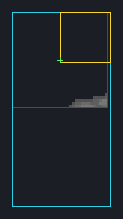 |
| Ryu | [0x1b] Tatsumaki Senpukyaku | `0x013ea` | the hurtbox lies 27 px past the drawing |  |
| Ryu | jump heavy kick (neutral) | `0x01904` | the hurtbox lies 27 px past the drawing | 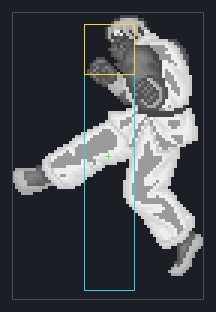 |
| Ken | [0x1b] Tatsumaki Senpukyaku | `0x034c8` | the hurtbox lies 27 px past the drawing |  |
| Ken | jump heavy kick (neutral) | `0x039e2` | the hurtbox lies 27 px past the drawing | 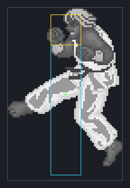 |

### Drawing outgrows the hurtbox (24)

| Fighter | Move | Stream | Finding | Picture |
| --- | --- | --- | --- | --- |
| Mike | attack | `0x0db1c` | 84% of the drawing outside the hurtbox, 67 points more than the stance | 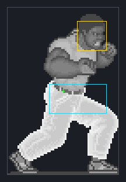 |
| Gen | attack | `0x10580` | 62% of the drawing outside the hurtbox, 45 points more than the stance | 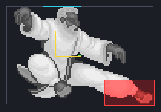 |
| Gen | attack | `0x10702` | 62% of the drawing outside the hurtbox, 45 points more than the stance |  |
| Gen | attack | `0x10a26` | 61% of the drawing outside the hurtbox, 45 points more than the stance | 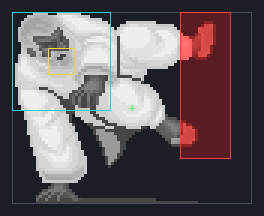 |
| Geki | [0x09] jump | `0x0b148` | 66% of the drawing outside the hurtbox, 40 points more than the stance | 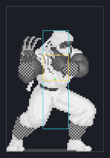 |
| Birdie | attack | `0x1141c` | 71% of the drawing outside the hurtbox, 40 points more than the stance | 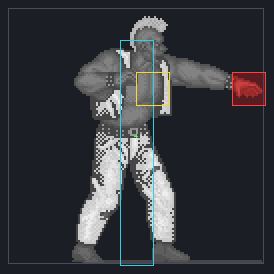 |
| Birdie | attack | `0x1165c` | 66% of the drawing outside the hurtbox, 35 points more than the stance | 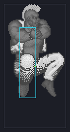 |
| Birdie | attack | `0x119a0` | 66% of the drawing outside the hurtbox, 35 points more than the stance |  |
| Mike | [0x03] walk back | `0x0d42c` | 51% of the drawing outside the hurtbox, 34 points more than the stance | 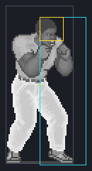 |
| Mike | [0x0b] jump back | `0x0d506` | 51% of the drawing outside the hurtbox, 34 points more than the stance |  |
| Gen | attack | `0x10440` | 50% of the drawing outside the hurtbox, 34 points more than the stance | 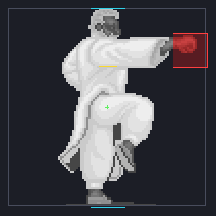 |
| Gen | attack | `0x10b4e` | 51% of the drawing outside the hurtbox, 34 points more than the stance | 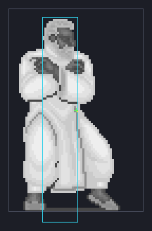 |
| Adon | attack | `0x133fc` | 50% of the drawing outside the hurtbox, 34 points more than the stance |  |
| Adon | attack | `0x13850` | 50% of the drawing outside the hurtbox, 34 points more than the stance | 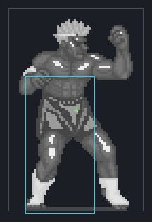 |
| Adon | attack | `0x1398c` | 50% of the drawing outside the hurtbox, 34 points more than the stance |  |
| Gen | attack | `0x104f0` | 49% of the drawing outside the hurtbox, 33 points more than the stance | 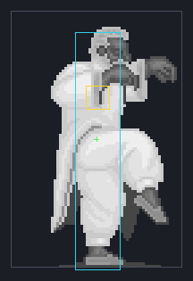 |
| Gen | [0x00] intro walk-in | `0x0fd8a` | 48% of the drawing outside the hurtbox, 32 points more than the stance | 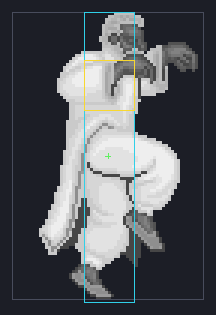 |
| Gen | [0x09] jump | `0x0ff9a` | 48% of the drawing outside the hurtbox, 32 points more than the stance |  |
| Gen | [0x0a] jump forward | `0x100fa` | 48% of the drawing outside the hurtbox, 32 points more than the stance |  |
| Gen | [0x0b] jump back | `0x1021a` | 48% of the drawing outside the hurtbox, 32 points more than the stance |  |
| Gen | attack | `0x10884` | 48% of the drawing outside the hurtbox, 32 points more than the stance |  |
| Gen | reaction | `0x0ff7a` | 48% of the drawing outside the hurtbox, 32 points more than the stance |  |
| Gen | reaction | `0x100da` | 48% of the drawing outside the hurtbox, 32 points more than the stance |  |
| Gen | reaction | `0x101fa` | 48% of the drawing outside the hurtbox, 32 points more than the stance |  |

### Critical box outside the hurtbox (7)

| Fighter | Move | Stream | Finding | Picture |
| --- | --- | --- | --- | --- |
| Geki | [0x02] walk forward | `0x0afd2` | the critical box sticks 64 px out of the hurtbox | 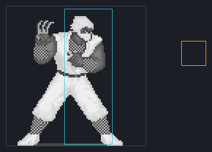 |
| Mike | attack | `0x0db1c` | the critical box sticks 36 px out of the hurtbox |  |
| Geki | attack | `0x0ba38` | the critical box sticks 24 px out of the hurtbox | 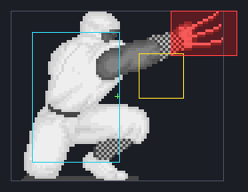 |
| Ryu | [0x0b] jump back | `0x0089a` | the critical box sticks 16 px out of the hurtbox | 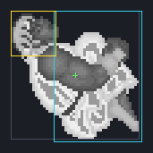 |
| Ken | [0x0b] jump back | `0x02978` | the critical box sticks 16 px out of the hurtbox |  |
| Lee | attack | `0x0f788` | the critical box sticks 16 px out of the hurtbox |  |
| Lee | attack | `0x0f92a` | the critical box sticks 16 px out of the hurtbox | 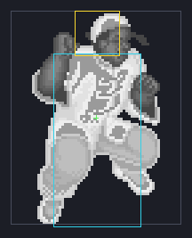 |

### Point hurtbox mid-move (7)

| Fighter | Move | Stream | Finding | Picture |
| --- | --- | --- | --- | --- |
| Geki | attack | `0x0ba38` | 8 of 40 ticks with a zero-size hurtbox (a point at the centre offset: hit only by a box that covers it) | 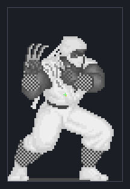 |
| Mike | attack | `0x0d956` | 5 of 19 ticks with a zero-size hurtbox (a point at the centre offset: hit only by a box that covers it) | 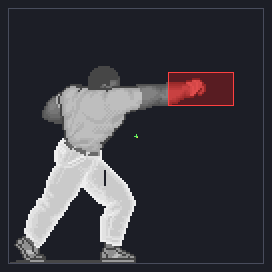 |
| Lee | attack | `0x0f92a` | 5 of 40 ticks with a zero-size hurtbox (a point at the centre offset: hit only by a box that covers it) |  |
| Lee | attack | `0x0f788` | 4 of 39 ticks with a zero-size hurtbox (a point at the centre offset: hit only by a box that covers it) |  |
| Lee | attack | `0x0faec` | 4 of 39 ticks with a zero-size hurtbox (a point at the centre offset: hit only by a box that covers it) | 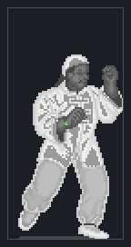 |
| Birdie | attack | `0x1151c` | 4 of 24 ticks with a zero-size hurtbox (a point at the centre offset: hit only by a box that covers it) | 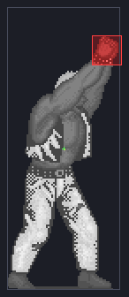 |
| Birdie | attack | `0x11b42` | 4 of 29 ticks with a zero-size hurtbox (a point at the centre offset: hit only by a box that covers it) | 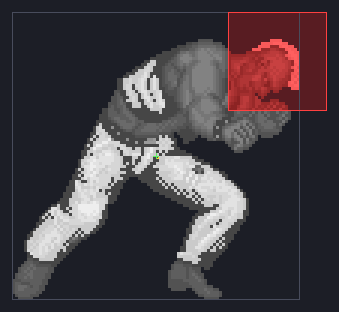 |

### Faster than the research (3)

| Fighter | Move | Stream | Finding | Picture |
| --- | --- | --- | --- | --- |
| Sagat | attack | `0x144b4` | projectile spawns on tick 9; the research's range is 12 to 16 | 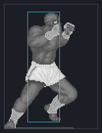 |
| Birdie | attack | `0x1141c` | startup 1; the research's fastest normal is 3 |  |
| Adon | attack | `0x132dc` | startup 1; the research's fastest normal is 3 | 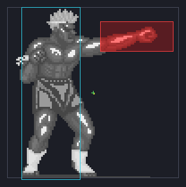 |

### Long reach (3)

| Fighter | Move | Stream | Finding | Picture |
| --- | --- | --- | --- | --- |
| Retsu | attack | `0x0cbe6` | reach 112 px from the stance centre |  |
| Joe | attack | `0x0e706` | reach 104 px from the stance centre | 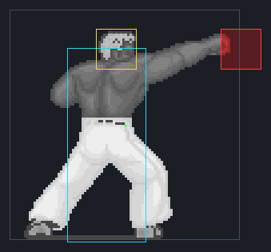 |
| Sagat | attack | `0x14030` | reach 96 px from the stance centre | 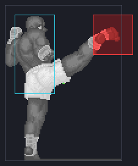 |

## Against the reference numbers

### Startup tiers

Melee moves by the research's modern-level tiers (section 5.2, first active frame counted). The research proposes these numbers for the modern level; the 1987 moves were never meant to match them, so a count in a different tier is a character, not a fault. Moves that start on their first tick (`1`) are boss CPU streams that begin on an active frame (see the open question above).

| Fighter | at or below 3 | light 4-5 | medium 6-8 | heavy 9-12 | slower than 12 | fastest | slowest |
| --- | --- | --- | --- | --- | --- | --- | --- |
| Ryu | 0 | 4 | 7 | 3 | 10 | 4 | 33 |
| Ken | 0 | 4 | 7 | 3 | 10 | 4 | 33 |
| Retsu | 0 | 1 | 0 | 3 | 3 | 4 | 21 |
| Geki | 0 | 0 | 0 | 2 | 3 | 10 | 35 |
| Joe | 1 | 2 | 1 | 2 | 2 | 3 | 26 |
| Mike | 1 | 0 | 1 | 2 | 0 | 3 | 10 |
| Lee | 1 | 0 | 0 | 3 | 5 | 3 | 26 |
| Gen | 0 | 1 | 0 | 2 | 4 | 5 | 24 |
| Birdie | 1 | 1 | 1 | 2 | 2 | 1 | 49 |
| Eagle | 0 | 3 | 0 | 1 | 3 | 5 | 41 |
| Adon | 1 | 1 | 1 | 2 | 2 | 1 | 25 |
| Sagat | 0 | 2 | 2 | 2 | 0 | 4 | 11 |

### Reach

Reach is pixels from the fighter's stance centre to the attack box's forward edge (x-offset + dx + hw), over each fighter's attack moves; the distance a move also carries the fighter (travel) is in the per-fighter tables. The research has no pixel reach for normals (its SF6 "range" is in other units); its one pixel figure is Super Turbo's throw, 48 px from the axis, and the 1987 game has no throws. For a rough shape, SF6 Sagat's longest normal is about 1.7 times his shortest (5HP 2.17 against 5LP 1.26, section 1.2); the last column is each fighter's longest reach over his shortest.

| Fighter | moves | shortest | median | longest | longest / shortest | 96 px or more |
| --- | --- | --- | --- | --- | --- | --- |
| Ryu | 24 | 32 | 60 | 84 | 2.62 | 0 |
| Ken | 24 | 32 | 60 | 84 | 2.62 | 0 |
| Retsu | 7 | 44 | 68 | 112 | 2.55 | 1 |
| Geki | 5 | 44 | 76 | 92 | 2.09 | 0 |
| Joe | 8 | 48 | 64 | 104 | 2.17 | 1 |
| Mike | 4 | 48 | 52 | 80 | 1.67 | 0 |
| Lee | 9 | 40 | 48 | 76 | 1.90 | 0 |
| Gen | 7 | 56 | 64 | 80 | 1.43 | 0 |
| Birdie | 7 | 56 | 56 | 88 | 1.57 | 0 |
| Eagle | 7 | 64 | 72 | 88 | 1.38 | 0 |
| Adon | 7 | 52 | 72 | 88 | 1.69 | 0 |
| Sagat | 6 | 48 | 48 | 96 | 2.00 | 1 |

### Projectiles

The effect a move spawns has its own box and sprite (`effect_vs_fighter`, `0x430b6`): the box is `hw` by `hh` half sizes about the sprite's centre, and the effect moves `speed` pixels a tick. The overreach is measured as for an attack box. The research's projectile speeds are in SF6 units and cannot be compared; its startup is 12 to 16 for the spawn.

| Fighter | Move | Spawns on tick | Template | Speed px/tick | Box half w x h per effect frame | Overreach per frame |
| --- | --- | --- | --- | --- | --- | --- |
| Ryu | Hadoken | 12 | `0x186dc` | 4 | 8x8 12x12 | -4 0 |
| Ken | Hadoken | 12 | `0x186dc` | 4 | 8x8 12x12 | -4 0 |
| Geki | attack | 30 | `0x1849c` | 4 | 8x8 8x8 | 5 5 |
| Geki | attack | 30 | `0x184bc` | 4 | 8x8 8x8 | 5 5 |
| Geki | attack | 30 | `0x184dc` | 4 | 8x8 8x8 8x8 8x8 | 5 5 5 5 |
| Sagat | attack | 9 | `0x1873c` | 8 | 12x12 12x12 12x12 | 14 13 0 |

### The research's notes on the 1987 game, against the ROM

The research (section 2) took these from SuperCombo's pages on the SF1++ hack and marked them as leads to check against the ROM, not values. Counting convention: the pages count frames before the first active frame, the audit counts the first active frame too (startup = pages' number + 1).

| Research note | ROM measure | Reading |
| --- | --- | --- |
| Medium kick startup: Ryu 21, Ken 26 | Ryu startup 22, Ken 27 (21 and 26 frames before the active one) | matches |
| Geki: "fastest attack comes out on frame 10" (and, on the same page, 9) | Geki's fastest attack stream is `0x0bb54`, startup 10 (9 frames before the active one) | matches one of the two figures |
| Jump: "an awful nine frame jump squat" (Ryu and Ken) | the jump's header pose lasts Ryu 9 ticks, Ken 9 | matches |
| Shoryuken: Ryu's is fully invincible, Ken's "is vulnerable for the first 4 frames" | the invulnerable flag first shows on tick 1 for Ryu and tick 5 for Ken; the first active frame is tick 5 for both | matches (Ken's first 4 ticks have no flag; the `symmetric_shotos_and_blockable_dp` toggle patches this) |
| Tatsumaki end lag: Ryu 28, Ken 24 | ticks after the last active frame: Ryu 27, Ken 23 | one tick less for both: the same four-tick gap between them, so a counting convention, not a different move |
| Hadoken end lag: on whiff Ryu 16, Ken 30; on hit Ryu 37, Ken 94; on block Ryu 7, Ken 19 | ticks from the fireball's spawn to the stream's end: Ryu 56, Ken 68 (the spawn is on tick 12 for both) | not comparable: the page does not say what its lag counts from, and hit lag includes the slow motion (`hadoken.md`) |
| Lee: for the first 16 frames of his block "his hurtbox is lowered dramatically" | ticks 1-16: hurtbox centre 24 px below the grid's, half height 24; ticks 17-17: hurtbox centre 4 px below the grid's, half height 44 | matches: the first 16 ticks have the hurtbox's centre well below the pose's centre |

## Every move

One row per move. *Startup*, *Active/Total* and *Reach* are as defined above; *Past* is the attack box's largest overreach in px and its direction (F forward, B back, U up, D down); *Body* is the largest points by which the drawing outgrows the hurtbox over the fighter's stance (negative: better covered than the stance); *Tight* is the critical box's largest overhang in px; *Travel* is the net px the frame steps carry the fighter (lunges, jumps); *Point hurt* is the ticks with a zero-size (point) hurtbox; *Flags* are the findings (`dormant`, `floating`, `overreach`, `bodypast`, `uncovered`, `tight`, `point`, `fast`, `reach`). `[0x..]` is the table slot.

### Ryu

Stance: 42% of the drawing outside the loose hurtbox.

| Move | Kind | Stream | Startup | Active/Total | Reach | Past | Body | Travel | Tight | Point hurt | Flags |
| --- | --- | --- | --- | --- | --- | --- | --- | --- | --- | --- | --- |
| [0x00] intro walk-in | table | `0x00400` | - | -/81 | - | - | - | +80 | - | 81 |  |
| [0x01] stance | table | header | - | -/1 | - | - | +0 | - | - | - |  |
| [0x02] walk forward | table | `0x00502` | - | -/16 | - | - | +0 | +32 | - | - |  |
| [0x03] walk back | table | `0x005b0` | - | -/16 | - | - | +0 | -28 | 2 | - |  |
| [0x04] standing block | table | header | - | -/9 | - | - | +10 | - | - | - |  |
| [0x05] crouch | table | header | - | -/1 | - | - | -27 | - | - | - |  |
| [0x06] crouch forward | table | header | - | -/1 | - | - | -25 | - | - | - |  |
| [0x07] crouch back | table | header | - | -/1 | - | - | +11 | - | - | - |  |
| [0x08] crouching block | table | header | - | -/1 | - | - | +15 | - | - | - |  |
| [0x09] jump | table | `0x0065e` | - | -/43 | - | - | +0 | - | - | - |  |
| [0x0a] jump forward | table | `0x0078c` | - | -/51 | - | - | +0 | +128 | 1 | - |  |
| [0x0b] jump back | table | `0x0089a` | - | -/51 | - | - | +0 | -128 | 16 | - | tight |
| [0x0c] win pose | table | `0x009a8` | - | -/8 | - | - | - | - | - | 8 |  |
| [0x0d] standing light punch | table | `0x009ca` | 4 | 2/6 | 52 | 9 F | +0 | - | - | - |  |
| [0x0e] light punch (variant input cannot reach) | table | `0x00a0c` | 12 | 2/14 | 52 | 9 F | +0 | - | - | - |  |
| [0x0f] standing medium punch | table | `0x00a6e` | 14 | 5/22 | 64 | 1 U | +11 | - | - | - |  |
| [0x10] standing heavy punch | table | `0x00af0` | 20 | 7/30 | 68 | 5 F | +11 | - | - | - |  |
| [0x11] crouching punch (light) | table | `0x00b92` | 13 | 5/23 | 60 | 5 F | +17 | - | 2 | - |  |
| [0x12] crouching punch (medium) | table | `0x00c14` | 7 | 5/14 | 60 | 5 F | +17 | - | - | - |  |
| [0x13] crouching punch (heavy) | table | `0x00c56` | 13 | 5/26 | 60 | 5 F | +24 | - | 2 | - |  |
| [0x14] standing light kick | table | `0x00e00` | 10 | 9/22 | 32 | 3 U | +0 | - | - | - |  |
| [0x15] standing medium kick | table | `0x00e62` | 22 | 6/45 | 78 | 6 F | +4 | - | 2 | - |  |
| [0x16] standing heavy kick | table | `0x00fac` | 21 | 10/39 | 84 | 6 F | +4 | - | 2 | - |  |
| [0x17] crouching light/medium kick | table | `0x01116` | 7 | 6/18 | 52 | 2 U | -5 | - | - | - |  |
| [0x18] sweep | table | `0x01158` | 10 | 5/25 | 72 | - | +20 | - | 12 | - | floating |
| [0x19] Shoryuken | table | `0x01200` | 5 | 28/56 | 36 | 7 F | -9 | +36 | - | - |  |
| [0x1a] Hadoken | table | `0x01362` | spawn 12 | -/67 | - | - | +0 | +16 | - | - |  |
| [0x1b] Tatsumaki Senpukyaku | table | `0x013ea` | 33 | 20/111 | 64 | 2 D | +30 | +80 | - | - | bodypast |
| [0x1c] crouching punch (medium, alt) | table | `0x00d38` | 16 (22/25 M/H) | 5/26 | 60 | 5 F | +17 | - | 2 | - |  |
| [0x1d] crouching punch (heavy, alt) | table | `0x00d18` | 18 (24/27 M/H) | 5/28 | 60 | 5 F | +17 | - | 2 | - |  |
| [0x1e] crouching punch (alt 2) | table | `0x00d38` | 16 (22/25 M/H) | 5/26 | 60 | 5 F | +17 | - | 2 | - |  |
| jump punch (neutral) | jump | `0x01584` | 5 | 6/26 | 56 | 7 F | +0 | - | - | - |  |
| jump punch (forward) | jump | `0x0166c` | 7 | 8/29 | 54 | 3 F | +0 | +32 | - | - |  |
| jump punch (back) | jump | `0x01734` | 7 | 8/29 | 54 | 3 F | +0 | -32 | 2 | - |  |
| jump kick (neutral) | jump | `0x017fc` | 5 | 8/28 | 64 | 6 U | +0 | - | - | - |  |
| jump heavy kick (neutral) | jump | `0x01904` | 6 | 4/32 | 64 | 2 D | +30 | - | - | - | bodypast |
| jump kick (forward) | jump | `0x019f2` | 7 | 8/30 | 56 | 2 F | +0 | +32 | - | - |  |
| jump kick (back) | jump | `0x01aba` | 7 | 8/29 | 56 | 2 F | +0 | -32 | 2 | - |  |
| blocked kick recoil | recoil | `0x00f4a` | - | -/14 | - | - | +0 | - | 2 | - |  |
| blocked kick recoil | recoil | `0x010b4` | - | -/9 | - | - | +0 | - | - | - |  |
| blocked kick recoil | recoil | `0x01094` | - | -/13 | - | - | +0 | - | - | - |  |

### Ken

Stance: 42% of the drawing outside the loose hurtbox.

| Move | Kind | Stream | Startup | Active/Total | Reach | Past | Body | Travel | Tight | Point hurt | Flags |
| --- | --- | --- | --- | --- | --- | --- | --- | --- | --- | --- | --- |
| [0x00] intro walk-in | table | `0x024de` | - | -/81 | - | - | - | +80 | - | 81 |  |
| [0x01] stance | table | header | - | -/1 | - | - | +0 | - | - | - |  |
| [0x02] walk forward | table | `0x025e0` | - | -/16 | - | - | +0 | +32 | - | - |  |
| [0x03] walk back | table | `0x0268e` | - | -/16 | - | - | +0 | -28 | 2 | - |  |
| [0x04] standing block | table | header | - | -/9 | - | - | +10 | - | - | - |  |
| [0x05] crouch | table | header | - | -/1 | - | - | -28 | - | - | - |  |
| [0x06] crouch forward | table | header | - | -/1 | - | - | -25 | - | - | - |  |
| [0x07] crouch back | table | header | - | -/1 | - | - | +11 | - | - | - |  |
| [0x08] crouching block | table | header | - | -/1 | - | - | +15 | - | - | - |  |
| [0x09] jump | table | `0x0273c` | - | -/43 | - | - | +0 | - | - | - |  |
| [0x0a] jump forward | table | `0x0286a` | - | -/51 | - | - | +0 | +128 | 1 | - |  |
| [0x0b] jump back | table | `0x02978` | - | -/51 | - | - | +0 | -128 | 16 | - | tight |
| [0x0c] win pose | table | `0x02a86` | - | -/8 | - | - | - | - | - | 8 |  |
| [0x0d] standing light punch | table | `0x02aa8` | 4 | 2/6 | 52 | 9 F | +0 | - | - | - |  |
| [0x0e] light punch (variant input cannot reach) | table | `0x02aea` | 12 | 2/14 | 52 | 9 F | +0 | - | - | - |  |
| [0x0f] standing medium punch | table | `0x02b4c` | 14 | 5/22 | 64 | 2 U | +11 | - | - | - |  |
| [0x10] standing heavy punch | table | `0x02bce` | 20 | 7/30 | 68 | 5 F | +11 | - | - | - |  |
| [0x11] crouching punch (light) | table | `0x02c70` | 13 | 5/23 | 60 | 5 F | +15 | - | 2 | - |  |
| [0x12] crouching punch (medium) | table | `0x02cf2` | 7 | 5/14 | 60 | 5 F | +15 | - | - | - |  |
| [0x13] crouching punch (heavy) | table | `0x02d34` | 13 | 5/26 | 60 | 5 F | +24 | - | 2 | - |  |
| [0x14] standing light kick | table | `0x02ede` | 10 | 9/22 | 32 | 3 U | +0 | - | - | - |  |
| [0x15] standing medium kick | table | `0x02f40` | 27 | 6/50 | 78 | 6 F | +2 | - | 2 | - |  |
| [0x16] standing heavy kick | table | `0x0308a` | 21 | 10/39 | 84 | 6 F | +2 | - | 2 | - |  |
| [0x17] crouching light/medium kick | table | `0x031f4` | 7 | 6/18 | 52 | 2 U | -5 | - | - | - |  |
| [0x18] sweep | table | `0x03236` | 10 | 5/25 | 72 | - | +20 | - | 12 | - | floating |
| [0x19] Shoryuken | table | `0x032de` | 5 | 28/56 | 36 | 7 F | -10 | +36 | - | - |  |
| [0x1a] Hadoken | table | `0x03440` | spawn 12 | -/79 | - | - | +0 | +16 | - | - |  |
| [0x1b] Tatsumaki Senpukyaku | table | `0x034c8` | 33 | 20/107 | 64 | 2 D | +28 | +80 | - | - | bodypast |
| [0x1c] crouching punch (medium, alt) | table | `0x02e16` | 16 (22/25 M/H) | 5/26 | 60 | 5 F | +15 | - | 2 | - |  |
| [0x1d] crouching punch (heavy, alt) | table | `0x02df6` | 18 (24/27 M/H) | 5/28 | 60 | 5 F | +15 | - | 2 | - |  |
| [0x1e] crouching punch (alt 2) | table | `0x02e16` | 16 (22/25 M/H) | 5/26 | 60 | 5 F | +15 | - | 2 | - |  |
| jump punch (neutral) | jump | `0x03662` | 5 | 6/26 | 56 | 7 F | +0 | - | - | - |  |
| jump punch (forward) | jump | `0x0374a` | 7 | 8/29 | 54 | 3 U | +0 | +32 | - | - |  |
| jump punch (back) | jump | `0x03812` | 7 | 8/29 | 54 | 3 U | +0 | -32 | 2 | - |  |
| jump kick (neutral) | jump | `0x038da` | 5 | 8/28 | 64 | 7 U | +0 | - | - | - |  |
| jump heavy kick (neutral) | jump | `0x039e2` | 6 | 4/28 | 64 | 2 D | +28 | - | - | - | bodypast |
| jump kick (forward) | jump | `0x03ad0` | 7 | 8/29 | 56 | 3 F | +0 | +32 | - | - |  |
| jump kick (back) | jump | `0x03b98` | 7 | 8/29 | 56 | 3 F | +0 | -32 | 2 | - |  |
| blocked kick recoil | recoil | `0x03028` | - | -/14 | - | - | +0 | - | 2 | - |  |
| blocked kick recoil | recoil | `0x03192` | - | -/9 | - | - | +0 | - | - | - |  |
| blocked kick recoil | recoil | `0x03172` | - | -/13 | - | - | +0 | - | - | - |  |

### Retsu

Stance: 41% of the drawing outside the loose hurtbox.

| Move | Kind | Stream | Startup | Active/Total | Reach | Past | Body | Travel | Tight | Point hurt | Flags |
| --- | --- | --- | --- | --- | --- | --- | --- | --- | --- | --- | --- |
| [0x00] intro walk-in | table | `0x0c210` | - | -/50 | - | - | - | +64 | - | 50 |  |
| [0x01] stance | table | header | - | -/1 | - | - | +0 | - | - | - |  |
| [0x02] walk forward | table | `0x0c332` | - | -/11 | - | - | -13 | +8 | 4 | - |  |
| [0x03] walk back | table | `0x0c3a0` | - | -/13 | - | - | +18 | - | 4 | - |  |
| [0x04] standing block | table | `0x0c890` | - | -/46 | - | - | -6 | - | 4 | - |  |
| [0x05] crouch | table | `0x0c40e` | - | -/25 | - | - | -12 | - | 4 | - |  |
| [0x06] crouch forward (unused slot: no stream, zero-size hurtbox) | table | header | - | -/1 | - | - | - | - | - | 1 |  |
| [0x07] crouch back (unused slot: no stream, zero-size hurtbox) | table | header | - | -/4 | - | - | - | - | - | 4 |  |
| [0x08] crouching block | table | `0x0c900` | - | -/51 | - | - | -15 | - | 4 | - |  |
| [0x09] jump | table | `0x0c4a8` | - | -/57 | - | - | -3 | - | - | - |  |
| [0x0a] jump forward | table | `0x0c5c8` | - | -/44 | - | - | +0 | +144 | - | - |  |
| [0x0b] jump back | table | `0x0c708` | - | -/45 | - | - | -3 | -128 | - | - |  |
| [0x0c] win pose | table | `0x0c828` | - | -/47 | - | - | - | - | - | 47 |  |
| attack | CPU attack n | `0x0c9b6` | 4 | 5/13 | 68 | 20 F | +6 | - | - | - | overreach |
| attack | CPU attack nm | `0x0ca46` | 11 | 10/29 | 76 | 9 F | -4 | - | 4 | - |  |
| attack | CPU attack n | `0x0cb16` | 9 | 13/30 | 54 | 5 F | -5 | +16 | 4 | - |  |
| attack | CPU attack nm | `0x0cbe6` | 11 | 13/36 | 112 | 40 F | +12 | - | 4 | - | overreach reach |
| attack | CPU attack nmf | `0x0ccd6` | 21 | 8/41 | 44 | 5 F | -2 | +168 | - | - |  |
| attack | CPU attack nm | `0x0cdf8` | 21 | 8/41 | 44 | 5 F | -2 | - | - | - |  |
| attack | CPU attack nm | `0x0cf1a` | 15 | 7/32 | 68 | 5 F | -2 | - | 8 | - |  |
| reaction | CPU reaction | `0x0c380` | - | -/12 | - | - | +18 | -10 | 4 | - |  |
| reaction | CPU reaction | `0x0c488` | - | -/57 | - | - | -3 | - | - | - |  |
| reaction | CPU reaction | `0x0c5a8` | - | -/44 | - | - | +0 | +144 | - | - |  |
| reaction | CPU reaction | `0x0c6e8` | - | -/45 | - | - | -3 | -128 | - | - |  |
| reaction | CPU reaction | `0x0c86a` | - | -/44 | - | - | -6 | -10 | 4 | - |  |
| reaction | CPU reaction | `0x0c8da` | - | -/49 | - | - | -15 | - | 4 | - |  |

### Geki

Stance: 26% of the drawing outside the loose hurtbox.

| Move | Kind | Stream | Startup | Active/Total | Reach | Past | Body | Travel | Tight | Point hurt | Flags |
| --- | --- | --- | --- | --- | --- | --- | --- | --- | --- | --- | --- |
| [0x00] intro walk-in | table | `0x0aeb0` | - | -/47 | - | - | +3 | +64 | 4 | 9 |  |
| [0x01] stance | table | header | - | -/1 | - | - | +0 | - | - | - |  |
| [0x02] walk forward | table | `0x0afd2` | - | -/13 | - | - | +17 | - | 64 | - | tight |
| [0x03] walk back | table | `0x0b040` | - | -/13 | - | - | +17 | -32 | - | - |  |
| [0x04] teleport | table | `0x0b6a8` | - | -/81 | - | - | +9 | +96 | 8 | 80 |  |
| [0x05] crouch | table | `0x0b0ae` | - | -/29 | - | - | -3 | - | - | 13 |  |
| [0x06] crouch forward (unused slot: no stream, zero-size hurtbox) | table | header | - | -/1 | - | - | - | - | - | 1 |  |
| [0x07] crouch back (unused slot: no stream, zero-size hurtbox) | table | header | - | -/1 | - | - | - | - | - | 1 |  |
| [0x08] teleport | table | `0x0b7c6` | - | -/81 | - | - | +9 | -96 | 8 | 80 |  |
| [0x09] jump | table | `0x0b148` | - | -/50 | - | - | +40 | - | - | 1 | uncovered |
| [0x0a] jump forward | table | `0x0b2a8` | - | -/45 | - | - | +10 | +128 | 4 | - |  |
| [0x0b] jump back | table | `0x0b3e8` | - | -/45 | - | - | +9 | -128 | 8 | - |  |
| [0x0c] win pose | table | `0x0b6a8` | - | -/81 | - | - | +9 | +96 | 8 | 80 |  |
| attack | CPU attack nm | `0x0b968` | 12 | 13/33 | 92 | 1 U | +17 | -32 | 8 | - |  |
| attack | CPU attack nm | `0x0ba38` | 15 | 13/40 | 76 | 5 F | +14 | - | 24 | 8 | tight point |
| attack | CPU attack nm | `0x0bb54` | 10 | 11/29 | 44 | -3 F | +14 | +24 | 8 | - |  |
| attack | CPU attack nmf | `0x0bc24` | 35 | 8/47 | 76 | 8 F | +20 | +126 | 4 | - |  |
| attack | CPU attack n | `0x0be5c` | 29 | 6/46 | 76 | 8 F | +23 | - | - | 1 |  |
| attack | CPU attack nmf | `0x0bf98` | spawn 30 | -/47 | - | - | +11 | - | - | 1 |  |
| attack | CPU attack nmf | `0x0c0f4` | - | -/35 | - | - | +9 | - | 8 | 8 |  |
| reaction | CPU reaction | `0x0b020` | - | -/17 | - | - | +17 | -24 | - | - |  |
| reaction | CPU reaction | `0x0b08e` | - | -/33 | - | - | -3 | - | - | 17 |  |
| reaction | CPU reaction | `0x0b128` | - | -/50 | - | - | +7 | - | - | 1 |  |
| reaction | CPU reaction | `0x0b288` | - | -/45 | - | - | +10 | +128 | 4 | - |  |
| reaction | CPU reaction | `0x0b3c8` | - | -/45 | - | - | +9 | -128 | 8 | - |  |
| reaction | CPU reaction | `0x0b688` | - | -/81 | - | - | +9 | +96 | 8 | 80 |  |
| reaction | CPU reaction | `0x0b7a6` | - | -/81 | - | - | +9 | -96 | 8 | 80 |  |

### Joe

Stance: 27% of the drawing outside the loose hurtbox.

| Move | Kind | Stream | Startup | Active/Total | Reach | Past | Body | Travel | Tight | Point hurt | Flags |
| --- | --- | --- | --- | --- | --- | --- | --- | --- | --- | --- | --- |
| [0x00] intro walk-in | table | `0x0dc0c` | - | -/50 | - | - | +4 | +64 | 4 | 41 |  |
| [0x01] stance | table | header | - | -/1 | - | - | +0 | - | 4 | - |  |
| [0x02] walk forward | table | `0x0dd2e` | - | -/18 | - | - | +4 | +16 | 4 | - |  |
| [0x03] walk back | table | `0x0de0e` | - | -/22 | - | - | +4 | -16 | 4 | - |  |
| [0x04] standing block | table | `0x0e370` | - | -/21 | - | - | +1 | - | 4 | - | bodypast |
| [0x05] crouch (stream pointer lands inside a record: unusable in the ROM) | table | `0x0e36a` | - | -/3 | - | - | +1 | - | - | - |  |
| [0x06] crouch forward (unused slot: no stream, zero-size hurtbox) | table | header | - | -/1 | - | - | - | - | - | 1 |  |
| [0x07] crouch back (unused slot: no stream, zero-size hurtbox) | table | header | - | -/4 | - | - | - | - | - | 4 |  |
| [0x08] crouching block (unused slot: no stream, zero-size hurtbox) | table | header | - | -/4 | - | - | - | - | - | 4 |  |
| [0x09] jump | table | `0x0df88` | - | -/41 | - | - | +4 | - | 4 | - |  |
| [0x0a] jump forward | table | `0x0e0a8` | - | -/36 | - | - | +4 | +120 | 4 | - |  |
| [0x0b] jump back | table | `0x0e1e8` | - | -/37 | - | - | +4 | -120 | 4 | - |  |
| [0x0c] win pose | table | `0x0e308` | - | -/11 | - | - | +19 | - | - | 4 |  |
| attack | CPU attack nm | `0x0e3ba` | 3 | 3/8 | 48 | 5 U | +5 | - | 4 | - |  |
| attack | CPU attack nm | `0x0e44a` | 10 | 10/24 | 68 | 5 D | +17 | - | 4 | - |  |
| attack | CPU attack n | `0x0e60a` | 10 | 5/19 | 64 | 4 U | +15 | - | 4 | - |  |
| attack | CPU attack nm | `0x0e706` | 5 | 17/30 | 104 | 13 F | +13 | - | 8 | - | reach |
| attack | CPU attack n | `0x0e7fc` | 5 | 7/16 | 64 | 1 F | +9 | - | 4 | - |  |
| attack | CPU attack nm | `0x0e8cc` | 8 | 10/24 | 72 | 5 U | +2 | - | 4 | - |  |
| attack | CPU attack nmf | `0x0e9bc` | 26 | 10/40 | 64 | 5 D | +16 | +120 | 4 | - |  |
| attack | CPU attack nm | `0x0eade` | 26 | 10/40 | 64 | 5 D | +16 | - | 4 | - |  |
| reaction | CPU reaction | `0x0ddee` | - | -/21 | - | - | +4 | -16 | 4 | - |  |
| reaction | CPU reaction | `0x0df68` | - | -/41 | - | - | +4 | - | 4 | - |  |
| reaction | CPU reaction | `0x0e088` | - | -/36 | - | - | +4 | +120 | 4 | - |  |
| reaction | CPU reaction | `0x0e34a` | - | -/20 | - | - | +1 | - | 4 | - |  |

### Mike

Stance: 18% of the drawing outside the loose hurtbox.

| Move | Kind | Stream | Startup | Active/Total | Reach | Past | Body | Travel | Tight | Point hurt | Flags |
| --- | --- | --- | --- | --- | --- | --- | --- | --- | --- | --- | --- |
| [0x00] intro walk-in | table | `0x0d076` | - | -/61 | - | - | +1 | +48 | - | 52 |  |
| [0x01] stance | table | header | - | -/1 | - | - | +0 | - | - | - |  |
| [0x02] walk forward | table | `0x0d1f8` | - | -/11 | - | - | +1 | +16 | - | - |  |
| [0x03] walk back | table | `0x0d42c` | - | -/11 | - | - | +34 | -16 | - | - | uncovered |
| [0x04] standing block | table | `0x0d87c` | - | -/22 | - | - | +3 | -8 | - | - |  |
| [0x05] crouch | table | `0x0d660` | - | -/14 | - | - | +19 | -8 | - | - |  |
| [0x06] crouch forward (unused slot: no stream, zero-size hurtbox) | table | header | - | -/1 | - | - | - | - | - | 1 |  |
| [0x07] crouch back (unused slot: no stream, zero-size hurtbox) | table | header | - | -/2 | - | - | - | - | - | 2 |  |
| [0x08] crouching block (unused slot: no stream, zero-size hurtbox) | table | header | - | -/4 | - | - | - | - | - | 4 |  |
| [0x09] jump | table | `0x0d6d4` | - | -/41 | - | - | +11 | - | - | - |  |
| [0x0a] jump forward | table | `0x0d2d2` | - | -/42 | - | - | +11 | +64 | - | - |  |
| [0x0b] jump back | table | `0x0d506` | - | -/41 | - | - | +34 | -128 | - | - | uncovered |
| [0x0c] win pose | table | `0x0d814` | - | -/14 | - | - | - | - | - | 14 |  |
| attack | CPU attack nmf | `0x0d8c6` | 3 | 3/8 | 52 | 6 F | +8 | - | - | - |  |
| attack | CPU attack nmf | `0x0d956` | 10 | 5/19 | 48 | 14 F | +17 | +4 | - | 5 | point |
| attack | CPU attack nmf | `0x0da26` | 7 | 5/16 | 80 | 10 F | +27 | - | - | - |  |
| attack | CPU attack nmf | `0x0db1c` | 10 | 5/21 | 68 | 2 F | +67 | - | 36 | 2 | uncovered tight |
| reaction | CPU reaction | `0x0d2b2` | - | -/42 | - | - | +11 | +64 | - | - |  |
| reaction | CPU reaction | `0x0d640` | - | -/13 | - | - | +19 | - | - | - |  |
| reaction | CPU reaction | `0x0d6b4` | - | -/42 | - | - | +11 | - | - | - |  |
| reaction | CPU reaction | `0x0d856` | - | -/19 | - | - | +3 | - | - | - |  |

### Lee

Stance: 43% of the drawing outside the loose hurtbox.

| Move | Kind | Stream | Startup | Active/Total | Reach | Past | Body | Travel | Tight | Point hurt | Flags |
| --- | --- | --- | --- | --- | --- | --- | --- | --- | --- | --- | --- |
| [0x00] intro walk-in | table | `0x0ec00` | - | -/49 | - | - | +3 | +56 | - | 9 |  |
| [0x01] stance | table | header | - | -/1 | - | - | +0 | - | - | - |  |
| [0x02] walk forward | table | `0x0ed54` | - | -/6 | - | - | +7 | +16 | - | - |  |
| [0x03] walk back | table | `0x0edc2` | - | -/6 | - | - | +7 | -16 | - | - |  |
| [0x04] standing block | table | `0x0f256` | - | -/17 | - | - | +28 | - | - | - |  |
| [0x05] crouch (unused slot: no stream, zero-size hurtbox) | table | header | - | -/3 | - | - | - | - | - | 3 |  |
| [0x06] crouch forward (unused slot: no stream, zero-size hurtbox) | table | header | - | -/1 | - | - | - | - | - | 1 |  |
| [0x07] crouch back (unused slot: no stream, zero-size hurtbox) | table | header | - | -/4 | - | - | - | - | - | 4 |  |
| [0x08] crouching block (unused slot: no stream, zero-size hurtbox) | table | header | - | -/4 | - | - | - | - | - | 4 |  |
| [0x09] jump | table | `0x0ee30` | - | -/32 | - | - | +0 | -8 | - | 3 |  |
| [0x0a] jump forward | table | `0x0efb0` | - | -/33 | - | - | +3 | +110 | - | 5 |  |
| [0x0b] jump back | table | `0x0f0f0` | - | -/33 | - | - | +3 | -110 | - | 5 |  |
| [0x0c] win pose | table | `0x0f284` | - | -/31 | - | - | +3 | - | - | 1 |  |
| attack | CPU attack n | `0x0f366` | 3 | 7/11 | 40 | 4 U | +7 | - | - | - |  |
| attack | CPU attack n | `0x0f3d6` | 9 | 10/25 | 48 | 6 U | +3 | - | - | - |  |
| attack | CPU attack nmf | `0x0f4a6` | 20 | 10/36 | 48 | 9 F | +22 | +100 | 8 | - |  |
| attack | CPU attack n | `0x0f5c8` | 9 | 10/23 | 44 | 5 U | +22 | - | 8 | - |  |
| attack | CPU attack n | `0x0f678` | 15 | 10/36 | 76 | 5 U | +22 | +16 | 8 | - |  |
| attack | CPU attack nmf | `0x0f788` | 26 | 8/39 | 64 | 4 U | +9 | +119 | 16 | 4 | tight point |
| attack | CPU attack m | `0x0f92a` | 26 | 8/40 | 64 | 4 U | +9 | -109 | 16 | 5 | tight point |
| attack | CPU attack nm | `0x0faec` | 26 | 8/39 | 48 | 9 F | +2 | - | - | 4 | point |
| attack | CPU attack n | `0x0fc8e` | 11 | 10/29 | 48 | 12 F | +18 | +24 | - | - |  |
| reaction | CPU reaction | `0x0eda2` | - | -/8 | - | - | +7 | -16 | - | - |  |
| reaction | CPU reaction | `0x0ef90` | - | -/36 | - | - | +3 | +110 | - | 5 |  |
| reaction | CPU reaction | `0x0f0d0` | - | -/36 | - | - | +3 | -110 | - | 5 |  |
| reaction | CPU reaction | `0x0f230` | - | -/17 | - | - | +0 | - | - | - |  |

### Gen

Stance: 16% of the drawing outside the loose hurtbox.

| Move | Kind | Stream | Startup | Active/Total | Reach | Past | Body | Travel | Tight | Point hurt | Flags |
| --- | --- | --- | --- | --- | --- | --- | --- | --- | --- | --- | --- |
| [0x00] intro walk-in | table | `0x0fd8a` | - | -/38 | - | - | +32 | +66 | - | 3 | uncovered |
| [0x01] stance | table | header | - | -/1 | - | - | +0 | - | - | - |  |
| [0x02] walk forward | table | `0x0febe` | - | -/9 | - | - | +11 | +16 | - | - |  |
| [0x03] walk back | table | `0x0ff2c` | - | -/9 | - | - | +11 | -16 | - | - |  |
| [0x04] standing block | table | `0x10340` | - | -/17 | - | - | +20 | - | - | - |  |
| [0x05] crouch (unused slot: no stream, zero-size hurtbox) | table | header | - | -/3 | - | - | - | - | - | 3 |  |
| [0x06] crouch forward (unused slot: no stream, zero-size hurtbox) | table | header | - | -/1 | - | - | - | - | - | 1 |  |
| [0x07] crouch back (unused slot: no stream, zero-size hurtbox) | table | header | - | -/4 | - | - | - | - | - | 4 |  |
| [0x08] crouching block (unused slot: no stream, zero-size hurtbox) | table | header | - | -/4 | - | - | - | - | - | 4 |  |
| [0x09] jump | table | `0x0ff9a` | - | -/34 | - | - | +32 | - | - | - | uncovered |
| [0x0a] jump forward | table | `0x100fa` | - | -/32 | - | - | +32 | +110 | - | - | uncovered |
| [0x0b] jump back | table | `0x1021a` | - | -/32 | - | - | +32 | -110 | - | - | uncovered |
| [0x0c] win pose | table | `0x1036e` | - | -/9 | - | - | - | +8 | - | 9 |  |
| attack | CPU attack n | `0x103b0` | - | -/9 | - | - | +15 | - | - | - | dormant |
| attack | CPU attack n | `0x10440` | 9 | 17/30 | 80 | 7 D | +34 | - | - | - | uncovered |
| attack | CPU attack n | `0x104f0` | 5 | 13/22 | 72 | 2 F | +33 | - | - | - | uncovered |
| attack | CPU attack nmf | `0x10580` | 24 | 8/36 | 64 | 1 D | +45 | +119 | - | - | uncovered |
| attack | CPU attack n | `0x10702` | 24 | 8/36 | 64 | 1 D | +45 | -109 | - | - | uncovered |
| attack | CPU attack nm | `0x10884` | 18 | 14/37 | 64 | 8 F | +32 | -32 | - | - | uncovered |
| attack | CPU attack n | `0x10a26` | 11 | 20/43 | 64 | 5 F | +45 | - | - | - | uncovered |
| attack | CPU attack n | `0x10b4e` | 20 | 25/61 | 56 | 4 F | +34 | - | - | - | uncovered |
| reaction | CPU reaction | `0x0fe9e` | - | -/11 | - | - | +11 | +27 | - | - |  |
| reaction | CPU reaction | `0x0ff0c` | - | -/11 | - | - | +11 | -27 | - | - |  |
| reaction | CPU reaction | `0x0ff7a` | - | -/37 | - | - | +32 | - | - | - | uncovered |
| reaction | CPU reaction | `0x100da` | - | -/35 | - | - | +32 | +110 | - | - | uncovered |
| reaction | CPU reaction | `0x101fa` | - | -/35 | - | - | +32 | -110 | - | - | uncovered |
| reaction | CPU reaction | `0x1031a` | - | -/27 | - | - | +20 | - | - | - |  |

### Birdie

Stance: 31% of the drawing outside the loose hurtbox.

| Move | Kind | Stream | Startup | Active/Total | Reach | Past | Body | Travel | Tight | Point hurt | Flags |
| --- | --- | --- | --- | --- | --- | --- | --- | --- | --- | --- | --- |
| [0x00] intro walk-in | table | `0x10cde` | - | -/43 | - | - | +7 | +64 | - | - |  |
| [0x01] stance | table | header | - | -/1 | - | - | +0 | - | - | - |  |
| [0x02] walk forward | table | `0x10e58` | - | -/12 | - | - | +25 | +70 | 8 | - |  |
| [0x03] walk back | table | `0x10ed2` | - | -/22 | - | - | +25 | -70 | 8 | - |  |
| [0x04] standing block | table | `0x113ac` | - | -/17 | - | - | +2 | - | - | - |  |
| [0x05] crouch (unused slot: no stream, zero-size hurtbox) | table | header | - | -/3 | - | - | - | - | - | 3 |  |
| [0x06] crouch forward (unused slot: no stream, zero-size hurtbox) | table | header | - | -/1 | - | - | - | - | - | 1 |  |
| [0x07] crouch back (unused slot: no stream, zero-size hurtbox) | table | header | - | -/4 | - | - | - | - | - | 4 |  |
| [0x08] crouching block (unused slot: no stream, zero-size hurtbox) | table | header | - | -/4 | - | - | - | - | - | 4 |  |
| [0x09] jump | table | `0x10f46` | - | -/58 | - | - | +7 | - | - | - |  |
| [0x0a] jump forward | table | `0x110e6` | - | -/36 | - | - | +7 | +112 | - | - |  |
| [0x0b] jump back | table | `0x11246` | - | -/41 | - | - | +7 | -128 | - | - |  |
| [0x0c] win pose | table | `0x113da` | - | -/6 | - | - | +15 | +16 | - | 1 |  |
| attack | CPU attack n | `0x1141c` | 1 | 7/8 | 64 | 2 U | +40 | - | 8 | - | uncovered fast |
| attack | CPU attack n | `0x1146c` | 12 | 9/25 | 88 | 15 F | +14 | - | - | - |  |
| attack | CPU attack n | `0x1151c` | 7 | 17/24 | 72 | 15 F | +7 | - | - | 4 | point |
| attack | CPU attack n | `0x115cc` | 5 | 9/17 | 56 | 22 F | +25 | +48 | - | - | overreach |
| attack | CPU attack nmf | `0x1165c` | 37 | 8/49 | 56 | 14 F | +35 | +110 | - | - | uncovered |
| attack | CPU attack nm | `0x119a0` | 49 | 10/66 | 56 | 14 F | +35 | - | - | - | uncovered |
| attack | CPU attack nmf | `0x11b42` | 9 | 17/29 | 56 | 9 U | +17 | +72 | - | 4 | point |
| reaction | CPU reaction | `0x10e32` | - | -/11 | - | - | +25 | +20 | 8 | - |  |
| reaction | CPU reaction | `0x10eac` | - | -/21 | - | - | +25 | -20 | 8 | - |  |
| reaction | CPU reaction | `0x10f26` | - | -/58 | - | - | +7 | - | - | - |  |
| reaction | CPU reaction | `0x110c6` | - | -/36 | - | - | +7 | +112 | - | - |  |
| reaction | CPU reaction | `0x11226` | - | -/41 | - | - | +7 | -128 | - | - |  |
| reaction | CPU reaction | `0x11386` | - | -/22 | - | - | +2 | - | - | - |  |

### Eagle

Stance: 17% of the drawing outside the loose hurtbox.

| Move | Kind | Stream | Startup | Active/Total | Reach | Past | Body | Travel | Tight | Point hurt | Flags |
| --- | --- | --- | --- | --- | --- | --- | --- | --- | --- | --- | --- |
| [0x00] intro walk-in | table | `0x11c64` | - | -/53 | - | - | +21 | +68 | 16 | - |  |
| [0x01] stance | table | header | - | -/1 | - | - | +0 | - | 4 | - |  |
| [0x02] walk forward | table | `0x11dd8` | - | -/9 | - | - | +15 | +8 | 4 | - |  |
| [0x03] walk back | table | `0x11e46` | - | -/9 | - | - | +15 | -8 | 4 | - |  |
| [0x04] standing block | table | `0x122da` | - | -/19 | - | - | +15 | - | 4 | - |  |
| [0x05] crouch (unused slot: no stream, zero-size hurtbox) | table | header | - | -/3 | - | - | - | - | - | 3 |  |
| [0x06] crouch forward (unused slot: no stream, zero-size hurtbox) | table | header | - | -/1 | - | - | - | - | - | 1 |  |
| [0x07] crouch back (unused slot: no stream, zero-size hurtbox) | table | header | - | -/4 | - | - | - | - | - | 4 |  |
| [0x08] crouching block | table | `0x1232e` | - | -/19 | - | - | +0 | - | 4 | - |  |
| [0x09] jump | table | `0x11eb4` | - | -/60 | - | - | +21 | - | 16 | - |  |
| [0x0a] jump forward | table | `0x12014` | - | -/43 | - | - | +21 | +120 | 16 | - |  |
| [0x0b] jump back | table | `0x12174` | - | -/63 | - | - | +21 | -150 | 16 | - |  |
| [0x0c] win pose | table | `0x1235c` | - | -/9 | - | - | - | - | - | 9 |  |
| attack | CPU attack nm | `0x1239e` | 5 | 4/12 | 64 | 9 F | +19 | +24 | 4 | - |  |
| attack | CPU attack nm | `0x12408` | 5 | 16/24 | 72 | 6 F | +30 | +24 | 4 | - |  |
| attack | CPU attack nm | `0x124d8` | 5 | 32/40 | 72 | 6 F | +30 | +56 | 4 | - |  |
| attack | CPU attack nm | `0x12628` | 9 | 4/24 | 88 | 12 F | +21 | - | 4 | - |  |
| attack | CPU attack nmf | `0x126f8` | 27 | 5/44 | 72 | 13 F | +21 | +90 | 16 | - |  |
| attack | CPU attack nm | `0x1285a` | 41 | 8/64 | 72 | 13 F | +21 | -144 | 16 | - |  |
| attack | CPU attack nm | `0x129bc` | 41 | 8/64 | 72 | 13 F | +21 | - | 16 | - |  |
| reaction | CPU reaction | `0x11e26` | - | -/12 | - | - | +15 | -16 | 4 | - |  |
| reaction | CPU reaction | `0x11e94` | - | -/63 | - | - | +21 | - | 16 | - |  |
| reaction | CPU reaction | `0x11ff4` | - | -/46 | - | - | +21 | +120 | 16 | - |  |
| reaction | CPU reaction | `0x12154` | - | -/66 | - | - | +21 | -150 | 16 | - |  |
| reaction | CPU reaction | `0x122b4` | - | -/24 | - | - | +15 | - | 4 | - |  |
| reaction | CPU reaction | `0x12308` | - | -/24 | - | - | +0 | -16 | 4 | - |  |

### Adon

Stance: 16% of the drawing outside the loose hurtbox.

| Move | Kind | Stream | Startup | Active/Total | Reach | Past | Body | Travel | Tight | Point hurt | Flags |
| --- | --- | --- | --- | --- | --- | --- | --- | --- | --- | --- | --- |
| [0x00] intro walk-in | table | `0x12b1e` | - | -/58 | - | - | +21 | +76 | - | - |  |
| [0x01] stance | table | header | - | -/1 | - | - | +0 | - | - | - |  |
| [0x02] walk forward | table | `0x12cb2` | - | -/22 | - | - | +2 | +16 | - | - |  |
| [0x03] walk back | table | `0x12d4c` | - | -/22 | - | - | +2 | -16 | - | - |  |
| [0x04] standing block | table | `0x1326c` | - | -/15 | - | - | +10 | - | - | 11 |  |
| [0x05] crouch (unused slot: no stream, zero-size hurtbox) | table | header | - | -/3 | - | - | - | - | - | 3 |  |
| [0x06] crouch forward (unused slot: no stream, zero-size hurtbox) | table | header | - | -/1 | - | - | - | - | - | 1 |  |
| [0x07] crouch back (unused slot: no stream, zero-size hurtbox) | table | header | - | -/4 | - | - | - | - | - | 4 |  |
| [0x08] crouching block (unused slot: no stream, zero-size hurtbox) | table | header | - | -/4 | - | - | - | - | - | 4 |  |
| [0x09] jump | table | `0x12de6` | - | -/49 | - | - | +21 | - | - | - |  |
| [0x0a] jump forward | table | `0x12f66` | - | -/41 | - | - | +21 | +128 | - | - |  |
| [0x0b] jump back | table | `0x130e6` | - | -/43 | - | - | +21 | -136 | - | - |  |
| [0x0c] win pose | table | `0x1329a` | - | -/23 | - | - | - | - | - | 23 |  |
| attack | CPU attack nmf | `0x132dc` | 1 | 18/25 | 60 | 10 F | +9 | - | - | - | fast |
| attack | CPU attack nmf | `0x1336c` | 5 | 10/19 | 72 | 13 F | +11 | - | - | - |  |
| attack | CPU attack nmf | `0x133fc` | 6 | 10/21 | 82 | 11 F | +34 | - | - | - | uncovered |
| attack | CPU attack nmf | `0x1348c` | 25 | 11/45 | 52 | 13 D | +27 | +121 | - | - |  |
| attack | CPU attack nmf | `0x1366e` | 25 | 11/46 | 52 | 13 D | +27 | +40 | - | - |  |
| attack | CPU attack nmf | `0x13850` | 10 | 10/40 | 88 | 10 F | +34 | +88 | - | - | uncovered |
| attack | CPU attack nmf | `0x1398c` | 10 | 20/80 | 88 | 10 F | +34 | +176 | - | - | uncovered |
| reaction | CPU reaction | `0x12c92` | - | -/22 | - | - | +2 | +16 | - | - |  |
| reaction | CPU reaction | `0x12d2c` | - | -/22 | - | - | +2 | -16 | - | - |  |
| reaction | CPU reaction | `0x12dc6` | - | -/50 | - | - | +21 | - | - | - |  |
| reaction | CPU reaction | `0x12f46` | - | -/42 | - | - | +21 | +128 | - | - |  |
| reaction | CPU reaction | `0x130c6` | - | -/44 | - | - | +21 | -136 | - | - |  |
| reaction | CPU reaction | `0x13246` | - | -/25 | - | - | +10 | - | - | - |  |

### Sagat

Stance: 34% of the drawing outside the loose hurtbox.

| Move | Kind | Stream | Startup | Active/Total | Reach | Past | Body | Travel | Tight | Point hurt | Flags |
| --- | --- | --- | --- | --- | --- | --- | --- | --- | --- | --- | --- |
| [0x00] intro walk-in | table | `0x13bfa` | - | -/44 | - | - | +17 | +60 | - | - |  |
| [0x01] stance | table | header | - | -/1 | - | - | +0 | - | - | - |  |
| [0x02] walk forward | table | `0x13d6e` | - | -/8 | - | - | +3 | +32 | - | - |  |
| [0x03] walk back | table | `0x13ddc` | - | -/8 | - | - | +3 | -16 | - | - |  |
| [0x04] standing block | table | `0x13e50` | - | -/19 | - | - | +0 | - | - | - |  |
| [0x05] crouch (unused slot: no stream, zero-size hurtbox) | table | header | - | -/3 | - | - | - | - | - | 3 |  |
| [0x06] crouch forward (unused slot: no stream, zero-size hurtbox) | table | header | - | -/1 | - | - | - | - | - | 1 |  |
| [0x07] crouch back (unused slot: no stream, zero-size hurtbox) | table | header | - | -/4 | - | - | - | - | - | 4 |  |
| [0x08] crouching block (unused slot: no stream, zero-size hurtbox) | table | header | - | -/4 | - | - | - | - | - | 4 |  |
| [0x09] jump (unused slot: no stream, zero-size hurtbox) | table | header | - | -/1 | - | - | - | - | - | 1 |  |
| [0x0a] jump forward (unused slot: no stream, zero-size hurtbox) | table | header | - | -/1 | - | - | - | - | - | 1 |  |
| [0x0b] jump back (unused slot: no stream, zero-size hurtbox) | table | header | - | -/1 | - | - | - | - | - | 1 |  |
| [0x0c] win pose | table | `0x13e7e` | - | -/9 | - | - | - | - | - | 9 |  |
| attack | CPU attack n | `0x13ec0` | - | -/11 | - | - | +0 | - | - | - | dormant |
| attack | CPU attack n | `0x13f10` | 4 | 17/24 | 64 | 10 F | +3 | - | - | - |  |
| attack | CPU attack n | `0x13fa0` | 5 | 13/22 | 80 | 9 F | +9 | - | - | - |  |
| attack | CPU attack nmf | `0x14030` | 8 | 20/32 | 96 | 11 F | +21 | +16 | - | - | reach |
| attack | CPU attack nmf | `0x140e0` | 11 | 17/30 | 48 | 5 F | +17 | +96 | - | - |  |
| attack | CPU attack nmf | `0x14242` | 9 | 17/37 | 48 | 5 F | +17 | - | - | - |  |
| attack | CPU attack nmf | `0x143a4` | 7 | 37/54 | 48 | 11 F | +21 | - | - | - |  |
| attack | CPU attack nmf | `0x144b4` | spawn 9 | -/67 | - | - | +11 | +16 | - | - | fast |
| reaction | CPU reaction | `0x13dbc` | - | -/9 | - | - | +3 | -32 | - | - |  |
| reaction | CPU reaction | `0x13e2a` | - | -/24 | - | - | +0 | - | - | - |  |

## Hit reactions and knock-outs

A fighter's hit and knock-out streams are outside the kit a player drives and are not flagged. In 1987 a fighter is invulnerable for his whole reaction, so their hurtboxes only matter once the modern rules make the reaction hittable (combos). The table shows what the combos would meet: how many of each fighter's reaction frames have a zero-size (point) loose hurtbox.

| Fighter | hit streams | knock-out streams | frames | frames with a point hurtbox | invulnerable flag |
| --- | --- | --- | --- | --- | --- |
| Ryu | 13 | 11 | 70 | 70 | 70 |
| Ken | 13 | 11 | 70 | 70 | 70 |
| Retsu | 13 | 11 | 70 | 70 | 70 |
| Geki | 13 | 11 | 70 | 70 | 70 |
| Joe | 13 | 11 | 75 | 75 | 75 |
| Mike | 13 | 11 | 95 | 95 | 95 |
| Lee | 13 | 11 | 81 | 81 | 81 |
| Gen | 13 | 11 | 75 | 75 | 75 |
| Birdie | 13 | 11 | 74 | 73 | 74 |
| Eagle | 13 | 11 | 75 | 75 | 75 |
| Adon | 13 | 11 | 72 | 72 | 72 |
| Sagat | 13 | 11 | 74 | 74 | 74 |

## Limits

- **Boxes are measured against pixels, not against intent.** A hurtbox that leaves an extended arm out is the 1987 design ("the 1987 box is a torso box"); it is flagged only where it is unusual for the ROM itself.
- **Poses are drawn in greys.** The palette is set at run time; the pens' brightness order is kept, the colours are not.
- **Frames at the ends of a stream.** The CPU follow-up call (`0x45630`) ends a stream's primary path; what follows is the CPU's next decision, which is not a frame of the move.
- **Random choices.** Geki's teleport picks one of three frame groups at random (`0x45a34`); the primary path takes the first and the other two are measured as frames but not as timing.
- **Joe's crouch slot is broken in the ROM.** His move 5's stream pointer lands inside a record; the audit shows its header pose only (see `boss-ladder-report.md`).
- **Projectile boxes** are measured against the effect's own sprite; where a projectile starts relative to the thrower is not.
- **No hit is simulated.** The audit reads the boxes; it does not play the moves against each other.
